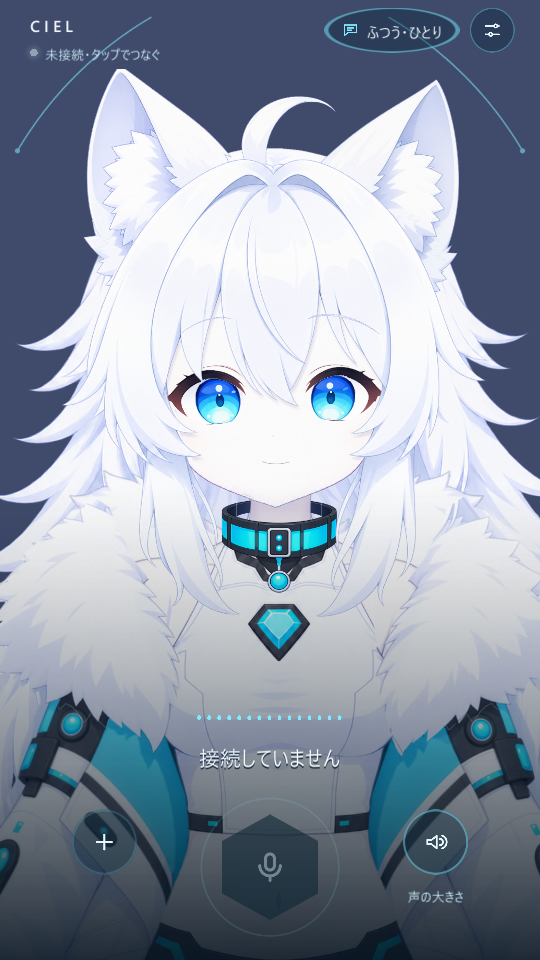
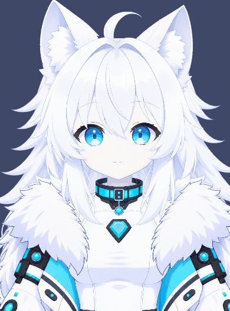
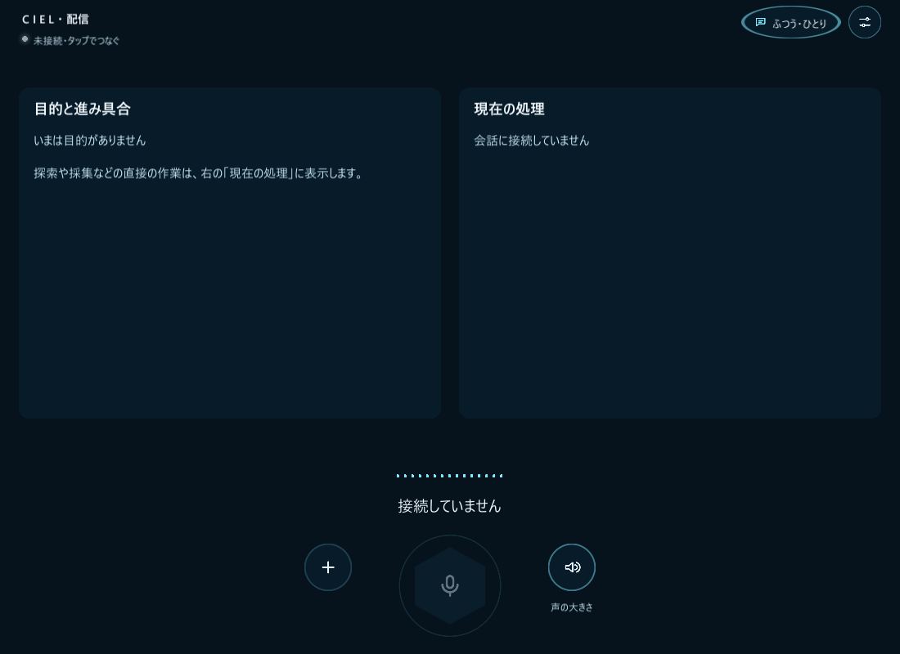

# CIEL Companion

**話して、触れて、一緒に遊ぶ。Live2Dのシエルと過ごす音声会話アプリ。**

シエル（CIEL）は、声で話しかけると表情と声で返してくれるキャラクターです。Android・Windowsでの日常の会話に加えて、Minecraftで一緒に遊ぶ機能や、配信・会議への参加にも取り組んでいます。

<p align="center">
  
  
</p>

左：日常版の実装画面（Unityで接続せずに描画）。右：Live2Dモデルの動作確認GIF。会話・ゲームのプレイ動画はこれから収録します。[紹介動画の撮影台本](docs/demo-recording-ja.md)にシーンと手順をまとめています。

[開発を始める](docs/development-setup-ja.md) · [システム構成](docs/architecture-ja.md) · [資料一覧](docs/README.md)

## シエルとできること

| 体験 | 内容 |
|---|---|
| 声で話す | 日本語の音声会話。声に合わせた口パクと表情、会話への割り込みに対応 |
| 触れて反応を楽しむ | 頬をつつく・引っ張るなど、Live2Dの動きと会話の反応 |
| 一緒に過ごす | おしゃべり度や、その場にいる人に合わせた会話。本人の同意後に名前やメモを記憶 |
| 一緒に遊ぶ | Minecraft Java版にシエルがプレイヤーとして参加。ついてくる・採集・制作などを頼む機能を開発中 |
| 配信する | Windows用のCIEL Broadcast。操作画面と、OBSに取り込むシエル映像・目的カードを別ウィンドウで表示 |
| 会議・歌を楽しむ | 仮想オーディオを使った会議参加、議事録、歌を聴いて感想を返す機能 |

**開発中のプロジェクトです。** 日常の音声会話はWindows・Androidでの確認記録があります。MinecraftのMCP統合など、追加実装の試験と実ゲームでの確認は別に管理しています。各機能の確認範囲は[資料一覧](docs/README.md)から参照してください。iOSは未検証です。

## 日常版と配信版

| | CIEL Companion | CIEL Broadcast |
|---|---|---|
| 用途 | シエルに触れながら日常の会話 | ゲーム実況・配信の操作と映像出力 |
| 対象 | Android / Windows | Windows |
| 起動シーン | `Conversation.unity` | `Broadcast.unity` |
| 画面 | シエルを中心にした縦画面 | 操作画面＋別ウィンドウの映像・目的カード |

<details>
<summary>配信版の操作画面を見る</summary>



この画像は接続前の画面です。配信時はシエル映像と目的カードを別ウィンドウからOBSに取り込みます。[アプリ構成の詳細](docs/app-composition-ja.md)

</details>

## 動かしてみる

このリポジトリはソースコードと制作資料です。Unityでの表示確認と、サーバーに接続した音声会話では必要な準備が異なります。

1. **画面・モデルを確認する**：Git LFSとUnity **6000.6.4f1**を用意し、Live2D Cubism **5 SDK R5（URP）**を別途復元して、`unity/`を開きます。[セットアップ手順](docs/development-setup-ja.md)
2. **音声会話を試す**：LiveKitの接続設定、会話サーバー、Irodori-TTSが必要です。OpenAI・LiveKitの資格情報はサーバー側に設定します。[接続手順](docs/development-setup-ja.md#7-音声会話を試す場合)
3. **コードから参加する**：通常のPython回帰テストはAPIキー・GPUなしで実行できます。[テストの準備と実行](docs/regression-tests-ja.md)

クローンの例（PowerShell）：

```powershell
git lfs install
git clone https://github.com/magic-sword/ciel-companion.git
cd ciel-companion
git lfs pull
```

SDK復元後にUnityを開く：

```powershell
.\scripts\unity.ps1 open .
```

クローンだけでは音声会話は動きません。API・クラウドサービスの利用費や、音声合成用GPUなどの実行環境も必要です。ビルド方法とサーバーの起動・反映は[コマンド集](docs/build-ja.md)を参照してください。

## 仕組みとリポジトリ

Unity＋Live2Dが表示と操作を担当し、LiveKitが声と状態を中継します。会話サーバーは「聞く・考える・話す」を分けたpipeline構成で、Irodori-TTSがシエルの声を作ります。MinecraftはMineflayerの体とMCPを介して接続します。[構成図と設定の入口](docs/architecture-ja.md)

| 場所 | 内容 |
|---|---|
| [`unity/`](unity/) | 日常版・配信版、共通Live2Dモデル、画面、音声通信 |
| [`server/agent/`](server/agent/) | 会話、記憶、プロンプト、目的の管理、環境との接続 |
| [`server/minecraft/`](server/minecraft/) | Minecraftの体・行動・視覚・知識、MCPサーバー |
| [`server/tts-irodori/`](server/tts-irodori/) | シエルの声の合成 |
| [`server/singing/`](server/singing/) | 歌声の分析 |
| [`assets/ciel/`](assets/ciel/) | キャラクター素材、Live2D作業モデル、アプリ用モデル |
| [`scripts/`](scripts/) | SDK復元、ビルド補助、テスト、サーバー反映、モデル制作 |
| [`docs/`](docs/README.md) | 使い方、構成、設計、検証・決定記録 |

## 開発・資料の読み方

- 初めて参加する：[開発環境構築](docs/development-setup-ja.md) → [システム構成](docs/architecture-ja.md)
- 会話を変える：[pipelineの仕組み](docs/conversation-pipeline-ja.md) → [プロンプト編集](server/agent/README.md)
- ゲーム連携を読む：[Minecraft](docs/minecraft-design-ja.md) → [環境のMCP設計と検証状況](docs/game-environment-mcp-design-ja.md)
- モデルを制作する：[Live2D制作仕様](docs/ciel-live2d-production-spec-ja.md) → [現在の制作方針](docs/ciel-live2d-rebuild-analysis-plan-ja.md)
- その他の機能・研究・決定記録：[資料一覧](docs/README.md)

変更した箇所に応じた[回帰テスト](docs/regression-tests-ja.md)を実行してください。`server/agent/`の変更では、その配下の[AGENTS.md](server/agent/AGENTS.md)も確認してください。

## 公開とライセンス

プロジェクト自身のLICENSEは未選定です。現時点ではOSSライセンスによる利用許諾は付与していません。Live2D SDKは同梱せず、別途その利用条件に従って取得・復元します。コード、キャラクター素材、外部SDKの利用条件を同一とみなさないでください。[第三者依存関係](docs/third-party-dependencies.md)

更新：2026-11-08（リポジトリの実装・設定・検証記録に基づく）。
