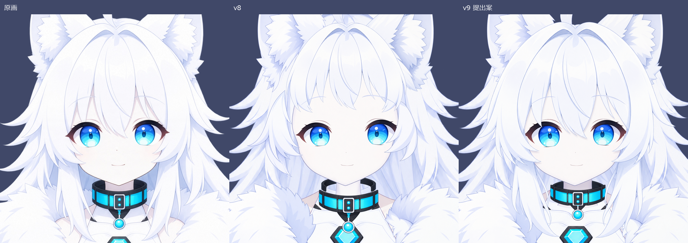

# シエル v9：顔まわり、段階0〜2の制作報告

2026-10-11 / Codex

**ユーザー確認Aに出す正面の提出案を作成した。** 中央前髪を目の間へ戻し、頬を包む髪から胸へ下る髪をつなぎ、両目の大きさ・間隔、首の影、首輪と丸飾りの配置を調整した。画像生成は **4回／上限30回**。ユーザーの承認はまだ受けていない。

今回の完成物は段階2までの見た目を確認する素材と合成である。**前髪・頬髪・胸へ下る髪は、採用品では `Hair_FrontAssembly.png` の一続きの層。各束の動作用分割・隠れた根元の補完は段階3に残る。** 目・口も完成形の層のまま。PSD、Cubism、Unity、動作完成を意味しない。

## ユーザー確認A：まず見る図

1. **[顔の比較：原画／v8／v9 提出案](proofs/A-face.png)** — 同じ範囲・同じ倍率。中央前髪、頬の囲まれ方、両目と微笑みを判断する主図。
2. **[上半身全体の比較](proofs/A-upper.png)** — 同じキャンバス・同じ倍率。胸へ下る髪、首輪と胸飾り、顔と服の量感。
3. **[スマホ想定・横幅360pxずつの比較](proofs/A-phone-360.png)** — 縮小後の顔の印象。実機画面の測定値ではなく、表示サイズの仮定。

[v9の顔を原寸で見る](proofs/A-face-v9-100pct.png) ／ [v9のみ横幅360px](proofs/phone-v9-360.png)

確認Aでは「この顔ならシエルとして自然でかわいく、動かすための分割へ進めるか」を判断してほしい。原画との画素一致は合否に用いない。



## 段階0：基準と記録方式

- 見た目の基準は [承認済み原画](../../master/ciel-upper-body-2x.png)。v8の枠は初期配置。新しい画像の参照には原画の頭部・対象枠の切り出しと、その時点の合成を渡した。
- [相談回答](../../../../docs/ciel-codex-consult-parts-ja.md)2〜4章と[計画書](../../../../docs/ciel-live2d-rebuild-analysis-plan-ja.md)8.3に従い、[層の担当・順序・影の所属](../../generated/v9/layer-contract.md)を作成。L/Rはキャラクター視点（R＝画面左）。
- 白磁の顔、白銀の髪、淡い青紫の線、シアンの瞳を基準とし、頬染め・人間の耳は追加していない。冷たい灰紫の影は保つ。
- [段階0の配置](../../generated/v9/placement-stage0.json)に、v8採用原本をファイル名で明示し、SHA256、元画像寸法、2172×2896の枠、変換行列、描画順を記録。新しいファイルの存在による自動採用はしない。
- 最終の[配置定義](placement.json)は、採用原本、全変換、マスク、影、補正理由、採用状態を保持する。原本の画素から一度だけ変換し、乗算済みアルファで補間した。

## 段階1：v8を配置で救済する試作

[段階1配置](../../generated/v9/placement-stage1.json) ／ [段階ごとの顔](proofs/stages-face.png) ／ [段階ごとの上半身](proofs/stages-upper.png)

| 部位 | 試したこと | 判断 |
|---|---|---|
| 両目 | まず同じ基準点で105%。髪の修正後に100/105/110%と左右個別補正を比較 | 原本を再生成する必要はなかった。最終は右108%、左100%＋位置補正 |
| 首輪前・丸飾り | 幅・高さを93%にし、基準点(1117,1490)から上40px | 首輪の大きさと位置は配置で改善。飾りを独立させ、追加で上へ移して間隔を確保 |
| 首輪後ろ | 基準点(1117,1440)で98%、段階1では下8px | 最終はさらに下12px。前帯の左右接点へ寄せる |
| 後ろ髪上端 | y365より上を出力マスクで隠す | 耳の間の余分な髪の山を除けた。正面では前面髪が担当。切断部の動作時露出は段階3以降の課題 |
| 前髪・横髪 | v8短縮版の配置救済では額と頬の露出が残ると確認 | 描き直し対象にした。後に短縮前の前髪原本も等方配置で比較した |
| 首 | 元原本の薄い陰影だけでは顎下が白い | 首への独立した顎影が必要と判断 |

v8の初期枠には縦横比の微小な違いを含むため、その変換を比較基準として明記して継承した。新しい採用髪は等方倍率で配置。首幅だけは接続を見て18%広げた。候補03の長い髪の横幅45%拡大は試作にとどめ、採用していない。

## 段階2：生成、組み上げ、採否

[生成の全記録](../../generated/v9/generation-log.json)に4回すべての原本・ハッシュ・指示文・参照・採否を記録。各候補の配置と合成は `generated/v9/candidate01`〜`candidate06` に保存した。候補番号と画像生成回数は別である。

| 生成 | 素材 | 合成後の判断 |
|---|---|---|
| 1 | `Hair_Front-01.png` | 中央束の長さは改善。ただし外側の巻き込みと別の頬髪が重なりすぎたため不採用 |
| 2 | `Hair_Side_R_Inner-01.png` | 広い輪郭外ハローを手動ベジェマスクで整え、左側への反転も試した。合成では毛先が多く、まとまりが弱いため不採用 |
| 3 | `Hair_Side_R_LongFront-01.png` | 原寸配置と幅拡大、左反転を比較したが、細さと頬髪との接続が不自然。最終稿に不使用 |
| 4 | `Hair_FrontAssembly-01.png` | 前髪・頬髪・手前の長い髪を一続きの形で再生成。候補04で接続が自然になり、05で縁・影、06で両目・飾りを調整して採用 |

別途、v8の `Hair_Front.png`（短縮前）も候補03で比較した。新前髪01よりまとまる箇所はあったが、目にかかる小さな尖りと頬髪との組み合わせが強いため、最終は生成4の形を選んだ。

この反復では、顔土台・両目・眉・鼻・口・首・服を同時に重ねている。個別の生成画像だけで採用を確定していない。生成4でも目・肌・眉を描き込まず、連続する髪の形を担当させた。

### 採用層と主な補正

すべて2172×2896の透明RGBA PNG。22層の名前・順序は[配置定義](placement.json)が正。下表は要点。

| 採用層 | 原本・処理 | 理由・接続 |
|---|---|---|
| Hair_FrontAssembly | 新規生成4。原本1254×1254から等方1.23倍、原点を(315,223)へ | 分け目は約(1095,371)、中央先端は約(1176,1072)。目の間へ下り、頬から胸までつながる。左右を反転した候補2/3は採用していない |
| Hair_Back | v8原本、上端y365の出力マスク | 後ろ髪は背面の広がりを担当。頭頂の二重の山を隠す |
| Hair_Ahoge | v8原本、下55px | 根元を前面髪の後ろへ入れる。耳間の接続を保つ |
| Eye_R | v8原本、初期枠に対し108%、基準点(930,1050) | 画面左の虹彩の縦幅を補い、主要ハイライトを維持 |
| Eye_L | v8原本、初期枠の100%、左25px・下3px | 画面右の目の外寄りを修正。左右の径と間隔を釣り合わせる |
| Face_Skin, Brow_R/L, Nose, Mouth | v8原本を明示再利用 | 連続した顔土台と微笑みを維持。眉は前面髪より上 |
| Face_Shadow_Hair | 前面髪のアルファから右5px・下12px、境界3px、不透明度0.25、RGB(171,159,187) | 顔のアルファへクリップ。目・鼻・口より後ろ。髪PNG外のにじみを顔影に使わない |
| Neck | v8原本、幅のみ18%拡大（x1117中心） | 顎下と首輪の接続を確保。下端は服・首輪内側へ隠れる |
| Neck_Shadow_Chin | RGB(178,163,189)、最大不透明度0.48。y1390まで一定、y1550までに減衰 | 首にクリップする顎の落ち影。既存原本の薄い陰影を含め、合成後の見える首の色で調整 |
| Choker_Back | v8修正版。98%、合計下20px | 首の後ろ。前帯と楕円の左右端を合わせる |
| Choker_Inside | (949,1359)–(1281,1492)の暗い楕円、RGB(34,41,54) | 首輪の内面。背面帯の内側、首より奥。v8胴の白い立ち襟が首輪内へ見える部分を覆う |
| Choker_Front | v8修正版、93%・上40px。原本y749まで | 前帯と金具を担当。金具の細分化はまだ行っていない |
| Choker_Pendant | 同じ原本のy750以降。前帯補正に加えて上30px | 接続タブと丸飾りを分離し、上端を帯の後ろへ重ねる。帯や首から外して浮かせない |
| Ear_R/L | v8原本 | 犬耳のまま。顔より後ろ、前髪が付け根を覆う。耳の裏・内毛の分離は段階3 |
| Body, Outer_R/L | v8原本の初期配置 | 胴・上着・ファーは今回の仮材。菱形はBody内のまま。衣服の描き直しは行っていない |

髪の採用原本は、アルファ32超の最大連結成分を支持域として周囲2原本pxを残し、離れた塵を除去した。輪郭全体を一律のアルファ閾値で切り詰める処理ではない。内部の代表アルファ253を255へ近づける小さな補正も記録した。候補2/3の手動ベジェマスクは作業記録に残すが、最終PNGには使っていない。

### 比較と補助測定

[目の一律倍率比較](proofs/eye-options.png)を経て、[最終の左右個別補正](proofs/eye-balance-final.png)を選んだ。数値だけで決めず、髪との重なり・白目・顔幅を同時に確認した。

| 補助項目 | 原画 | v8 | v9提出案 |
|---|---:|---:|---:|
| 右目の青〜シアン領域 幅×高さ | 132×137 | 132×127 | 142×137 |
| 左目の青〜シアン領域 幅×高さ | 133×136 | 139×137 | 140×138 |
| 同領域の中心間隔・概算px | 365.5 | 389.5 | 365 |
| 首中央の平均RGB・概算 | (219,206,219) | (249,246,248) | (216,208,221) |

色領域は虹彩の厳密な輪郭ではなく、限定領域内の `B−R>80, G>65, B>150` の外接枠。首の検査領域は(1080,1390)–(1150,1410)。v9の顔の別小領域は約(251,248,248)で、首が顔より一段暗くなっている。詳細な座標とRGBは[測定記録](measurements.json)。

丸飾りのアルファ128超の下端はy1621、胸の菱形の暗い枠の上端はy1659で、縦方向の間隔は**38px**。見た目でも白い服が間に見える。横幅360pxの縮小では約6.3pxに相当する。これは実機での値ではない。

## 確認図の一覧

主比較はすべて左から原画／v8／v9。同じ図の中で個別に拡大して揃える処理はしていない。

| 図 | 内容・倍率 |
|---|---|
| [A-face](proofs/A-face.png) | **確認A主図**。全画像共通で(318,236)–(1854,1772)、0.5倍 |
| [A-upper](proofs/A-upper.png) | **確認A全体図**。2172×2896全域、約0.3倍 |
| [A-phone-240](proofs/A-phone-240.png) / [360](proofs/A-phone-360.png) / [480](proofs/A-phone-480.png) | 1人の表示幅がそれぞれ240/360/480pxの全体比較 |
| [phone-v9-240](proofs/phone-v9-240.png) / [360](proofs/phone-v9-360.png) / [480](proofs/phone-v9-480.png) | v9単独、余分な表題枠なし |
| [A-face-v9-100pct](proofs/A-face-v9-100pct.png) | v9頭部、1原本px＝1出力px |
| [edges-head](proofs/edges-head.png) / [edges-upper](proofs/edges-upper.png) | 白・中間灰・暗背景。頭部0.4倍／全体約0.23倍 |
| [edges-front-hair](proofs/edges-front-hair.png) | 採用した前面髪を単体で明暗背景へ。0.5倍 |
| [edges-detail-100pct](proofs/edges-detail-100pct.png) | 頭頂・頬の毛先・胸の毛先の白／暗背景。100% |
| [diagnostics-head](proofs/diagnostics-head.png) | 通常／髪と髪影を外した顔／顔と表情パーツを外した髪。0.4倍 |
| [diagnostics-hair](proofs/diagnostics-hair.png) | 髪だけ／前面髪だけ。共通領域、0.4倍 |
| [diagnostics-neck](proofs/diagnostics-neck.png) | 通常／独立影なし／首と首輪だけ。共通領域、1倍 |
| [eye-options](proofs/eye-options.png) | 両目を一律100/105/110%。この中の105%は中間候補 |
| [eye-balance-final](proofs/eye-balance-final.png) | 原画／両目105%／最終の右108%・左100%＋位置補正 |
| [stages-face](proofs/stages-face.png) / [stages-upper](proofs/stages-upper.png) | v8／配置だけの段階1／最終案 |
| [coverage-translation-only](proofs/coverage-translation-only.png) | 髪だけ左16px／正面／右16px・下8px。髪影は固定。平行移動の接点検査であり頭XYの動作確認ではない |
| [layers-common-scale](proofs/layers-common-scale.png) | 全22層。各キャンバスを共通の約0.18倍で表示 |

最終主図、縮小表示、明暗の輪郭、顔・髪の除外図、首まわり、平行移動図を表示して点検した。採用前面髪の白い広域ハローと浮遊する大きな切れ端は確認図で見られず、前髪の中央先端と主ハイライトも読める。全画素・全将来姿勢の合格を意味しない。

## 残る問題と未確認

- **ユーザー確認Aは未承認。** 原画に対し、前髪の細かな束、頬髪の丸み・先端、髪のハイライトには差がある。顔の好みとしての最終判断を待つ。
- **動作層への分割は未実施。** 前面髪は一続き。各束の根元を独立して動かすための描き足し、首影・顔影の頭XY追従、目と口の内部、耳の付け根・裏面、金具と菱形の分離は段階3以降。
- 後ろ髪のy365の切り分けは、正面で前面髪・耳に隠れる位置に置いた。大きな頭の回転や耳の倒れで切断が露出しないかは未確認。単体では直線の上端が見える。
- v8顔土台のこめかみ側の余白、髪を独立して動かす際に必要な肌面積は、仮リグで再確認する。髪を外した診断図は「その状態で見せる完成デザイン」ではない。
- 首土台には元の薄い陰影があり、今回の顎影を重ねて最終色を合わせた。動く影として厳密に分離する際には土台の陰との関係を整理する必要がある。首だけの図では隠れる上端・下端が見える。
- 胴・上着・ファー、背面髪のボリューム、耳の細部はv8仮材。原画より服・ファーの存在感が強い点は今回直していない。既存材の微小な透明縁を全身仕上げ済みとは扱わない。
- 240px幅では鼻・口の細線は小さい。スマホ想定はPNG縮小の仮確認で、Unityの実際の表示枠、端末、縮小フィルター、輪郭のちらつきは未確認。
- まばたき、口パク、表情、髪・耳の物理、±30パラメーターと途中値、PSD取り込み、Cubism/Unityの描画・性能は今回検査していない。

## 検証と再現

[検証結果](validation.json)：22層すべてRGBA・2172×2896。保存した層を描画順に再合成すると `compose.png` と全画素一致した。開始時に記録した既存入力106ファイルのSHA256に変更なし。PNGの寸法・ハッシュは[出力一覧](output-manifest.json)。

採用配置だけから再生成する場合（リポジトリルートで実行）：

```powershell
python -I scripts/live2d/v9/build.py render assets/ciel/layers/v9/placement.json assets/ciel/generated/v9/repro --export
```

確認図を含めて明示した候補06を提出物へ書き出す処理は [finalize.py](../../../../scripts/live2d/v9/finalize.py)。試作の配置は [iterate.py](../../../../scripts/live2d/v9/iterate.py)、原本・マスク・合成は [build.py](../../../../scripts/live2d/v9/build.py)。画像生成の再実行はこれらに含めていない。

制作側の保存先は指定された `generated/v9`、`layers/v9`、`scripts/live2d/v9`。画像生成ツールは管理する自動キャッシュへも原本を保存するため、その返却原本を `generated/v9/parts` へコピーした。既存素材や既存の組み立てスクリプトは編集していない。
