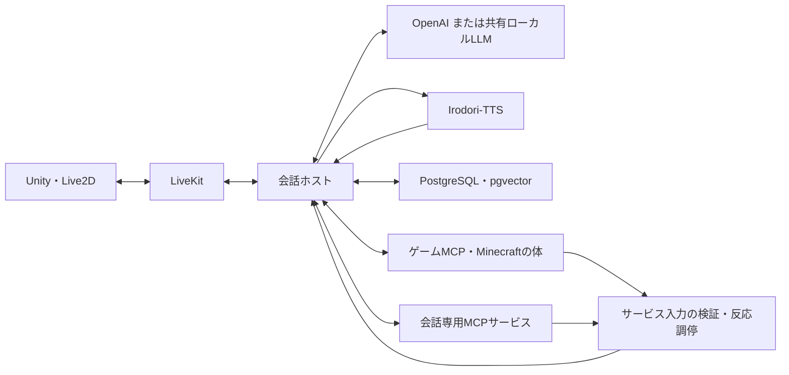

# システム構成

> 責務：プロセス・配置・接続・共有範囲の地図。

この資料は配置する部品、接続、状態の共有範囲を説明する。設計上の判断は[設計方針](design-policy-ja.md)、設定値と反映は[実行設定](local-runtime-ja.md)、検証範囲は[確認状況](verification-status-ja.md)を参照する。

## 全体像

通常のComposeはpipeline＋Irodori。ローカル音声はCPUのVosk、通常の音声認識はOpenAI。推論方式は本番と開発で独立して選ぶ。旧Realtime・声質変換は比較用の選択肢で、通常経路と混ぜない。

## 部品と正本

| 部品 | 場所 | 担当する状態・詳細 |
|---|---|---|
| Companion / Broadcast | `unity/` | 共通Runtime Prefab、端末の表示・音声・設定。[アプリ構成](app-composition-ja.md) |
| 会話ホスト | `server/agent/` | 部屋ごとの履歴、発話、本人確認、受付と実行管理。[会話pipeline](conversation-pipeline-ja.md) |
| 会話専用サービス | `server/agent/session_mcp.py`・`service_mcp.py` | 記憶・検索・歌・画像などのMCP境界。[サービス境界](service-boundaries-ja.md) |
| 共有LLM | `server/local-llm/` | ループバックの推論APIとGPU/CPU切替。[共有API](shared-llm-api-ja.md) |
| 音声合成 | `server/tts-irodori/` | 会話間で共有するGPU合成・待機と取消 |
| 記憶DB | PostgreSQL・pgvector | 同意・人物・メモ・関係・版番号。[共有記憶](shared-memory-ja.md) |
| Minecraft | `server/minecraft/` | 体の所有権、計画、技、観測・修復。[Minecraft](minecraft-design-ja.md) |
| 歌の分析 | `server/singing/` | 歌声のローカル解析。[歌](singing-scoring-ja.md) |
| 正式キャラクター | `assets/ciel/` | 採用素材・編集モデル・SDKパッケージ。[制作仕様](ciel-live2d-production-spec-ja.md) |

実際に固定する版はUnityのProjectVersion/manifest/lock、各Dockerfile・requirements・package-lockを正本とする。最新製品の版という意味ではない。

## 会話と共有資源の分離

端末が接続するLiveKit部屋ごとに、会話履歴、短期の思考、発話待ち、仮名簿、作業クライアントを分離する。別の会話全文を自動で読む機能はない。長期記憶は共有DBで同期し、main/devの公開範囲・同意・競合検知を維持する。

Minecraftの体を操作できる会話は一つ。ゲームの所有権を取得したことと、MCP接続・能力を読み込んだことを区別する。共有GPUには同時要求・音声合成の待機があり、接続可能であることは低遅延の保証ではない。

Irodoriは合成を直列実行し、会話間で順番を回す。実行中を含め1会話4件・全体64件まで、待機開始25秒・結果待ち30秒。割り込み時は対象要求を取り消し、実行中のGPU処理は結果を捨てる。本文を合成ログへ出さない。数値を変更する場合は`server/tts-irodori/scheduler.py`等の実装と検証も更新する。

## 接続と公開範囲

サーバー側のTTS 8766、歌8767、DB5433、共有LLM8094/制御8095、Minecraft MCP8771は原則ループバックで利用する。ComposeはLinuxのhost networkを前提とする。端末へOpenAIやDBのキーを埋め込まない。Unityの接続設定と秘密情報はGit対象外。

本番、開発、専用ベンチマークは別の配置・Composeプロジェクト。実行検証のために通常ワールドを初期化しない。[ビルド・配置](build-ja.md)、[ベンチマーク](minecraft-benchmark-ja.md)に従う。
