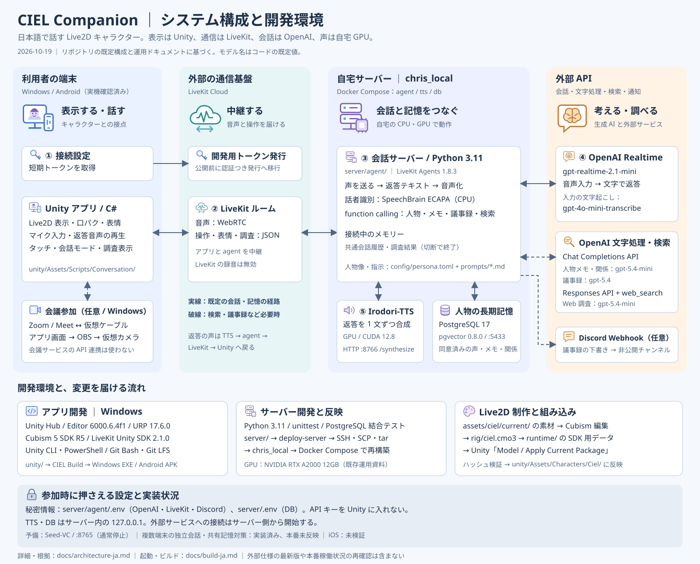
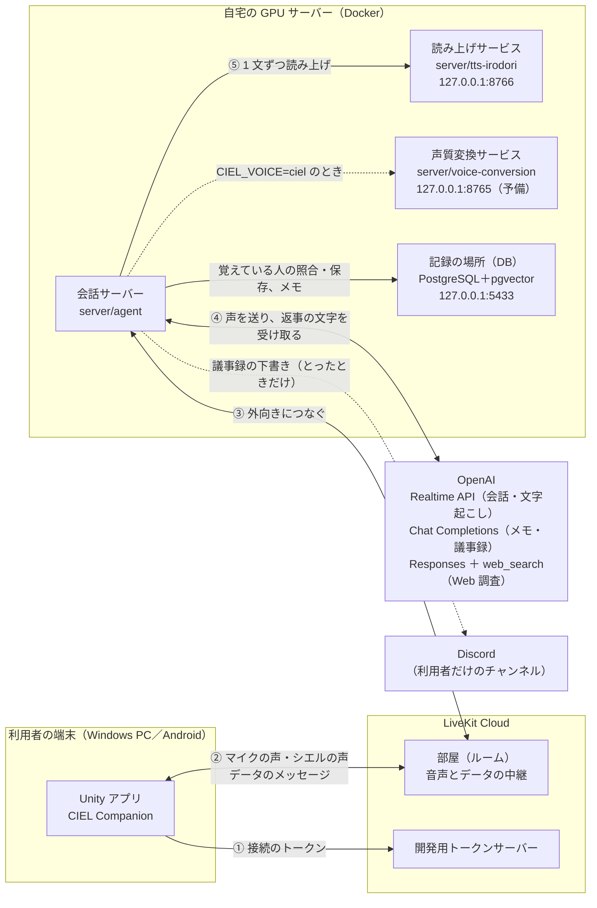
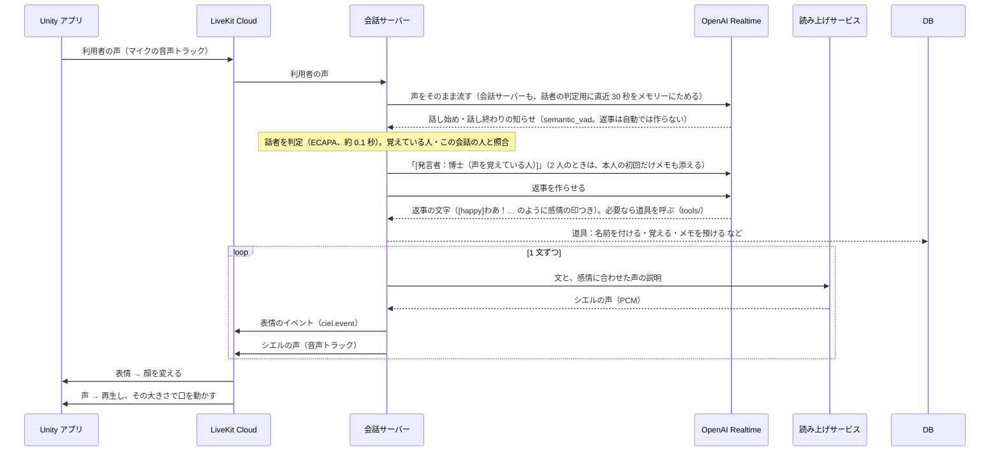
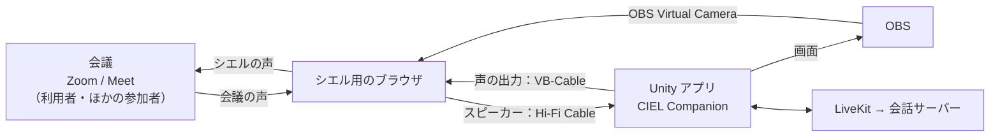

# システムの構成

更新：2026-10-19（日本時間）。リポジトリの既定構成と、既存の運用記録をまとめる。本番未反映の追加実装は個別に示す。目標の仕様は [仕様書](specification-ja.md)、決めた理由は [音声会話の構成の決定記録](decisions/voice-pipeline-ja.md) を参照。

## 新しく参加する人へ

**表示は Unity、通信は LiveKit Cloud、会話の生成は OpenAI、シエルの声は自宅 GPU の Irodori-TTS が担当する。** 会話サーバーがこれらをつなぎ、同意した人の長期記憶を PostgreSQL に保存する。

[構成図をブラウザーで開く・拡大する](system-overview-ja.svg)

アプリ側の改修は `unity/`、会話・記憶・ツールは `server/agent/`、声の生成は `server/tts-irodori/`、キャラクターの素材・モデルは `assets/ciel/` から入る。起動と反映の手順は [ビルド・サーバーデプロイ](build-ja.md)、人物記憶の動作は [人を覚える機能](people-memory-ja.md) を参照。

クローン直後は [開発環境構築の図](development-setup-ja.svg)と[コマンドつきの手順](development-setup-ja.md)から進める。Windows / VS Code、Codex・Claude Code の拡張、SDK 復元、表示確認、接続設定、Python のテストを案内する。

### 開発環境とツール

ここで示す版はプロジェクトの固定値であり、各製品の最新版を示すものではない。

| 分野 | 環境・ツール | 設定・入口 |
|---|---|---|
| アプリ | Windows 上の Unity Hub / Unity Editor **6000.6.4f1**、C#、URP **17.6.0** | `unity/ProjectSettings/ProjectVersion.txt`、`unity/Packages/manifest.json` |
| 描画・音声通信 | Live2D Cubism **5 SDK R5（URP）**、LiveKit Unity SDK **2.1.0** | Cubism は `scripts/restore-cubism.ps1` で復元、LiveKit は manifest / lock で固定 |
| 対象端末 | Windows、Android（IL2CPP / ARM64、実機確認済み）。iOS は未検証 | `unity/Assets/Editor/CielBuild.cs`。Android は Hub で SDK・NDK・OpenJDK を導入 |
| 会話サーバー | Python **3.11**、LiveKit Agents / OpenAI plugin **1.8.3** | `server/agent/Dockerfile`、`requirements.txt`、`agent.py` |
| 話者識別 | SpeechBrain **1.0.3**、ECAPA、CPU 版 PyTorch **2.5.1** | `speakers.py`、`speaker_store.py`。モデルは Docker イメージ作成時に取得 |
| 読み上げ | Irodori-TTS、Python 3.11、uv、CUDA **12.8** 系依存 | `server/tts-irodori/Dockerfile`。上流コードをコミット固定、GPU で合成 |
| サーバー稼働 | Docker Compose、自宅の GPU サーバー | `server/compose.yaml`。GPU は既存運用資料で RTX A2000 12GB |
| DB | PostgreSQL **17** ＋ pgvector **0.8.0** | Compose イメージ `pgvector/pgvector:0.8.0-pg17`、永続ボリューム `ciel_db-data` |
| ビルド・反映 | Unity CLI、PowerShell / Git Bash、SSH・SCP・tar | `scripts/unity.ps1`、`scripts/server/deploy-server.sh`（Git Bash） |
| バージョン管理 | Git、Git LFS | `.gitattributes`。LiveKit の依存取得や `.cmo3` の管理に LFS を使用 |
| 検証 | Python unittest、使い捨て PostgreSQL の結合テスト、Unity の確認用メニュー | [回帰テスト](regression-tests-ja.md)、`server/agent/tests/`、`unity/Assets/Editor/` |
| モデル制作 | Live2D Cubism、素材生成・加工用 Python スクリプト | `assets/ciel/current/` → `rig/ciel.cmo3` → `runtime/` → Unity のモデル更新メニュー |
| 会議接続（任意） | Zoom / Google Meet、VB-Cable / Hi-Fi Cable、OBS Virtual Camera | [会議への参加](meeting-bridge-ja.md)。会議サービスの API は使わず、音声機器と映像で接続 |

### 利用 API とローカル接続

モデル名はコード・設定見本の既定値。稼働先の `.env` で変更できる項目は、実際の設定を優先する。

| 接続先 | 用途・方式 | 既定モデル / 設定 |
|---|---|---|
| LiveKit Cloud | 開発用トークン発行、WebRTC 音声トラック、JSON データメッセージ | `LIVEKIT_URL`・`LIVEKIT_API_KEY`・`LIVEKIT_API_SECRET`。端末側は `LiveKitTokenSource.asset` |
| OpenAI Realtime API | 音声入力、発話区切りの検出、返答テキスト、function calling | `gpt-realtime-2.1-mini`（`CIEL_REALTIME_MODEL`） |
| Realtime の入力文字起こし | 会話履歴・人物メモ・議事録の元になる日本語の文字起こし | `gpt-4o-mini-transcribe`（`agent.py`） |
| OpenAI Chat Completions API | 人物メモ・関係の更新、議事録の要約 | `gpt-5.4-mini`（`CIEL_NOTES_MODEL`）、`gpt-5.4`（`CIEL_MINUTES_MODEL`） |
| OpenAI Responses API | `web_search` による調査と引用出典の取得 | `gpt-5.4-mini`（`CIEL_RESEARCH_MODEL`）。既存の OpenAI キーを使用 |
| Irodori-TTS | 返答テキストを音声に変換するローカル HTTP 接続 | `http://127.0.0.1:8766/synthesize` |
| PostgreSQL | 人物・声の特徴・メモ・関係の永続化 | `127.0.0.1:5433`。`CIEL_DB_URL` は Compose が設定 |
| Discord Webhook（任意） | 議事録の下書き送信。送り先はアプリの端末ごとに登録して選ぶ（端末に無ければ既定の送り先）。未設定・送信失敗時はサーバー側ファイルへ保存 | アプリの設定画面・`CIEL_MINUTES_DISCORD_WEBHOOK`（既定） |
| 歌を聴く | 歌声から印象の手がかり（心に響いた度・盛り上がり・くせ）を出すローカル HTTP 接続。歌声は外へ送らない | `http://127.0.0.1:8767/analyze`（`CIEL_SINGING_URL`） |
| Seed-VC（予備） | OpenAI の音声の声質変換。通常は停止 | `ws://127.0.0.1:8765`、Compose の `vc` profile |

OpenAI・LiveKit のキーはサーバーだけに置く。Hugging Face などからのモデル取得はビルド・モデル準備の経路であり、通常会話の音声通信経路とは別。キーや接続設定の実値は図に記載しない。

## 全体図

- 自宅サーバーは LiveKit Cloud と OpenAI へ**外向きにつなぐだけ**。ルーターのポート開放・ドメイン・証明書は要らない。読み上げと声質変換のサービスは同じマシンの中（127.0.0.1）でだけ待ち受ける。
- API キー（OpenAI・LiveKit）は自宅サーバーの `server/agent/.env` にだけ置く。Unity のアプリには入れない。

## 部品と役割

複数端末はそれぞれ独立した部屋で会話し、人物の長期記憶のみ共通DBで共有する。接続ごとの部屋名、共有記憶の同期・同時更新対策、音声合成の待機制御の追加実装は[複数端末の独立した会話](decisions/independent-conversations-ja.md)を参照（本番未反映）。

| 部品 | 場所 | 役割 |
|---|---|---|
| Unity アプリ | `unity/` | シエル（Live2D）の表示、マイクの録音、シエルの声の再生、口パク、表情、タッチ、画面の操作 |
| LiveKit Cloud | 外部サービス | アプリと会話サーバーのあいだで、声（音声トラック）とデータのメッセージを中継する |
| 会話サーバー | `server/agent/`（LiveKit Agents 1.8） | 部屋に入り、利用者の声を OpenAI へ送り、返事の文字から声を作ってアプリへ返す。表情・タッチ・会話のモードを扱う |
| 読み上げサービス | `server/tts-irodori/` | Irodori-TTS で、文をシエルの声で読み上げる（GPU、16 ステップ） |
| 歌を聴くサービス | `server/singing/` | Audiobox Aesthetics・MERT・CREPE で、歌声から感想の手がかりを出す（GPU、約 2 GB）。[仕組み（図つき）](singing-scoring-ja.md)・[使う AI モデル](singing-models-ja.md)・[歌を聴く決定記録](decisions/singing-ja.md) |
| 声質変換サービス | `server/voice-conversion/` | Seed-VC で OpenAI の声をシエルの声へ変える。今は使っていない（品質を上げる候補） |
| OpenAI Realtime API | 外部サービス | 声を聞いて返事を考える。既定は `gpt-realtime-2.1-mini`、返事は**文字だけ**作らせる。相手の発言の文字起こし（`gpt-4o-mini-transcribe`、日本語＋「シエル」と覚えている人の名前をヒントに）も同じ接続で作る |
| OpenAI の文字のモデル | 外部サービス | 会話の裏の作業：その人について覚えておくメモ（`gpt-5.4-mini`）、議事録のまとめ（`gpt-5.4`） |
| Web 調査 | `server/agent/web_research.py` ＋ OpenAI Responses API | `web_search` で検索し、引用出典つきの結果を返す（`gpt-5.4-mini`）。会話サーバーへの反映は決定記録に記載。アプリの出典表示の実機確認は未実施。[詳細](decisions/web-research-ja.md) |
| Discord | 外部サービス | 議事録の下書きを、利用者だけが見るチャンネルへ Webhook で送る（とったときだけ） |

### Unity アプリの中

| スクリプト | 役割 |
|---|---|
| `Conversation/CielConversation.cs` | トークンの取得、部屋への接続、マイク・声の出力の機器の選択、マイクのオン・オフ、口パクの音量、データのメッセージの送受信、会話のモード |
| `Conversation/CielConversationUI.cs` | マイクボタン、状態の表示、機器の選択欄（PC）、声の出力の切り替えボタン（Android）、会話のモードのボタン、議事録のボタン、表情の確認ボタン（画面の部品はコードで作る） |
| `Conversation/AndroidSpeaker.cs` | Android で、声を本体のスピーカーか受話口から出すかを OS（AudioManager）に頼む |
| `Conversation/AgentVoiceMeter.cs` | シエルの声の大きさを測る（口パク用。音は鳴らさない） |
| `Conversation/CielExpression.cs` | 表情の切り替え（Cubism の表情ファイル） |
| `Conversation/CielTouch.cs` | 画面のタッチ（頭を撫でる、ほっぺをつつく など）。その場の動きを出し、会話サーバーへ知らせる |
| `Editor/CielBuild.cs` | Windows・Android のビルド（CIEL ＞ Build ＞ Windows／Android）。[アプリのビルド](build-ja.md) |

### 会話サーバーの中

| ファイル | 役割 |
|---|---|
| `agent.py` | 入口。会話モデル・声の方式を選び、会話を始め、各部品をつなぐ |
| `persona.py` ＋ `config/` | シエルの指示（人物像・あいさつ・感情の印・タッチ・多人数・話者・メモの記録係・議事録）を Markdown から読む。[プロンプト管理方針](decisions/prompt-management-ja.md) |
| `emotion.py` | 返事の文の頭の感情の印（`[happy]` など）を読み、その感情の声で 1 文ずつ読み上げ、表情のイベントを送る。崩れた印も拾う（[音声会話の決定記録](decisions/voice-pipeline-ja.md)の「感情の印の崩れ」） |
| `irodori_tts.py` | 読み上げサービスへの接続 |
| `touch.py` | タッチの知らせを受けて、声の反応を返す |
| `mode.py` | 会話のしかた（おしゃべり度・その場にいる人）。ひかえめで黙る返事（`[silent]`）を捨てる |
| `initiative.py` | おしゃべりのとき、しばらく静かなら、シエルから話しかける |
| `notes.py` | 会話の裏で、同意した人について覚えておくメモを書く（別の文字のモデル `gpt-5.4-mini`）。[メモの決定記録](decisions/person-notes-ja.md) |
| `relationship.py` | 会話の終わりに、シエルがその人をどう思っているか（親しさの段階・気持ち・一時的な気分）を書き直す（同じ文字のモデル）。[関係の決定記録](decisions/person-relationship-ja.md) |
| `minutes.py` ＋ `minutes_admin.py` | 会議の議事録。始めと終わりのあいだの発言をため、別の文字のモデル（`gpt-5.4`）でまとめ、下書きを Discord の Webhook へ送る。始めと終わりは、アプリの議事録のボタン・声（道具）・管理用のコマンドから。長い会議は 10 分ごとに途中までをまとめ直す。[議事録の決定記録](decisions/meeting-minutes-ja.md) |
| `turns.py` | 話し終わりで返事を作らせる。先に話者を判定して「[発言者：…]」を足す（2 人でも多人数でも） |
| `speakers.py` ＋ `speaker_store.py` | 話者の識別（ECAPA の声の特徴、照合、知らない人A・B）と、覚えている人の記録（DB）。[決定記録](decisions/speaker-identification-ja.md) |
| `tools/` | 会話モデルが必要なときに呼ぶ道具（function calling）。人についての道具（`people.py`）と、その人のメモの道具（`memory.py`）、議事録を始める・終える道具（`minutes.py`）。[道具の決定記録](decisions/tools-ja.md) |
| `singing.py` ＋ `tools/singing.py` | 歌を聴く。聴いているあいだは会話モデルへの声を止めてマイクの声をため、歌を聴くサービスの手がかりから感想を言わせる。[歌を聴く決定記録](decisions/singing-ja.md) |
| `voice_conversion.py` | 声質変換サービスへの接続（`CIEL_VOICE=ciel` のとき） |
| `conversation.py` ＋ `conversation_recording.py` | 接続中の共通会話履歴。人物メモ・議事録・会話検索が同じ発言を参照する。全文はメモリーに保持し、通常の全文ログ・DB 保存は行わない。[会話履歴](decisions/conversation-history-ja.md) |
| `web_research.py` ＋ `research.py` ＋ `tools/research.py` | Web 検索、引用出典、接続中の調査記録、アプリへの結果通知。調査本文と実際の会話を分けて保持する。[Web 調査](decisions/web-research-ja.md) |

## 会話の流れ（既定：CIEL_VOICE=irodori）

- 返事の出だしの遅れ ≒「話者の判定（約 0.1 秒）」＋「最初の 1 文の文字が届くまで」＋「その文の読み上げ（0.4〜0.7 秒）」。
- 返事は、会話サーバー（`turns.py`）が話し終わりごとに作らせる。LiveKit も会話モデルも自動では作らない（話者の 1 行を先に足すため）。
- 利用者がシエルの話の途中で話し始めると、シエルの話は止まる（割り込み。会話モデルの側で判定）。
- 会話の裏で：同意した人について覚えておくメモを書く（`notes.py`）。議事録をとっているときは、発言をためておき、終わりにまとめる（`minutes.py`）。どちらも別の文字のモデルで、会話を止めない。
- 人を覚えるしくみ（声・同意・メモ）の使い方は [人を覚える機能の使い方](people-memory-ja.md)。
- 会話の録音・文字起こしは LiveKit Cloud に残さない（`record=False`）。

### 声の方式（`CIEL_VOICE`）

| 値 | 声の作り方 | 状態 |
|---|---|---|
| `irodori` | 会話モデルは文字だけ作り、Irodori-TTS で読み上げる | **既定** |
| `ciel` | 会話モデルの声を Seed-VC でシエルの声へ変える | 予備（GPU を分け合うので irodori とは同時に動かさない） |
| `openai` | 会話モデルの声のまま | 比べるとき用 |

## データのメッセージ（音声とは別の通り道）

すべて LiveKit のデータのメッセージ（信頼できる送り方）で、JSON。

| topic | 向き | 中身 | 使い道 |
|---|---|---|---|
| `ciel.event` | 会話サーバー → アプリ | `{"v":1,"type":"character.expression","seq":…,"expression":"happy","intensity":1.0,"ttl_ms":…}` | 声に合わせて表情を変える |
| `ciel.event` | 会話サーバー → アプリ | `{"v":1,"type":"minutes.state","recording":true}` | 議事録をとっているか（アプリの議事録のボタンの表示） |
| `ciel.touch` | アプリ → 会話サーバー | `{"v":1,"type":"user.touch","part":"head","gesture":"stroke","phase":"start","duration_ms":…}` | タッチへの声の反応（[タッチの仕様](ciel-touch-interaction-ja.md)） |
| `ciel.style` | アプリ → 会話サーバー | `{"v":1,"type":"conversation.style","talk":"chatty","presence":"auto","meeting":false}` | 会話のしかた。おしゃべり度（quiet・normal・chatty）、その場にいる人（auto・solo・close・public）、会議の機器につないでいるか。以前の `ciel.mode`（solo・group）も受け付ける |
| `ciel.event` | 会話サーバー → アプリ | `{"v":1,"type":"conversation.style","talk":"quiet","presence":"public","reason":"meeting"}` | いまの答え方と覚えていることの出し方（自動のときは会議・聞こえた声の数で決まる）。設定画面の「いまは：…」 |
| `ciel.volume` | アプリ → 会話サーバー | `{"v":1,"type":"voice.volume","volume":0.7}` | シエルの声の大きさ（0〜1）。アプリの声の再生には音量を変える手段がないので、会話サーバーが送る前に声を小さくする（`server/agent/volume.py`） |
| `ciel.minutes` | アプリ・管理用のコマンド（サーバーの API）→ 会話サーバー | `{"v":1,"type":"minutes.control","action":"start"}`（終わりは `"finish"`） | 議事録の始めと終わり（[議事録の決定記録](decisions/meeting-minutes-ja.md)） |
| `ciel.research` | 会話サーバー → アプリ | `research.result`・`research.text`・`research.source`・`research.complete` | 調査本文と出典を小さいパケットに分けて送る。[Web 調査](decisions/web-research-ja.md) |

## 会議に参加するとき（多人数）

Zoom・Google Meet には、シエル用のブラウザを「別の参加者」として入れ、そのマイクとスピーカーを仮想オーディオケーブルでアプリにつなぐ。**会議の人たちは LiveKit の部屋には入らない。** 部屋に入るのは、いつもどおりアプリと会話サーバーだけ。

- 声の出力に仮想ケーブルを選ぶと、アプリは会議につないでいることを会話サーバーへ知らせる。その場にいる人が「自動」なら、会話サーバーは「ひかえめ・人前」にする。
- ひかえめのときは、会話サーバーがその決まり（`config/prompts/talk_quiet.md`）を指示に足す。シエルは名前を呼ばれたときやシエルへの質問のときだけ答え、それ以外は `[silent]` と出して黙る。
- 配線・設定・困ったときの手順は [会議への参加](meeting-bridge-ja.md)。

## どこで動かすか

| 部品 | 動かす場所 | 起動・反映 |
|---|---|---|
| Unity アプリ | 利用者の Windows PC（エディタか `unity/Builds/Windows/CIEL Companion.exe`）、Android（開発用 APK、会話等は 2026-10-16 に実機確認済み） | [アプリのビルド](build-ja.md) |
| 会話サーバー（`agent`） | 自宅サーバーの `~/work/ciel-companion/server`（Docker Compose の一式 `ciel`、ホストのネットワーク） | リポジトリのルートで Git Bash から `scripts/server/deploy-server.sh`。`server/` 一式を送り、`docker compose up -d --build`。`.env` と `data/` は送らない・上書きしない |
| 読み上げサービス（`tts`） | 自宅サーバー（Docker、GPU） | 同じ一式で起動する |
| 声質変換サービス（`vc`） | 自宅サーバー（Docker、GPU） | 使うときだけ `docker compose --profile vc up -d`（読み上げサービスと GPU を分け合う） |
| 記録の場所（`db`、PostgreSQL＋pgvector） | 自宅サーバー（Docker、127.0.0.1:5433） | 同じ一式で起動する。データは Docker のボリューム `ciel_db-data` |

GPU（RTX A2000 12GB）は、別の vLLM のコンテナとも分け合う。会話を試すあいだは vLLM を止めている（[決定記録](decisions/voice-pipeline-ja.md)）。

## 設定の置き場所

| 設定 | 場所 | Git |
|---|---|---|
| OpenAI・LiveKit のキー、会話モデル、声の方式 | `server/agent/.env`（見本は `.env.example`） | 入れない |
| 議事録の下書きを送る Discord の Webhook の URL | アプリの端末の中（PlayerPrefs）。既定の送り先は `server/agent/.env` の `CIEL_MINUTES_DISCORD_WEBHOOK` | 入れない |
| 送れなかった議事録の下書き | 自宅サーバーの `server/agent/data/minutes/` | 入れない |
| DB のパスワード | `server/.env`（見本は `server/.env.example`。無ければデプロイのときに自宅サーバーで作る） | 入れない |
| 覚えている人（名前・声の特徴・その人のメモ。本人が同意した人だけ） | DB の `people`・`voiceprints`・`person_notes`。管理は `speaker_admin.py`（一覧・メモを見る・呼び名を直す・削除） | 入れない |
| 会話の裏の文字のモデル、話者の判定の基準 | `server/agent/.env` の `CIEL_NOTES_MODEL`・`CIEL_MINUTES_MODEL`・`CIEL_SPK_*`（見本は `.env.example`） | 入れない |
| シエルの指示（プロンプト） | `server/agent/config/`（`persona.toml` と `prompts/*.md`）。次の会話から反映 | 入れる |
| アプリの接続の設定（開発用トークンサーバーの ID） | `unity/Assets/Settings/LiveKitTokenSource.asset` | 入れない |
| アプリで選んだマイク・声の出力・会話のモード・スピーカー（Android） | 端末ごと（Unity の PlayerPrefs） | — |

## 今の制限と、これから

- 接続のトークンは、LiveKit の**開発用トークンサーバー**から取っている（誰でも取れる）。公開する前に、認証つきのトークン発行（仕様書の `server/session-api/`）へ切り替える。
- ビルドしたアプリには接続の設定が入るので、ほかの人に配らない。
- 話者は声だけで判定する。会議では全員の声が 1 本に混ざって届くので、1 つの発言に 2 人の声が混ざると主な話者しか付けられない。ほとんど同じ声の 2 人は区別しきれない（「たぶん」として扱う）。
- Android：会話・話者の識別・メモ・スピーカーの切り替えを実機で確認済み（2026-10-16）。マイクの選択は OS に任せる。iOS は未確認。
