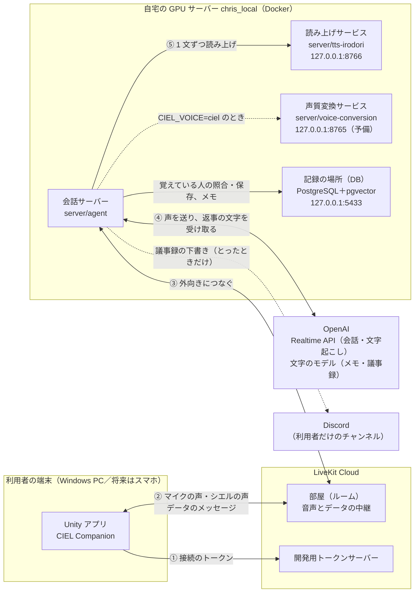
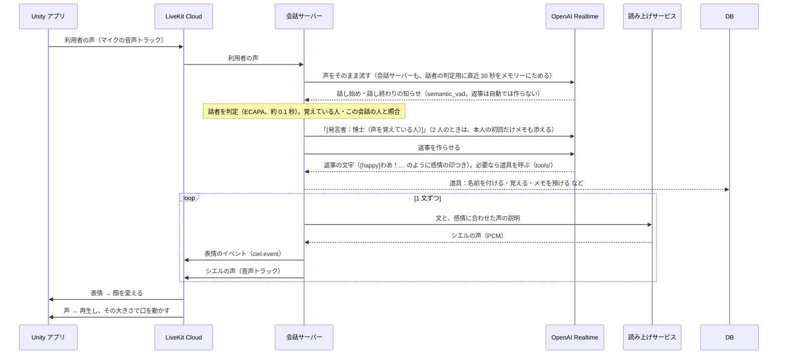
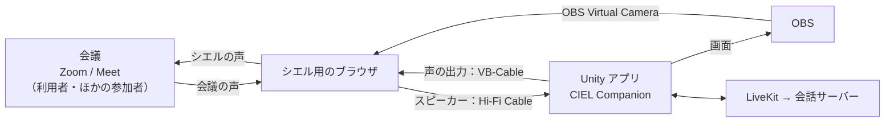

# システムの構成

更新：2026-10-16（日本時間）。**いま実際に動いている構成**をまとめる。目標の仕様は [仕様書](specification-ja.md)、決めた理由は [音声会話の構成の決定記録](decisions/voice-pipeline-ja.md) を参照。

## 全体図

- 自宅サーバーは LiveKit Cloud と OpenAI へ**外向きにつなぐだけ**。ルーターのポート開放・ドメイン・証明書は要らない。読み上げと声質変換のサービスは同じマシンの中（127.0.0.1）でだけ待ち受ける。
- API キー（OpenAI・LiveKit）は自宅サーバーの `server/agent/.env` にだけ置く。Unity のアプリには入れない。

## 部品と役割

| 部品 | 場所 | 役割 |
|---|---|---|
| Unity アプリ | `unity/` | シエル（Live2D）の表示、マイクの録音、シエルの声の再生、口パク、表情、タッチ、画面の操作 |
| LiveKit Cloud | 外部サービス | アプリと会話サーバーのあいだで、声（音声トラック）とデータのメッセージを中継する |
| 会話サーバー | `server/agent/`（LiveKit Agents 1.8） | 部屋に入り、利用者の声を OpenAI へ送り、返事の文字から声を作ってアプリへ返す。表情・タッチ・会話のモードを扱う |
| 読み上げサービス | `server/tts-irodori/` | Irodori-TTS で、文をシエルの声で読み上げる（GPU、16 ステップ） |
| 声質変換サービス | `server/voice-conversion/` | Seed-VC で OpenAI の声をシエルの声へ変える。今は使っていない（品質を上げる候補） |
| OpenAI Realtime API | 外部サービス | 声を聞いて返事を考える。既定は `gpt-realtime-2.1-mini`、返事は**文字だけ**作らせる。相手の発言の文字起こし（`gpt-4o-mini-transcribe`、日本語＋「シエル」と覚えている人の名前をヒントに）も同じ接続で作る |
| OpenAI の文字のモデル | 外部サービス | 会話の裏の作業：その人について覚えておくメモ（`gpt-5.4-mini`）、議事録のまとめ（`gpt-5.4`） |
| Discord | 外部サービス | 議事録の下書きを、利用者だけが見るチャンネルへ Webhook で送る（とったときだけ） |

### Unity アプリの中

| スクリプト | 役割 |
|---|---|
| `Conversation/CielConversation.cs` | トークンの取得、部屋への接続、マイク・声の出力の機器の選択、マイクのオン・オフ、口パクの音量、データのメッセージの送受信、会話のモード |
| `Conversation/CielConversationUI.cs` | マイクボタン、状態の表示、機器の選択欄（PC）、声の出力の切り替えボタン（Android）、会話のモードのボタン、議事録のボタン、表情の確認ボタン（画面の部品はコードで作る） |
| `Conversation/AndroidSpeaker.cs` | Android で、声を本体のスピーカーか受話口から出すかを OS（AudioManager）に頼む |
| `Conversation/AgentVoiceMeter.cs` | シエルの声の大きさを測る（口パク用。音は鳴らさない） |
| `Conversation/CielExpression.cs` | 表情の切り替え（Cubism の表情ファイル） |
| `Conversation/CielTouch.cs` | 画面のタッチ（頭を撫でる、ほっぺをつつく など）。その場の動きを出し、会話サーバーへ知らせる |
| `Editor/CielBuild.cs` | Windows・Android のビルド（CIEL ＞ Build ＞ Windows／Android）。[アプリのビルド](build-ja.md) |

### 会話サーバーの中

| ファイル | 役割 |
|---|---|
| `agent.py` | 入口。会話モデル・声の方式を選び、会話を始め、各部品をつなぐ |
| `persona.py` ＋ `config/` | シエルの指示（人物像・あいさつ・感情の印・タッチ・多人数・話者・メモの記録係・議事録）を Markdown から読む。[プロンプト管理方針](decisions/prompt-management-ja.md) |
| `emotion.py` | 返事の文の頭の感情の印（`[happy]` など）を読み、その感情の声で 1 文ずつ読み上げ、表情のイベントを送る。崩れた印も拾う（[音声会話の決定記録](decisions/voice-pipeline-ja.md)の「感情の印の崩れ」） |
| `irodori_tts.py` | 読み上げサービスへの接続 |
| `touch.py` | タッチの知らせを受けて、声の反応を返す |
| `mode.py` | 2 人・多人数の会話の切り替え。多人数で黙る返事（`[silent]`）を捨てる |
| `notes.py` | 会話の裏で、同意した人について覚えておくメモを書く（別の文字のモデル `gpt-5.4-mini`）。[メモの決定記録](decisions/person-notes-ja.md) |
| `minutes.py` ＋ `minutes_admin.py` | 会議の議事録。始めと終わりのあいだの発言をため、別の文字のモデル（`gpt-5.4`）でまとめ、下書きを Discord の Webhook へ送る。始めと終わりは、アプリの議事録のボタン・声（道具）・管理用のコマンドから。長い会議は 10 分ごとに途中までをまとめ直す。[議事録の決定記録](decisions/meeting-minutes-ja.md) |
| `turns.py` | 話し終わりで返事を作らせる。先に話者を判定して「[発言者：…]」を足す（2 人でも多人数でも） |
| `speakers.py` ＋ `speaker_store.py` | 話者の識別（ECAPA の声の特徴、照合、知らない人A・B）と、覚えている人の記録（DB）。[決定記録](decisions/speaker-identification-ja.md) |
| `tools/` | 会話モデルが必要なときに呼ぶ道具（function calling）。人についての道具（`people.py`）と、その人のメモの道具（`memory.py`）、議事録を始める・終える道具（`minutes.py`）。[道具の決定記録](decisions/tools-ja.md) |
| `voice_conversion.py` | 声質変換サービスへの接続（`CIEL_VOICE=ciel` のとき） |

## 会話の流れ（既定：CIEL_VOICE=irodori）

- 返事の出だしの遅れ ≒「話者の判定（約 0.1 秒）」＋「最初の 1 文の文字が届くまで」＋「その文の読み上げ（0.4〜0.7 秒）」。
- 返事は、会話サーバー（`turns.py`）が話し終わりごとに作らせる。LiveKit も会話モデルも自動では作らない（話者の 1 行を先に足すため）。
- 利用者がシエルの話の途中で話し始めると、シエルの話は止まる（割り込み。会話モデルの側で判定）。
- 会話の裏で：同意した人について覚えておくメモを書く（`notes.py`）。議事録をとっているときは、発言をためておき、終わりにまとめる（`minutes.py`）。どちらも別の文字のモデルで、会話を止めない。
- 人を覚えるしくみ（声・同意・メモ）の使い方は [人を覚える機能の使い方](people-memory-ja.md)。
- 会話の録音・文字起こしは LiveKit Cloud に残さない（`record=False`）。

### 声の方式（`CIEL_VOICE`）

| 値 | 声の作り方 | 状態 |
|---|---|---|
| `irodori` | 会話モデルは文字だけ作り、Irodori-TTS で読み上げる | **既定** |
| `ciel` | 会話モデルの声を Seed-VC でシエルの声へ変える | 予備（GPU を分け合うので irodori とは同時に動かさない） |
| `openai` | 会話モデルの声のまま | 比べるとき用 |

## データのメッセージ（音声とは別の通り道）

すべて LiveKit のデータのメッセージ（信頼できる送り方）で、JSON。

| topic | 向き | 中身 | 使い道 |
|---|---|---|---|
| `ciel.event` | 会話サーバー → アプリ | `{"v":1,"type":"character.expression","seq":…,"expression":"happy","intensity":1.0,"ttl_ms":…}` | 声に合わせて表情を変える |
| `ciel.event` | 会話サーバー → アプリ | `{"v":1,"type":"minutes.state","recording":true}` | 議事録をとっているか（アプリの議事録のボタンの表示） |
| `ciel.touch` | アプリ → 会話サーバー | `{"v":1,"type":"user.touch","part":"head","gesture":"stroke","phase":"start","duration_ms":…}` | タッチへの声の反応（[タッチの仕様](ciel-touch-interaction-ja.md)） |
| `ciel.mode` | アプリ → 会話サーバー | `{"v":1,"type":"conversation.mode","mode":"group"}` | 2 人（solo）・多人数（group）の切り替え |
| `ciel.minutes` | アプリ・管理用のコマンド（サーバーの API）→ 会話サーバー | `{"v":1,"type":"minutes.control","action":"start"}`（終わりは `"finish"`） | 議事録の始めと終わり（[議事録の決定記録](decisions/meeting-minutes-ja.md)） |

## 会議に参加するとき（多人数）

Zoom・Google Meet には、シエル用のブラウザを「別の参加者」として入れ、そのマイクとスピーカーを仮想オーディオケーブルでアプリにつなぐ。**会議の人たちは LiveKit の部屋には入らない。** 部屋に入るのは、いつもどおりアプリと会話サーバーだけ。

- 声の出力に仮想ケーブルを選ぶと、アプリは自動で多人数のモードにし、会話サーバーへ知らせる。
- 多人数のモードでは、会話サーバーが多人数の決まり（`config/prompts/group.md`）を指示に足す。シエルは名前を呼ばれたときやシエルへの質問のときだけ答え、それ以外は `[silent]` と出して黙る。
- 配線・設定・困ったときの手順は [会議への参加](meeting-bridge-ja.md)。

## どこで動かすか

| 部品 | 動かす場所 | 起動・反映 |
|---|---|---|
| Unity アプリ | 利用者の Windows PC（エディタか `unity/Builds/Windows/CIEL Companion.exe`）、Android（開発用の APK、実機は未確認） | [アプリのビルド](build-ja.md) |
| 会話サーバー（`agent`） | chris_local の `~/work/ciel-companion/server`（Docker Compose の一式 `ciel`、ホストのネットワーク） | リポジトリのルートで `.\scripts\server\deploy-server.ps1`（Git Bash は `scripts/server/deploy-server.sh`）。`server/` 一式を送り、`docker compose up -d --build`。`.env` と `data/` は送らない・上書きしない |
| 読み上げサービス（`tts`） | chris_local（Docker、GPU） | 同じ一式で起動する |
| 声質変換サービス（`vc`） | chris_local（Docker、GPU） | 使うときだけ `docker compose --profile vc up -d`（読み上げサービスと GPU を分け合う） |
| 記録の場所（`db`、PostgreSQL＋pgvector） | chris_local（Docker、127.0.0.1:5433） | 同じ一式で起動する。データは Docker のボリューム `ciel_db-data` |

GPU（RTX A2000 12GB）は、別の vLLM のコンテナとも分け合う。会話を試すあいだは vLLM を止めている（[決定記録](decisions/voice-pipeline-ja.md)）。

## 設定の置き場所

| 設定 | 場所 | Git |
|---|---|---|
| OpenAI・LiveKit のキー、会話モデル、声の方式 | `server/agent/.env`（見本は `.env.example`） | 入れない |
| 議事録の下書きを送る Discord の Webhook の URL | `server/agent/.env` の `CIEL_MINUTES_DISCORD_WEBHOOK` | 入れない |
| 送れなかった議事録の下書き | 自宅サーバーの `server/agent/data/minutes/` | 入れない |
| DB のパスワード | `server/.env`（見本は `server/.env.example`。無ければデプロイのときに自宅サーバーで作る） | 入れない |
| 覚えている人（名前・声の特徴・その人のメモ。本人が同意した人だけ） | DB の `people`・`voiceprints`・`person_notes`。管理は `speaker_admin.py`（一覧・メモを見る・呼び名を直す・削除） | 入れない |
| 会話の裏の文字のモデル、話者の判定の基準 | `server/agent/.env` の `CIEL_NOTES_MODEL`・`CIEL_MINUTES_MODEL`・`CIEL_SPK_*`（見本は `.env.example`） | 入れない |
| シエルの指示（プロンプト） | `server/agent/config/`（`persona.toml` と `prompts/*.md`）。次の会話から反映 | 入れる |
| アプリの接続の設定（開発用トークンサーバーの ID） | `unity/Assets/Settings/LiveKitTokenSource.asset` | 入れない |
| アプリで選んだマイク・声の出力・会話のモード・スピーカー（Android） | 端末ごと（Unity の PlayerPrefs） | — |

## 今の制限と、これから

- 接続のトークンは、LiveKit の**開発用トークンサーバー**から取っている（誰でも取れる）。公開する前に、認証つきのトークン発行（仕様書の `server/session-api/`）へ切り替える。
- ビルドしたアプリには接続の設定が入るので、ほかの人に配らない。
- 話者は声だけで判定する。会議では全員の声が 1 本に混ざって届くので、1 つの発言に 2 人の声が混ざると主な話者しか付けられない。ほとんど同じ声の 2 人は区別しきれない（「たぶん」として扱う）。
- Android：会話・話者の識別・メモ・スピーカーの切り替えを実機で確認済み（2026-10-16）。マイクの選択は OS に任せる。iOS は未確認。
