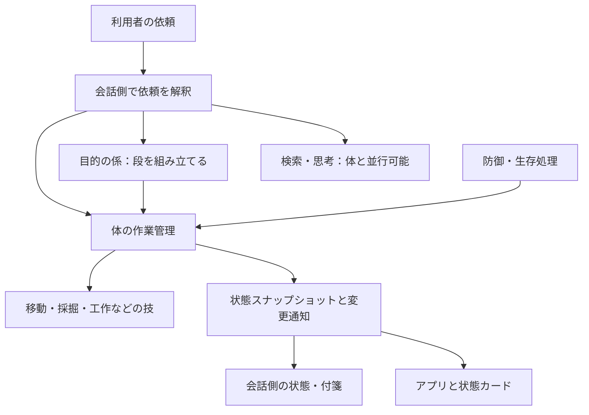

# 体の作業と切り替えの設計案

2026-11-08。調査結果・設計方針と実装の記録。ローカルに実装済み。稼働中のサーバーには未反映。

## 結論

体の実行サービスに、作業の所有権と切り替えを一元管理する管理役を置く。体には状態機械を使い、思考・検索・発話は別に動かす。コールバックは状態機械に出来事を渡す手段として残す。

「体が1つ」と「シエル全体が1つずつしか処理できない」は別の制約。全体を1本の待ち行列にすると、追従のように終わりのない作業が次の依頼を塞いでしまう。

## 現在の構造と問題

| 層 | 現在の役割 | 切り替えで問題になる点 |
|---|---|---|
| Minecraft `Runner` | `current` に現在の技を1つ持つ | 古い技へ停止要求を出すが、終了・後片付けを待たずに新しい技を開始する |
| Minecraft `CielLink` | 命令の応答待ち、実行中タスク、終了通知を管理 | 実行状態の管理が Runner と別に存在する |
| 会話 `GameEnv` | ツール呼び出し、終了通知の受付、付箋登録 | 開始応答と終了通知の到着順によって、終了済みタスクを後から登録する |
| 会話 `GoalRunner` | 複数段の目的を実行 | 新規目的は原則キューへ入る。直接の体操作は目的実行中に `goal_running` で断られる |
| `Activity` / Unity | タスク一覧、目的の段、実際の技を表示 | 別経路の情報を併記し、技の重複判定もタイトル文字列に依存する |

参照先:

- [Runner](../server/minecraft/src/skills.js): `start`, `stop`, `follow`。
- [CielLink](../server/minecraft/src/ciel/link.js): `do`, `runSkill`, 終了通知処理。
- [GameEnv](../server/agent/game_env.py): `use`, `_task_done`, `_refresh`。
- [目的の係](../server/agent/goals.py): `start`, `body_step`, `stop`。
- [Activity](../server/agent/activity.py): `task_started`, `task_done`, `state`。
- [Unity表示](../unity/Assets/Scripts/Conversation/CielConversationUI.Activity.cs): 体の表示部分。
- [防御](../server/minecraft/src/guard.js): 移動の割り込み、`idle` 待ち。

### ローカルで再現したこと

1. `GameEnv.use` のツール呼び出し中に `task_done` を渡し、その後 `started` を返す。これを異なるIDで2回行うと、両方とも終了しているのに `Activity` に追従2件と付箋2件が残る。終了通知の先着を記録しないため、後着の開始応答で復活する。
2. `Runner` に追従を開始させ、材料がない状態で木のツルハシ作成を依頼する。`missing_materials` を返し、現在の技は `follow` のまま。開始前検査が既存作業の停止より先にあるためで、工作が受理されたわけではない。

実ゲームへの接続を使わず、ローカルの疑似応答・botで確認した。今回の約70秒の出来事そのものの通信記録との照合は未実施。追従は停止まで続く仕様なので、70秒という経過時間だけでは停止遅延と判断できない。表示2件だけでも、実作業が2件走っていたとは判断できない。

### 停止を巡る別の注意点

`Runner.stop` はキャンセルトークンの設定と経路・採集の停止要求であり、停止完了の応答ではない。古い技の非同期処理が残り得る。防御中は経路停止を避け、技側には防御の終了待ちもある。切り替えを保証するには、これらの待ちもキャンセル可能にする必要がある。

`Runner` は古い技の終了で新しい `current` を消さない参照チェックを持つが、それだけでは古い処理による装備・移動などの副作用を防げない。

## 提案する責任分担



体の所有権を決めるのは実際にbotを動かすMinecraft側。会話側の目的管理は残すが、直接命令も目的の段も同じ管理役へ送る。Unityは実行中の作業を独自に推測して増やさない。

### 資源ごとの並行性

| 処理 | 基本ルール |
|---|---|
| 移動、採掘、工作、装備、アイテム操作 | `body` を排他使用し、一度に1つ |
| 検索、会話の推論、計画の作成 | 体と並行可能。古い依頼の結果から勝手に体を動かさない |
| 発話 | 体と並行可能。受理・開始・失敗を区別して伝える |
| ワールド状態の読取り | 副作用がなければ並行可能。視点変更を伴う観察は体操作として扱う |
| 防御・生存処理 | 優先度のある割り込み。移動などを直接奪い合わないよう所有者を管理する |

当初は体を丸ごと1資源にする。安全に併用できる必要が実際に出た時点で、視点・手・移動などへ細分化する。状態機械にも並行領域は定義できるため、状態機械の採用自体が並行処理を禁止するわけではない（[W3C SCXML](https://www.w3.org/TR/scxml/#parallel)）。

### 体の作業の状態

```text
accepted → preparing → running → succeeded / failed / cancelled
                          ↕
                        waiting

切り替え要求 → 現在の作業を stopping → 終了・後片付け確認 → 次を preparing
```

- `accepted` は依頼の受付。体で始めたこととは区別する。
- `preparing` は材料・経路などの確認。材料収集が必要なら目的の係が段を組み立てる。
- `waiting` は理由を必須にする。防御、対象が見えない、経路など。単に「実行中70秒」にしない。
- `stopping` は停止完了まで続く。停止期限を超えた場合は異常状態を表示し、次の体操作を重ねない。回復は技・ライブラリに応じた明示的な手順で行う。
- 終了したIDを後着の通知・応答で実行中へ戻さない。
- 古い作業は世代番号を確認し、所有権を失った後に新しい移動・装備・工作を行わない。すでに発行済みの操作は後片付け完了を待つ。

状態管理ライブラリの導入は必須ではない。最初は状態・遷移・禁止条件を明示した小さな実装でよい。

### 新しい依頼の扱い

- 明示的な新規の体への依頼は、原則「切り替え」。無期限の追従の後ろへ入れない。
- 「終わったら」「その後で」はキューへ追加する。
- 自発的な行動は利用者の指示を追い越さない。
- 切り替えを受理したら旧作業を停止する。新作業が材料不足なら「追従は止めた／材料が足りず工作は未開始」と分かる状態を返す。材料集めを伴う依頼は目的へ展開する。
- 追従を工作後に再開するのは、「作ったらまたついてきて」など依頼で明示された場合にする。
- 停止要求は停止対象IDを持つ。古い目的の遅い停止要求で、新しい工作を止めない。
- 同じ通信の再送は依頼IDで冪等にする。言い直し・再依頼・個数追加の扱いは意味で判断し、タイトル一致だけで統合しない。
- 目的の置換時には古い目的の実行世代も無効化し、終了応答を受けた古いループが次の段を投入しないようにする。

## 状態通知とカード

通知は残し、同じ状態のスナップショットも取得可能にする。再接続時や応答の期限超過時に照合できるようにする。

最低限の項目は、接続世代、単調増加する更新番号、作業ID、依頼ID、目的・段ID、作業種別、状態、状態の開始時刻、待ち理由、置換待ちの依頼、直近の終了結果。切断時は「不明／接続待ち」とし、確認なしに「なにもしていない」へ変えない。

イベントは重複・順序逆転を前提に処理する。開始応答にも現在の状態と更新番号を返し、終了済みIDの後着開始を無視する。IDは接続世代と組み合わせ、再接続時の番号再利用を区別する。付箋は履歴であり、体の現在状態の正本にしない。

カードの例:

```text
依頼：石のツルハシを作る
体：追従を停止しています（2秒）
次：材料を確認 → 工作
心：材料の集め方を考えています
```

切り替え後に足りなければ「工作は未開始：丸太が不足」。目的・段・技の関係はIDで結び、現在の体の作業は1行にまとめる。待機中のカードは残す。

## 改修順序と検証

1. **表示の不整合を先に直す。** 終了先着・通知重複・再接続を処理し、体のスナップショットと照合する。経過時間だけで消す処理にはしない。
2. **体の切り替えを保証する。** 停止完了待ち、期限、ID指定停止、世代の確認をRunnerへ入れる。工作の事前検査失敗時の扱いも決める。
3. **直接命令と目的の入口を統合する。** 置換とキューを明示し、目的の実行ループが古い段を再投入しないようにする。防御・生存処理の所有権も同じ規約へ移す。
4. **カードを正本の状態から描画する。** 停止中・材料待ち・防御中・失敗を区別し、目的／段／技の重複表示を整理する。

主要な検証条件:

- 終了通知が開始応答より先でも、終了済みの作業が復活しない。
- 追従→工作、採掘→追従の切り替えで、旧処理の後片付け後に次が動く。
- 連続する複数依頼、停止中の再置換、遅い停止・終了応答でも所有権が逆戻りしない。
- 材料不足、防御中、経路失敗、停止期限超過が理由つきで表示される。
- 目的実行中の新規依頼で古い目的が次の段を再投入しない。
- 切断・再接続で残骸や重複が増えない。
- 検索や会話は体の処理中も続けられる。

## 実装した内容

- `server/minecraft/src/body-command.js` の `BodyCommands` が体の作業を管理する。`Runner` はMinecraftの準備検査・技・停止処理を提供する。受付は `accepted`、実際の開始は `started`。停止と後片付けの両方を待ち、停止中の複数依頼は最新を採用する。
- 停止確認は既定5秒で警告状態にする。期限超過・後片付け失敗時は次を開始しない。旧作業が正常に終了した場合は所有権を解放し、期限超過によって断った新規依頼を勝手に再実行しない。
- 命令のIDと会話の世代を組み合わせる。過去の世代の終了・停止を新しい命令に適用しない。同一IDの再送は重ねて実行しない。目的の段は別途 `request_id` でも冪等にし、停止後に遅れて届いた段を拒否する。接続内の応答キャッシュ・終了履歴は各512件まで保持する。
- 技の非同期の体操作は `commandBot` を通す。防御は発行済みの操作が終わるまで待ち、通常操作の再開を制御する。防御終了待ちはキャンセル可能。食事は体が空いているときだけ行い、食事中に受けた命令は終了を待つ。
- `GoalRunner` の利用者の新規目的は既定で置換。`queue=true` は順番待ち、自発的な目的は利用者の目的の後ろへ入れる。新規目的の計画前に古い体の作業へ停止を要求する。計画・修復が遅れて完了しても古い目的を再開しない。
- 目的の段を実行中・計画中の直接命令は、古い目的を止めてから同じ体の入口へ渡す。心に任せた段の内部で使う直接操作は引き続き可能。自発的な行動が実行中の依頼を置換しないよう制御する。
- `game://state.body` に接続世代・実行サービスの世代・更新番号・現在と次の作業・防御/食事の所有権・直近の結果を出す。変更通知で読み直し、2秒ごとの体の状態送信でも照合する。終了通知の先着・重複を処理し、観測済みのタスクが正本から消えた場合も付箋を閉じる。
- `activity.state.body` があるアプリは、それを体の現在状態として描画する。以前のタスク一覧・技・目的の段を体の欄に重ねない。切り替え中、準備中、防御待ち、停止確認の遅れ、直前の失敗を表示する。古い通知には従来表示を使う。
- 検索・推論・発話の処理は体の待ち行列に入れない。

## 反映と確認

配信アプリ・会話サーバー・Minecraftの体の3か所に変更がある。新しいアプリは古い状態通知も読める。サーバー反映時はMinecraftの体を先に更新し、続いて会話サーバーを更新する。体のサービスは会話間で共有されるため、開発用の会話サーバーだけ更新しても切り替えの保証は有効にならない。

自動検証は `server/minecraft/test/body-command.test.js`、`mining-tools.test.js`、会話側の `test_game_env.py`・`test_goals.py`、Unityの `CielAudienceCardCheck` などに追加した。

ローカル検証結果:

- Minecraft: 72件成功、1件スキップ（手元のNodeのSQLiteにFTS5がないため）。変更したつなぎ役と体の管理の16件も最終変更後に再実行して成功。
- 会話サーバーの通常回帰: 519件成功。DB結合テストは未実施。結果は `.local/body-command-regression-verified/`。
- Unity: 状態カード74件、アプリ構成41件、旧表示9件成功。配信用Windowsアプリのビルド成功。ログは `unity/Logs/check-body-command-final.log` と `unity/Logs/build-body-command.log`。

最終的な実ゲームでの「追従→ツルハシ作成」「採掘→追従」「防御中の切り替え」と音声での応答確認は、サーバー反映後に実施する。今回の改修では稼働中サービスの再起動・本番反映は行っていない。モデルに渡すゲームの使い方も受付と開始の区別に合わせたが、実モデルを使った音声評価は未実施。
