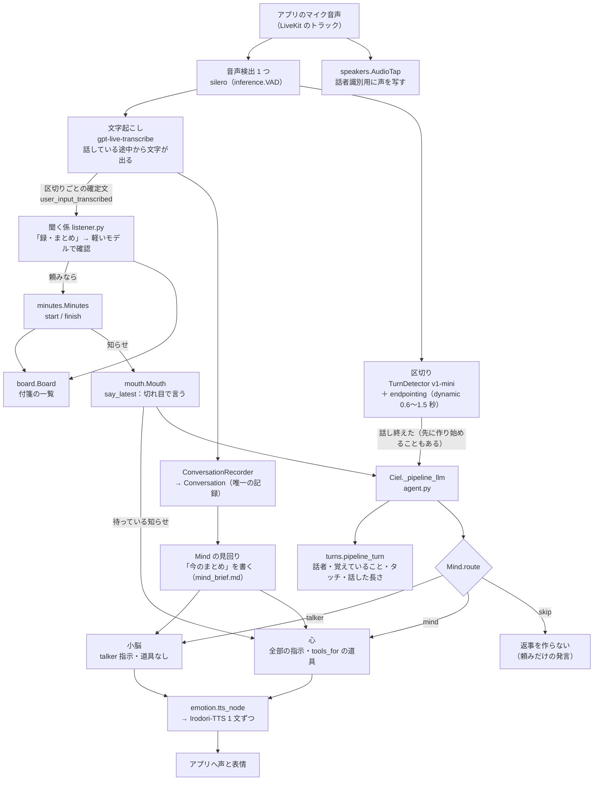
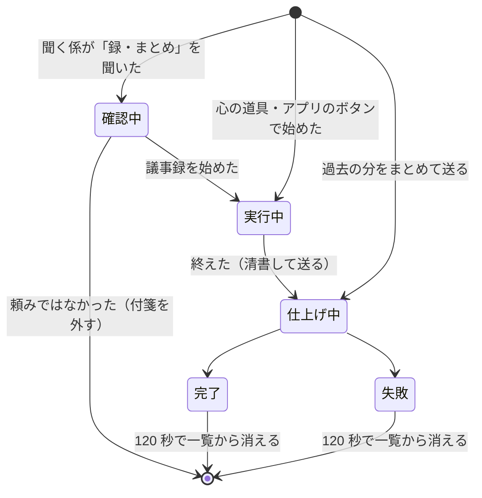

# 会話の組み立て（pipeline）の仕組み

更新：2026-10-31（日本時間）。本番と開発用の会話サーバーは `CIEL_MODEL=pipeline` で動く（`server/compose.yaml`・`server/compose.dev.yaml`）。

この文書は、会話サーバー（`server/agent/`）を直す人と AI エージェント（Claude Code・Codex）向けの **今の作りの地図** です。
- 何が良くなったか・なぜそうしたかは [会話の作り直しの成果](conversation-improvements-2026-10-ja.md) にあります。
- 経緯と測定の記録は [聞く・考える・話すの作り直し（設計）](attention-and-thinking-design-ja.md) にあります。
- 全体の構成（アプリ・LiveKit・読み上げ・DB）は [システムの構成](architecture-ja.md) にあります。

## 0. 先に知っておくこと（要点）

1. **返事は 2 つの係が作る。** ふだんの返事は **小脳**（短い指示・道具なし・最近の 16 発言）が作る。頼みごと・長い話・会議などは **心**（全部の指示・道具あり・最近の 40 発言）が作る。どちらが作るかは **コードが決める**（`mind.py` の `Mind.route`）。モデルには決めさせない。
2. **会話の記録は 1 つ。** 正は `conversation.py` の `Conversation` です。返事のたびに、この記録から送る会話を組み立てる（`Mind.build`）。LiveKit が持つ会話からは「今回の分」（最後のシエルの返事より後ろ）だけを使う。LiveKit の会話は書き換えない。
3. **シエルを話させる入り口は 1 つ。** `mouth.py` の `Mouth` です。`session.generate_reply` を直接呼ばない。
4. **頼みごとは付箋で持つ。** `board.py` の `Board` に置く。今の状態は過去の発言から推し量らず、付箋の一覧「[今のタスク]」で渡す。頼んだ発言は、送る会話の中で「（→ #1 会議の議事録をとる：実行中）」に置き換える。
5. **話の途中の頼みは聞く係が拾う。** `listener.py` の `Listener` が、文字起こしの区切りごとに見る。返事を待たず、コードが議事録を始める・終える。
6. **大事な振る舞いは、指示文ではなくコードで止める。** 道具を渡さない、返事を作らない、などで止める。指示文（`config/prompts/*.md`）は補助にとどめる。
7. **プロンプトの本文は `config/prompts/*.md` に置く。** 参照先は `config/persona.toml` です。Python に本文を書かない（`server/agent/AGENTS.md`）。

## 1. 全体の流れ



組み立ては `agent.py` の `make_pipeline` と `entrypoint` の `if PIPELINE:` の中で行う。`PIPELINE` は `CIEL_MODEL=pipeline` かつ `CIEL_VOICE=irodori` のときだけ真になる。

## 2. 1 回の返事ができるまで（処理の順）

| 順 | どこで | 何をする |
|---|---|---|
| 1 | LiveKit（`make_pipeline`） | 音声検出が話し始め・話し終わりを見る。区切りのモデルと endpointing が「話し終えた」を決める。決まる前から返事と声を作り始める（`preemptive_generation`）。 |
| 2 | `listener.Listener.on_transcribed` | 文字起こしが区切られるたびに呼ばれる。「録・まとめ」があれば、確認中の付箋を出して軽いモデルで確かめる。頼みなら `Minutes.start/finish` を呼び、その発言を付箋に結び付ける。 |
| 3 | `Ciel.on_user_turn_completed` → `turns.pipeline_end_turn` | 長く話したなら相づちを流す（`aizuchi.py`）。声の登録の読み上げ中なら `StopResponse` で返事を作らない。 |
| 4 | `Ciel.llm_node` → `_pipeline_llm` | ここから返事を作る。`Agent.default.llm_node` はここでしか呼ばない。 |
| 5 | `turns.TurnReplies.pipeline_turn` | 前の発言のあとに話した区間で、話者を決める（`speakers.py`）。返す値は `tag`（話者の 1 行）・`memory`（覚えていること）・`touch`（タッチの 1 行）・`seconds`（話した長さ）・`enroll`。 |
| 6 | `Listener.settled(3.0)` | 確かめている頼みがあれば、終わるまで待つ（ふだんは約 1 秒）。聞く係と心が同じ頼みを同時に受けないようにするため。 |
| 7 | `Mind.route` | `talker`・`mind`・`skip` のどれかを決める（3 章）。 |
| 8 | `Mind.build`（＋心なら `Mind.tools_for`） | 送る会話を組み立てる（4 章）。 |
| 9 | `emotion.tts_node` | 文の頭の感情の印（`[happy]` など）を読む。1 文ずつ、その感情の声で Irodori-TTS に読ませ、表情のイベントをアプリへ送る。`[silent]` の返事は読まない（`mode.drop_silent`）。 |
| 10 | `conversation_item_added` | `ConversationRecorder` が記録に書く。心が知らせを添えた返事を最後まで言えたら、その知らせを口から外す（`agent.py` の `on_said`）。 |

シエルが話している途中に相手が話すと、LiveKit が止める。0.8 秒より短い声（咳・相づち）では止めない（`interruption: {'mode': 'vad', 'min_duration': interruptions.CONFIRM_SECONDS}`。`CIEL_INTERRUPT_SECONDS` で変えられる）。

## 3. 小脳と心の振り分け（`Mind.route`）

上から順に見て、最初に当てはまったものに決める。

| 条件 | 結果 | 理由（`debug_log` の `mind_route`） |
|---|---|---|
| 今回の分に道具の結果（`function_call_output`）がある | 心 | 道具の結果を受けた続き |
| 口が `minutes`・`song`・`enrolled` の知らせを頼んだ直後（`Mind.on_say` が `_deep` を立てる） | 心 | 知らせは心が作る |
| 今回の分に相手の発言が無い（自分から話しかける・タッチなど） | 小脳 | — |
| 最後の発言から付箋になった頼みを除くと、つなぎの言葉（`FILLER`）しか残らない | **skip** | `on_board`。一言は議事録係の知らせが言う |
| 口に、まだ言っていない知らせが待っている | 心 | `notice`。返事の中で伝える |
| 頼みごとの言葉がある（`REQUEST`：録・まとめ・調べ・検索・何時・名前・覚えて・歌 など） | 心 | `request` |
| 10 秒以上話した、または 80 字以上 | 心 | `long` |
| ひかえめでなく、シエルのあと 2 人以上が話した | 心 | `people` |
| ひかえめで「シエル」（聞き間違いを含む `NAME`）と呼ばれた | 心 | `named` |
| ひかえめ（会議）のとき | 心 | `quiet`。黙るか答えるかを心が見極める |
| どれでもない | 小脳 | — |

**頼みの言葉を探す前に、付箋になった部分を除く**（`Board.strip`）。除かないと、「議事録開始して」が残っている限り心に回し続け、心が終了の頼みと取り違えた。

**心に渡す道具**（`Mind.tools_for`）：議事録を動かす道具（`start_minutes`・`finish_minutes`・`summarize_past_minutes`）は、今回の発言に `MINUTES_ASK`（録・まとめ・終わ・終了・止め・ストップ・送って）があるときだけ渡す。相手の発言が無い返事（知らせ）では全部渡す。指示で「終えない」と書いても、心は終える道具を呼んだ。そのため、道具そのものを渡さない。

## 4. 送る会話の組み立て（`Mind.build`）

モデルに送る会話は、上から次の順に並べる。

```
[system] 指示
         小脳：Ciel.talker_instructions_for（人物像・感情の印・タッチ・talker.md・tasks.md・その場にいる人・おしゃべり度）
         心　：Ciel.instructions_for（上に加えて、話者・議事録・会話の道具・調べもの・内なる考え・歌の使い方）
[user / assistant] 最近の発言（Conversation から。小脳 16・心 40。1 発言 1200 字まで）
         user は「名前：本文」。付箋になった頼みは「（→ #番号 内容：状態）」に置き換える
         今回の発言（LiveKit の側にある分）は、ここには入れない
[system] 補足（Mind._notes）
         今の日時（clock.now_line）
         [今のまとめ]（心が書いたもの）
         心の状態（おしゃべりのときだけ。initiative.state_note）
         [今のタスク]（Board.context）
         心だけ：議事録の状態（Minutes.context）と、議事録係からの一言（take_note）
         覚えていること（pipeline_turn の memory）
         ひかえめのときの念押し（talk_quiet_turn.md）
         心で、相手の発言があり、知らせが待っているとき：[まだ伝えていない知らせ]
[system] 今回の発言の話者（[発言者：…]）とタッチの 1 行
[今回の分] LiveKit の会話の、最後のシエルの返事より後ろ（今回の発言・今回だけの指示・道具の呼び出しと結果）
```

決まり：
- **LiveKit の会話（`chat_ctx`）は書き換えない。** 書き換えると、先に作り始めた返事が「発言が変わった」とみなされて捨てられ、毎回作り直しになった。話者の 1 行も、送る会話にだけ置く。
- **今回の発言は LiveKit の側の分を使う。** 記録の側の同じ発言（とその切れ端）は飛ばす。文字起こしの確定が返事より遅れることがあるため。
- **「今のまとめ」** は、心が裏で書く（`Mind.step`・`_write_brief`、`config/prompts/mind_brief.md`）。いつ書くかは、発言が増えたら、`summaries/live.py` の `due` と同じ決め方で決める。小脳は最近の 16 発言しか読まないので、会話全体の流れはここで伝える。

## 5. 付箋（`board.py`）



- 付箋は、聞く係・心の道具・アプリのボタンのどれが受けても 1 枚です。動かすのは `minutes.py` の `start`・`finish`・清書の終わりです。
- `Card.said` に、頼んだ発言の文字起こしを持つ。それを `mark`（印に置き換える）・`strip`（頼みとして数えない）が使う。
- 変わるたびに `board.state` をアプリへ送る（`ciel.event`）。アプリはまだ表示しない。
- 今は議事録だけ。調べもの・歌・声の登録は、まだ乗っていない。

## 6. 口と知らせ（`mouth.py`）

| 呼び方 | 使う場面 |
|---|---|
| `say(why, **kwargs)` | 今すぐ話させる（あいさつ・返事・タッチ・歌・自分から話しかける）。`before_say` で心に why を知らせる |
| `say_when_free(why, wait, anyway, settle)` | だれも話しておらず、シエルも考え中・話している最中でない切れ目を待ってから話す（声の登録のあとの一言） |
| `say_latest(why, settle)` | 知らせを切れ目で言う。待つあいだに同じ why が来たら、最新の 1 つだけ言う（議事録の知らせ。`MINUTES_SETTLE = 1.2` 秒黙ってから） |
| `waiting()` / `drop(why)` | まだ言っていない知らせを心が読み、返事の中で伝える。言い終えたら外す |

知らせの流れ（例：長い話の途中で「議事録開始して」）：
1. 聞く係が議事録を始める。`Minutes.on_change` → `agent.py` の `on_minutes` → `say_latest('minutes', ...)` が切れ目を待つ。
2. 相手が話し終えて返事を作る。`route` は `notice` で心に回す。`build` が待っている知らせを `[まだ伝えていない知らせ]` に入れ、`handed` に覚える。
3. 心の返事が止められずに最後まで言えたら、`on_said` が `voice.drop('minutes')` を呼び、知らせは別に言わない。止められたら知らせは待ち続け、切れ目で言う。

## 7. 設定（環境変数）

| 環境変数 | 既定 | 意味 |
|---|---|---|
| `CIEL_MODEL` | コードは `realtime`、Compose は `pipeline` | 組み立て。`realtime` に戻すと以前の形 |
| `CIEL_VOICE` | `irodori` | pipeline は irodori のときだけ |
| `CIEL_MIND_MODEL` | `gpt-5.4-mini` | 小脳と心の両方のモデル（`openai.LLM`） |
| `CIEL_MIND_REASONING` | `none` | 小脳と心の考える量 |
| `CIEL_STT_MODEL` | `gpt-live-transcribe` | 文字起こし。`keywords` で「シエル」「議事録」と覚えている人の名前を渡す |
| `CIEL_LISTENER_MODEL` | `gpt-5.4-mini` | 聞く係の確認 |
| `CIEL_BRIEF_MODEL` | `gpt-5.4-mini` | 今のまとめ |
| `CIEL_ENDPOINT_MODE` / `_MIN` / `_MAX` | `dynamic` / 0.6 / 1.5 | 話し終えたと決めるまでの待ち |

モデルの一覧と単価は `models.py` の `ROLES`・`PRICES`・`PER_MINUTE` が正です。

使う指示文（`config/prompts/`）：
- 小脳だけ：`talker.md`
- 小脳と心の両方：`tasks.md`
- 今のまとめ：`mind_brief.md`
- 聞く係：`listener.md`
- 心：`character.md` ほか、`instructions_for` が並べるもの

## 8. 直したいときの入口

| やりたいこと | 触る場所 | 気をつけること |
|---|---|---|
| どちらの係が返すかを変える | `mind.py` の `route`・`REQUEST`・`LONG_*` | `test_mind.py` に場面を足す。`debug_log` の `mind_route` で確かめる |
| 小脳の話し方 | `config/prompts/talker.md`・`talker_instructions_for` | 小脳は道具を持たない。「しました」と言わせない |
| 心に渡す道具を絞る | `mind.py` の `tools_for` | 知らせ（発言なし）の返事では全部渡す |
| 話の途中で拾う頼みを増やす | `listener.py`（`WORDS`・`act`）・`listener.md`・`board.py` | 付箋に結び付けないと、心が同じ頼みを受け直す |
| 新しい種類の付箋（調べもの・歌など） | `board.py` の `add/move`、その係のモジュール | `said` を結び付ける。`tasks.md` は種類によらず読める形のまま |
| 新しい知らせ | `mouth.py` の `WHY`、`mind.py` の `DEEP_WHY` | `say_latest` を使い、`generate_reply` を直接呼ばない |
| 区切り・割り込みの秒数 | `agent.py` の `make_pipeline`・`ENDPOINT_*`・`interruptions.CONFIRM_SECONDS` | 短くすると、息つぎで返事を始めては止められる |

## 9. 確かめ方

- **単体テスト（料金なし）：** リポジトリのルートで `.venv/Scripts/python.exe -m unittest discover -s server/agent/tests`、または `scripts/server/run-regression.py`（[回帰テスト](regression-tests-ja.md)）。関係するのは `test_mind.py`・`test_mouth.py`・`test_board.py`・`test_listener.py`・`test_minutes_*.py`。
- **場面の比べ（料金あり、全場面 2 回で約 0.6 ドル）：** 開発用のコンテナで `bench_compare.py` を回す（solo・long_request・meeting・idle）。回す前に料金を伝える（[料金のかかる確認](paid-checks-ja.md)）。
- **デバッグ用の会話ログ：** 開発用はいつも残す。`scripts/server/debug-log.sh pull --dev` で取り出す。pipeline で見る種類は次のとおり。
  - `mind_route`（振り分けの理由）
  - `mind_brief`（今のまとめ）
  - `board`（付箋の動き）
  - `listener_action`（聞く係が動かしたもの）
  - `speak`（口の why）
  - `item`（返事の文と、止められたか）
  - `model_usage`（料金）
- **反映：** 開発用は `scripts/server/deploy-server.sh --dev`、本番は `scripts/server/deploy-server.sh`（[ビルド・サーバーデプロイ](build-ja.md)）。

## 10. まだ残っていること

詳しくは [成果の 4 章](conversation-improvements-2026-10-ja.md#4-残っていること) にあります。
- 止められた直後に、次の返事が声にならないことがある。原因はまだ分からない。調べるには、作った文と道具の呼び出しをログに残す必要がある。
- 会議で、人どうしの話に 1 回ほど口をはさむ。
- 調べもの・歌・声の登録は、まだ付箋に乗っていない。
- 心の状態（`initiative`）は、まだ記録の外にある。満腹度を外す段階 3 は、まだ始めていない。
