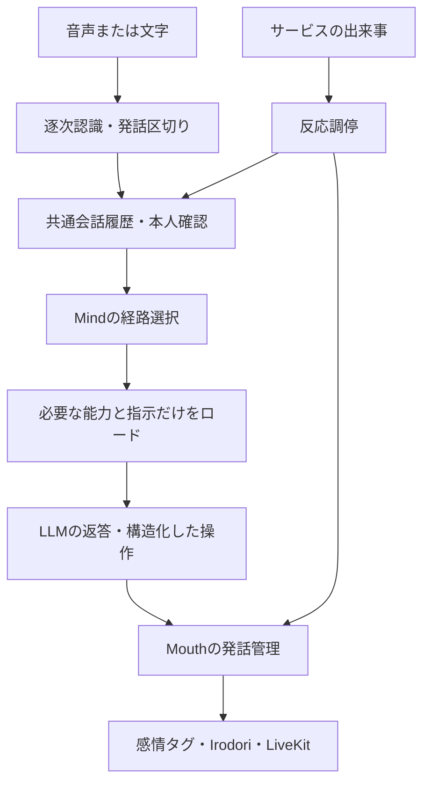

# 会話pipeline

> 責務：入力から返答までの実行順、共通履歴、経路選択、発話の調停。

この資料は音声・文字入力から返答、履歴、通知を組み立てる現在の実行順と状態の所有者を説明する。モデル設定は[実行設定](../operations/local-runtime-ja.md)、道具公開は[能力カタログ](capability-runtime-ja.md)、サービス入力の優先順位は[反応契約](service-events-and-reactions-ja.md)を正本とする。

## 入力から返答まで

1. `agent.make_pipeline`が入力部品を組み立てる。voiceではVAD、OpenAIまたはVoskの途中結果・確定結果、発話区切りを使用する。textではマイクを購読せずmanual入力とする。
2. `conversation_recording.py`と`Conversation`が、確定状態・発言ID・話者・時刻を記録する。途中の認識と確定した依頼を区別する。
3. `listener.py`は文字起こしの確定から議事録等の依頼を確認し、`game_intake.py`はゲームの構造化した依頼・明示停止を受け付ける。停止を推論の完了まで待たせない。
4. `turns.py`が声の区間、本人確認、記憶、接触等を返答の補足へまとめる。話者不明・「たぶん」を確かな本人に昇格させない。
5. `Ciel._pipeline_llm`が`Mind.route/build/tools_for`を使用する。付箋に受け付け済みの依頼を重複実行しない。
6. サービスの結果や発話要求は`Mouth`で順番・取消を管理し、`emotion.py`とIrodori経由で声・表情を送る。生成完了と最後まで発話したことは別に確認する。

## 経路選択

一般会話は短い指示・履歴のtalkerと、道具や確認を扱うmindをコードで選ぶ。道具結果の続き、内部通知、依頼、長い発言、ひかえめの会議などはmindで判断する。付箋になった依頼だけの発言はskipし、担当サービスからの報告と二重に返答しない。正確な判定順は`mind.py`の`route`を参照する。

ゲーム中は`agent.py`がmind経路を使い、道具のない返答から約束を再実行させる旧経路を通常のゲーム実行に使わない。計画と修復は[ゲーム側の作業契約](../games/game-work-contract-ja.md)が所有する。ローカルモードでは埋め込みAPIによる意味ルーター・例文学習を使わない。

mindへは能力の概要を渡し、`load_capabilities`で必要なサービスのスキーマと指示をロードする。実行時にも話者・コメントの権限と公開範囲を検証する。コメントからの道具結果の続きも、持ち主の依頼へ権限を昇格させない。

## 会話の組み立てと履歴

履歴の正本は部屋ごとの`Conversation`。LiveKitの`chat_ctx`を直接書き換えず、送信用の会話を組み立てる。人物像・保存同意等の常時指示、最近の発言、現在の日時・本人・作業・まとめ、今回の入力と道具結果を用いる。今回の入力を保存履歴とLiveKit側から二重に送らない。保持数等の変更は`mind.py`・`conversation.py`とテストを同時に更新する。

会話本文は原則接続中のメモリーに保持する。共通履歴は最大3000発言・合計200万字・1発言16000字。古い保持範囲の欠落と未確定・省略を検索結果に示し、見つからないことを未発言の証拠にしない。会話検索は同じ接続内の履歴だけを対象とし、人物DBや別会話の全文とは区別する。

人物メモ・関係・議事録は履歴のカーソルと確定状態を使う。永続化の同意は[共有記憶](../services/shared-memory-ja.md)、議事録の範囲は[議事録](../services/meeting-minutes-ja.md)が正本。デバッグ用の明示的なログ保存は[運用](../development/build-ja.md)で扱う。

## 発話・自発的な思考・付箋

`mouth.py`を発話の入口とし、各機能から無秩序に`generate_reply`しない。`initiative.py`の自発的な思考と`curiosity.py`の調査は、利用者の入力・作業の正式状態とは独立する。会話の番、出来事、発話済み・用済みの状態で調停し、生成しただけで通知を消費しない。

`Board`は依頼受付と説明用の付箋を持つ。体の現在状態やゲーム内の計画ツリーの正本にはしない。本人の記憶・検索・歌等の処理本体は[サービス境界](service-boundaries-ja.md)を使い、受付と発話は会話ホストが行う。

接触・被ダメージ等の即時表情はLLMを待たず、発話はTTL・優先順位・会話の世代を検証する。作業の状態と会話・リアクションは[表示契約](../app/work-display-contract-ja.md)に従って並行表示する。

## ローカル推論と正規化

ローカルLLMへ送る会話だけでsystemの補足を先頭へまとめ、連続assistantを順序を保って結合する。元の履歴・道具呼び出しと結果の境界は変更しない。末尾assistantがprefillと扱われる場合は現在の内部イベントを末尾へ渡し、過去の利用者の依頼を繰り返さない。thinkingの無効化・JSONと道具呼び出しは`models.py`・`mind.local_context`を参照する。

## 変更と確認の入口

低遅延化の実装順序と、準備・会話の評価境界は末尾の「音声会話の低遅延化」を参照する。

| 変更 | 主な実装 |
|---|---|
| 音声認識と発話区切り | `agent.py`、`speech_input.py`、`vosk_stt.py`、`vosk_engine.py` |
| 経路と履歴の組み立て | `mind.py`、`turns.py`、`conversation.py` |
| 指示本文 | [プロンプト管理](prompt-management-ja.md)、`config/persona.toml` |
| 本人確認・保存 | `speakers.py`、`speaker_store.py`、`tools/memory.py` |
| 受付・付箋・発話 | `listener.py`、`game_intake.py`、`board.py`、`mouth.py` |
| 反応・音声・表情 | `reactions.py`、`emotion.py`、`irodori_tts.py` |

試験コマンドは[回帰テスト](../testing/regression-tests-ja.md)、確認済み範囲と未確認項目は[確認状況](../testing/verification-status-ja.md)を参照する。

## 音声会話の低遅延化

起動中に準備時間を使い、準備完了後の会話の応答時間を改善する。起動直後の遅い単発を、準備済み会話のp95へ混ぜない。ローカル音声の`CIEL_VOICE_FAST=1`（既定）で、ジョブ内の準備・背景推論の分類・最初の文の早期合成を実装した。`0`は比較試験で旧動作を選ぶ設定。ソース実装と稼働サービスへの反映、実測は[確認状況](../testing/verification-status-ja.md)で区別する。

### 原因の整理

| 待つ箇所 | 実装と根拠 | 確認が残ること |
|---|---|---|
| 発話末尾→確定文字起こし・発話区切り | `vosk_stt.py`の自然確定と`agent.make_pipeline`のdynamic endpointing。認識処理は実時間に追随するが、無音の判定を待つ | Vosk確定待ちとturn detectorの重複量。個別の中央値を足して遅延を算出しない |
| LLMへ送る前 | `turns.pipeline_turn`で話者判定・記憶、`listener.settled`で進行中の依頼確認を待つ。後者の上限3秒は常時の固定待機ではない | 人の登録済み話者、記憶量、道具受付での待ち時間。小さな合成コーパスだけでは測定できていない |
| 最初の文字→最初の声 | `emotion.tts_node`は句点等を待ち、`request_audio`は文全体のPCMを受け取ってから流す。本返答は相づちの終了も待つ | 文が揃うまで、TTSのキュー待ち、実合成、相づち待ちの個別時間 |
| 共有LLMの競合・入力再評価 | 表の返答と、`initiative`・`mind`の要約等が同じ2枠を使う。現在のgatewayには会話優先の入場制御がない | 前回ログの背景推論・2枠使用は競合の可能性の証拠であり、長い単発の原因をキューやキャッシュだけに断定できない |
| GPU/CPUモードと履歴増加 | MoE専門家はGPU併用時もCPU処理。歌ではLLMの再起動を伴うCPU切替があり、長い文脈ほど前処理も増える | 前回の基準測定はGPUで短い独立した会話。長時間会話・歌・複数端末での実測が必要 |

ストリーミングLLMと`preemptive_generation.preemptive_tts=True`は現在すでに有効。先行生成を新設するだけの改善として数えない。[LiveKit公式の説明](https://docs.livekit.io/agents/multimodality/audio/#preemptive-speech-generation)でも、確定前の生成は文脈の変更で破棄・再生成され得る。固定したSDKの挙動を確認してから調整する。

### 起動時に準備する

`voice_preparation.prepare`は`AgentSession.start`の前に、実際のジョブプロセスで話者エンコーダー・Voskを用意し、talkerの固定指示で1トークンの準備要求とIrodoriの非再生合成を行う。本文は`voice_warmup_file`から読み、履歴・本人の記憶へ保存しない。準備前後のモデル・モード・世代が一致することを確認する。失敗時は準備済みとして会話を開始しない。

開始後は`ciel.event`へ`voice.ready` v1（`ready`、`elapsed_ms`、段階別ms、指示指紋、推論世代）を送る。`voice.ready_request` v1で現在の状態を再取得できる。返答前にも世代を照合し、変更・不明時は`ready=false`を通知する。会話中に暖機を挟んで応答期限を伸ばさず、その条件の遅延を記録する。専用評価受信口の世代は`evaluation_ingress`、通常の新supervisorでは`inference_process`を識別し、両者を混同しない。

- ワーカーと実際の会話ジョブで、VAD・Vosk・話者エンコーダーをロードする。モデルキャッシュはプロセス内なので、親プロセスだけで準備して子ジョブも準備済みと見なさない。
- 共有LLMには、実際に使うtalkerの固定指示とチャット形式で小さな準備要求を送る。単なる`/health`や短い「OK」の応答だけでは、実際の入力の前処理まで準備できた保証がない。mindはその用途を使う構成だけ別に確認する。
- Irodoriの初回合成、相づちのキャッシュ、LiveKitの音声トラックを準備する。準備用の文字・音声を本人の会話や記憶へ保存したり、利用者へ再生したりしない。
- 準備の状態はモデル・指示の指紋、推論モードとプロセスの世代に結び付ける。モデルの再起動・指示変更・CPU/GPU切替で再確認する。接続できることと、低遅延で応答できることを区別する。
- KVキャッシュは共有要求で入れ替わり得る。準備後のヒットを保証せず、失効のたびに利用者を無期限に待たせるゲートにも使わない。準備失敗・準備期限を状態として扱い、起動時間の許容を会話中のタイムアウト延長へ転用しない。

### 準備完了後の処理

現在の実装は、会話・要約等の要求を分類する入場制御と、利用者/シエルが話している間の新しい内なる考えの保留を行う。実行中の背景LLMの強制中断、要約の追加統合、STT/turn detectorの待機値変更、モデル自体の音声ストリーミングは未実装。

最初の文には`voice_first_sentence_file`の指示をtalkerへ加え、12〜20文字を目安に意味のある一文を先に生成する。`emotion.split_sentences`は、12文字以上で特定の接続表現に続く読点がある場合だけ最初の単位を前倒しできる。文字数や時間だけで任意の場所を切らず、既存の感情タグ・取消・PreambleCutを維持する。

1. **待ち時間を同じ発言IDで計測する。** マイク/SDKの発話末尾、STT確定、話者・記憶の確認終了、依頼確認終了、LLM投入・受理・最初の本文、最初の文確定、TTS投入・開始・PCM取得、相づち待ち終了、送信・端末再生を結ぶ。単調時計をプロセス内で使い、端末との時刻差は別に扱う。本文や音声を常時保存する必要はない。
2. **会話の推論機会を守る。** [共有APIの制御案](../operations/shared-llm-api-ja.md#会話を優先する入場制御の設計)で前景と背景を調停する。会話・道具の重要な結果を待たせず、要約・内なる考えは統合・延期する。準備直後に背景推論で枠とキャッシュを埋める状態を避ける。
3. **最初の意味のある文を早く音声化する。** 句点まで長く生成する場合、句読点・長さ・経過時間で自然な短い単位へ区切る案を比較する。否定・数値・固有名詞・感情タグを途中で切らず、後続の合成は再生中に先行する。現在の非ストリーミングIrodoriはHTTPを小分けに読むだけでは合成途中の音声を送れない。真の音声ストリーミングはモデル/合成API側の別の変更である。
4. **終了判定を精度と一緒に調整する。** VAD末尾、STTの自然確定、turn detectorの役割を分けて観測し、途中の間・数字・否定を含む録音で待機値を比較する。途中結果で準備する場合も、発話の継続・訂正で破棄し、道具の実行と確定依頼の受付を先行させない。話者・権限・保存同意の確認は短縮のために省略しない。

相づちは聞こえたことを伝える既存手段で、本返答の速度の代用スコアにはしない。追加の推論モデルやGPUメモリー確保は初期案に含めない。固定指示の再利用は、人物像・権限を残したまま、時刻や毎発言の補足を末尾側へ置く構成を比較する。[llama.cppのキャッシュ](https://github.com/ggml-org/llama.cpp/blob/master/tools/server/README.md)は共通の先頭部分の再利用であり、似た意味の入力ならヒットするという仕組みではない。固定した稼働版で適用を確認する。

### 改善を判定する

起動準備は所要時間と成功率を別に記録する。準備済み会話は同じ録音・モデル・負荷で本返答p50/p95、失敗率、認識誤り、途中の間への割り込み、誤った操作、音質を比較する。仮の目標は本返答p50 2.5秒以下・p95 3.5秒以下で、達成済みの数値ではない。測定で各段階の短縮余地を確認してから修正する。

最初は「計測と準備完了の確認」、次に「背景推論の入場制御」、その後「文分割と終了判定」を別々に試す。複数端末、背景要約、長い履歴、歌によるモード切替も評価条件に追加する。起動直後と準備済みを分けても、準備後に生じた再起動やモード変更の遅延を結果から隠さない。
