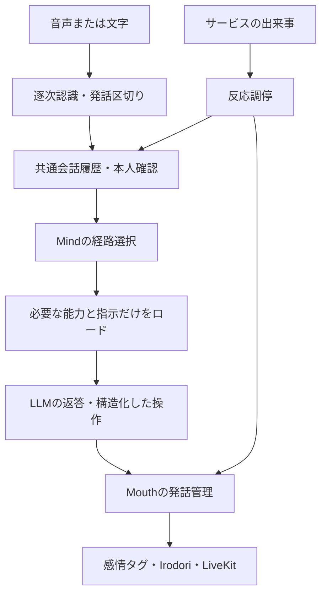

# 会話pipeline

> 責務：入力から返答までの実行順、共通履歴、経路選択、発話の調停。

この資料は音声・文字入力から返答、履歴、通知を組み立てる現在の実行順と状態の所有者を説明する。モデル設定は[実行設定](../operations/local-runtime-ja.md)、道具公開は[能力カタログ](capability-runtime-ja.md)、サービス入力の優先順位は[反応契約](service-events-and-reactions-ja.md)を正本とする。

## 入力から返答まで

ゲーム・作業イベントは受信時に鮮度を検証し、受信後の待機・返答生成・音声再生には通知専用の期限を設けない。利用者の割り込み・停止、接続解除、会話終了は引き続き生成と音声を停止する。その他の入力イベントの既存TTLは維持する。

ゲームの重要通知は、受信検証後に`Conversation`の`event`として記録する。発生元・ID・発生時刻・種別・事実を持ち、実際の発言と同じ記録順で`Mind.build`へ渡る。利用者の依頼や架空のassistant発言には変換しない。会話へ渡すのは事実の一文（`fact`）だけで、ID・時刻・主体・観測値は記録に残す。ローカル送信時には補足の形式へ変換する。履歴の件数・文字数と直近文脈の上限を適用し、発話の期限切れ・取消・通知キューの集約で既に記録した出来事は削除しない。議事録と個人関係の発言資料には混入させない。

通知の推論起動には`generate_reply()`を使い、通知本文を一回限りの`instructions`へ重ねて付けない。作業結果も固定文の直接読み上げを経ず、共通の返答生成へ渡す。通常会話へ取り込んだ待機通知は、返答が完了してから待機キューを消費する。現在の持ち物・体力・位置・作業状態は従来どおり要求時の補足で取得する。

1. `agent.make_pipeline`が入力部品を組み立てる。voiceではVAD、OpenAIまたはVoskの途中結果・確定結果、発話区切りを使用する。textではマイクを購読せずmanual入力とする。
2. `conversation_recording.py`と`Conversation`が、確定状態・発言ID・話者・時刻を記録する。途中の認識と確定した依頼を区別する。
3. 議事録は通常の会話推論から能力を読み込み、ツールで受け付ける。文字起こし断片ごとの別LLMによる並列受付は使用しない。ゲームを遊んでいる間の持ち主の発言は、`game_decision.py`が全履歴から一つの決定（話す言葉と行動）で扱う。明示停止を推論の完了まで待たせない。権限・対象・検査は[能力カタログ](capability-runtime-ja.md#ゲーム中の発言の決定)を参照する。
4. `turns.py`が声の区間、本人確認、記憶、接触等を返答の補足へまとめる。話者不明・「たぶん」を確かな本人に昇格させない。
5. `Ciel._pipeline_llm`が`Mind.route/build/tools_for`を使用する。付箋に受け付け済みの依頼を重複実行しない。
6. サービスの結果や発話要求は`Mouth`で順番・取消を管理し、`emotion.py`とIrodori経由で声・表情を送る。生成完了と最後まで発話したことは別に確認する。

## 経路選択

返事はいつも一つのmind経路で作る。一般会話も道具結果の続きも、ゲーム中の決定も、同じ固定の指示・同じ道具の一覧・同じ履歴の並びを使う。`Mind.route`が返すのは、返事を作る（`mind`）か黙る（`skip`）かだけ。付箋になった依頼だけの発言はskipし、担当サービスからの報告と二重に返答しない。短い指示で返す小脳、意味ルーター、例文の学習、約束の再実行は2026-11-16に撤去した。

固定の指示と道具の一覧は、発言ごとに出し入れしない。Qwenのテンプレートは道具の一覧を固定の指示より前に置くので、一覧が変わると先頭からキャッシュが外れる。`Mind.tools_for`が一覧を変えるのは、ゲームの体を受け持っていない間（ゲームの道具を除く）と、配信コメントへの返事（コメントから使えない道具を除く）だけ。その発言で使わせない道具（頼みの無い発言での議事録の開始・終了、記録していない間の状態確認、決定が話すだけを選んだあとの作業の道具）は、一覧に載せたまま`Mind.refused_now`で決め、呼ばれたら`mind.only_given`で実行前に落とす。

ゲーム中の持ち主の発言では、`agent.py`がmindの要求（固定の指示・道具・履歴・補足・今回の発言）を先に組み立て、`game_decision.py`へそのまま渡す。決定は同じ要求の後ろに、ゲームの遊び方の指示・決定の書き方・今できること（`game_decide.md`）を足し、`tool_choice=none`と構造化出力で書く。mindとキャッシュを共有するので、決定で新しく読むのは後ろの指示だけになる。決定が話すだけを選んだときは、mindが同じ要求で返事を作る。計画と修復は[ゲーム側の作業契約](../games/game-work-contract-ja.md)が所有する。

mindへは能力の概要と少数の個別操作を渡す。他の道具は`load_capabilities`の結果へ完全なスキーマと指示を返し、`execute_capability`で実行する。ロードのたびに固定systemやツール定義を追加しない。`Mind.build`が今回の送信文脈を組んだあと、`CapabilityCatalog.retain_context`で、その文脈に残る発行済み定義だけを保持する。次の返答で本文が外れた定義は取得状態も失効し、必要なときに再ロードする。実行時にも話者・コメントの権限と取得済みの版・正規スキーマを検証する。コメントからの道具結果の続きも、持ち主の依頼へ権限を昇格させない。

通常の会話の決定の書き方（`tool_decide.md`と、続きを有効にした会話の`continuation*.md`）は会話の間変わらないので、固定systemの能力概要のあと、返事の前提（`reply_frame.md`）の直前に置く（`tool_decision.decision_rules`）。毎回の末尾には進行状態と選択肢（`tool_decide_state.md`）だけを付ける。Qwenのようなハイブリッドモデルは、llama-serverが最後のuser発言の先頭と末尾の数百トークン前に保存した途中状態からしかキャッシュを戻せない。末尾に長い決まった指示があると、途中状態がすべて次の返事と共通しない位置に入り、履歴を毎回読み直す（[実測](../testing/voice-results-ja.md#返事ごとに履歴を読み直していた問題の修正)）。

能力概要は固定指示の直後、毎回変わる時刻・作業・話者等の補足より前に置く。初回挨拶前のキャッシュ準備にも同じ概要を含める。サービスの接続・公開範囲が変われば概要を更新するため、速度のために古い権限を固定しない。道具定義・指示本文・履歴の内容は削らない。

## 会話の組み立てと履歴

通常の音声・文字会話は`say`・`act`と操作結果のフィードバックを使う[構造化判断ループ](capability-runtime-ja.md#通常会話の構造化判断ループ)で返す。ロード後もLiveKitの結果イベントから次の判断へ進む。発話単位の状態と割り込みを管理し、結果通知を担当サービスが持つ場合は重複して話さない。ゲーム判断と自発判断は既存の入口を使う。

動的補足の後方配置を`mind.local_context`の既定動作とする。`agent.py`の通常呼出しにも適用する。`trailing_notes=False`は従来方式との比較用。反復問題は独立した評価課題として扱う。[実測と採用判断](../testing/weight-space-results-ja.md#動的補足の後方配置の比較)を参照する。

ローカル送信の`mind.local_context`は、先頭の固定systemをそのまま維持する。途中のsystem項目は、元の位置で`user`形式の`SYSTEM: `＋本文へ変換する（Mindcraftが途中systemを受け付けない相手へ送るときと同じ形）。Qwenのテンプレートが途中systemを拒否する制約に合わせ、利用者の新しい依頼と出所を区別する。シエルが実際に発言したassistant履歴として補足を追加しない。tool呼出し・結果の順序とroleは維持する。日時・作業状態・話者等の変更で冒頭の固定指示を書き換えず、履歴までの共通prefixの再利用を可能にする。意味の変わらない共通prefixを保持する設計であり、共有枠・履歴の保持窓の変更を含む全要求のキャッシュヒットは保証しない。

補足の本文は普通の文章のまま渡し、注意書きの見出しやJSONで包まない。以前の「[内部補足（利用者の発言・依頼ではありません）]」＋JSONは、返事に「（注：…）」を書かせる誘因になっていた（書式の比較は[プロンプトの書き方](../../../agent-skills/skills/ciel-prompt-writing/SKILL.md)）。`SYSTEM: `は出所の表現で、実行権限の検証を置き換えない。能力カタログ・正式な使い方の固定部分は動的補足へ移さず、能力ロードの詳細は従来どおりtool結果へ渡す。

本来の利用者依頼が記録へ確定する前にtool結果が返る経路では、内部補足をuser形式へ変換する前の履歴で依頼の有無を判定し、必要ならLiveKitの元依頼を復元する。内部補足があることを人の依頼がある証拠にしない。利用者発言のない自発発話では末尾の内部イベントを使い、assistantで終わる場合は空のuser項目で新しい生成を開始する。古い利用者依頼を再発行しない。元の`Conversation`やLiveKitの履歴は書き換えない。

履歴の正本は部屋ごとの`Conversation`。LiveKitの`chat_ctx`を直接書き換えず、送信用の会話を組み立てる。人物像・保存同意等の常時指示、最近の発言、現在の日時・本人・作業・まとめ、今回の入力と道具結果を用いる。今回の入力を保存履歴とLiveKit側から二重に送らない。保存履歴から外すのは、最後の返事より後ろの今回の分だけで、それより前の同じ言葉（2回目の「うん」など）は過去の発言として残す（外すと履歴の途中が変わり、キャッシュが外れる）。最近の発言は、始まりを毎回ずらさず、60件を超えたときだけ最新の40件まで進める（`Mind._window`）。1件ずつずらすと履歴の先頭が毎回変わり、そこから後ろのキャッシュが外れる。保持数等の変更は`mind.py`・`conversation.py`とテストを同時に更新する。

会話本文は原則接続中のメモリーに保持する。共通履歴は最大3000発言・合計200万字・1発言16000字。古い保持範囲の欠落と未確定・省略を検索結果に示し、見つからないことを未発言の証拠にしない。会話検索は同じ接続内の履歴だけを対象とし、人物DBや別会話の全文とは区別する。

人物メモ・関係・議事録は履歴のカーソルと確定状態を使う。永続化の同意は[共有記憶](../services/shared-memory-ja.md)、議事録の範囲は[議事録](../services/meeting-minutes-ja.md)が正本。デバッグ用の明示的なログ保存は[運用](../development/build-ja.md)で扱う。

## 単一ループの実験

評価した単一ループを通常のConversationDecisionへ接続した。`continuation.py`が同じsay/act出力のnext（continue/wait）と取消世代を管理する。別の思考・評価モデルは増やさない。nextを先に決め、sayは1項目・120文字以内とし、未完の説明は同じSpeechHandleで続ける。人格・指示は維持し、続きの判断と結果を履歴末尾へ追加する。継続を有効にした会話では、同一応答内の短い未処理事項をmemo（最大160文字）に持てる。sayが空でも新しい検討事項があれば次の判断へ進み、音声チャンクを生成しない。同じ無言の検討事項の反復と8段の上限超過を検出する。質問・実結果待ち・静かにする依頼・扱うことが終わった場合は待機する。タイマーで無限に思考を起動する方式ではない。

道具は段階ロード、実行、実結果のフィードバックを経て再判断する。clarify/blocked/acceptedは基盤が待機へ移し、空のcontinueと8段の上限超過はエラーにする。毎回現在の操作権限も検証する。生成上限は操作引数のため600tokenを維持し、途中切れの出力は採用しない。

発話は既存LiveKitの音声ストリームへ順に渡す。次の生成は再生と並行するため、ストリームへの提出と音声再生完了は区別する。制御JSONは要求内の非公開履歴だけに保持し、共通会話履歴にはSDKが実際の発話と割り込みを記録する。ユーザーの発話開始で継続を取り消し、古い生成結果を捨てる。waitでは新しい入力・出来事まで推論を休止する。時刻指定再開、応答をまたぐ継続メモの保持・圧縮は未実装。今回の改修はexperiment/continuation-purpose-cacheで評価し、稼働版への反映とは区別する。

ゲーム所有中のGameDecisionによる依頼・行動判断は既存の領域別経路を維持する。旧出力順や矛盾時エラーは比較用ベンチマークに限る。文字での比較結果は音声品質の改善を保証しない。[評価仕様](../testing/continuation-benchmark-ja.md)と[配布・確認範囲](../testing/verification-status-ja.md)を参照する。

## 発話・自発的な思考・付箋

`mouth.py`を発話の入口とし、各機能から無秩序に`generate_reply`しない。通常会話は上記の単一ループを使う。旧Initiativeの8秒待機・30秒間隔の独立起動は撤去し、同じ状況をタイマーだけで再推論しない。旧モジュールは初版の比較・回帰参照用に残るが、会話ホストからは起動しない。

`CIEL_INITIATIVE=1`（既定）で発話の継続判断を有効にし、`0`またはひかえめモードでは追加発話を無効にする。道具の実結果を受け取る処理は維持する。出来事の受け付け・歌・人前での調停は既存のサービス入力経路が担当する。発話を継続できることと、新しい目的を無入力で周期的に作ることは異なる。後者の定期推論は行わない。考えに話したい気持ちを付けて話す番に話す案は[話し出す動機](speaking-motivation-ja.md)（採用前）。

`initiative`ログは起動、沈黙、発話選択、行動、取消、割り込みを区別する。`spoken`は発話を選んだ数であり、音声再生完了ではない。`model_response`には要求秒数と、取得できる場合の入力・出力の計算時間を残す。`conversation_latency_report.py`は自発判断の件数・要求時間・発話中の人の割り込み・返答項目を別集計し、沈黙した要求の使用量を次の返答へ混ぜない。要求時間は待機を含み、GPU使用率と同義ではない。

`Board`は依頼受付と説明用の付箋を持つ。体の現在状態やゲーム内の計画ツリーの正本にはしない。本人の記憶・検索・歌等の処理本体は[サービス境界](service-boundaries-ja.md)を使い、受付と発話は会話ホストが行う。

接触・被ダメージ等の即時表情はLLMを待たず、発話はTTL・優先順位・会話の世代を検証する。作業の状態と会話・リアクションは[表示契約](../app/work-display-contract-ja.md)に従って並行表示する。

## ローカル推論と正規化

ローカルLLMへ送る会話だけで途中systemの補足を元の位置の内部イベントへ変換し、連続assistantを順序を保って結合する。元の履歴・道具呼び出しと結果の境界は変更しない。末尾assistantがprefillと扱われる場合は新しい生成を始めるuser項目を末尾へ渡し、過去の利用者の依頼を繰り返さない。thinkingの無効化・JSONと道具呼び出しは`models.py`・`mind.local_context`を参照する。

## 変更と確認の入口

低遅延化の実装順序と、準備・会話の評価境界は末尾の「音声会話の低遅延化」を参照する。

| 変更 | 主な実装 |
|---|---|
| 音声認識と発話区切り | `agent.py`、`speech_input.py`、`vosk_stt.py`、`vosk_engine.py` |
| 経路と履歴の組み立て | `mind.py`、`turns.py`、`conversation.py` |
| 指示本文 | [プロンプト管理](prompt-management-ja.md)、`config/persona.toml` |
| 本人確認・保存 | `speakers.py`、`speaker_store.py`、`tools/memory.py` |
| 受付・付箋・発話 | `listener.py`、`game_decision.py`、`board.py`、`mouth.py` |
| 反応・音声・表情 | `reactions.py`、`emotion.py`、`irodori_tts.py` |

試験コマンドは[回帰テスト](../testing/regression-tests-ja.md)、確認済み範囲と未確認項目は[確認状況](../testing/verification-status-ja.md)を参照する。

## 音声会話の低遅延化

起動中に準備時間を使い、準備完了後の会話の応答時間を改善する。起動直後の遅い単発を、準備済み会話のp95へ混ぜない。ローカル音声の`CIEL_VOICE_FAST=1`（既定）で、ジョブ内の準備・背景推論の分類・最初の文の早期合成を実装した。`0`は比較試験で旧動作を選ぶ設定。ソース実装と稼働サービスへの反映、実測は[確認状況](../testing/verification-status-ja.md)で区別する。

### 原因の整理

| 待つ箇所 | 実装と根拠 | 確認が残ること |
|---|---|---|
| 発話末尾→確定文字起こし・発話区切り | `vosk_stt.py`の自然確定と`agent.make_pipeline`のdynamic endpointing。認識処理は実時間に追随するが、無音の判定を待つ | Vosk確定待ちとturn detectorの重複量。個別の中央値を足して遅延を算出しない |
| LLMへ送る前 | `turns.pipeline_turn`で話者判定・記憶を準備する。議事録の別LLM受付は通常pipelineへ接続しない | 人の登録済み話者、記憶量、道具受付での待ち時間 |
| 最初の文字→最初の声 | `emotion.tts_node`は句点等を待ち、`request_audio`は文全体のPCMを受け取ってから流す。本返答は相づちの終了も待つ | 文が揃うまで、TTSのキュー待ち、実合成、相づち待ちの個別時間 |
| 共有LLMの競合・入力再評価 | 表の返答と背景推論が同じ2枠を使う。会話優先の入場制御、会話ジョブ内の背景モデル要求の取り消し、上流への切断伝播を実装 | 別ジョブの負荷、キャッシュ失効、Qwenの再帰状態の復元範囲。配布と実測は確認状況で区別する |
| GPU/CPUモードと履歴増加 | MoE専門家はGPU併用時もCPU処理。歌ではLLMの再起動を伴うCPU切替があり、長い文脈ほど前処理も増える | 前回の基準測定はGPUで短い独立した会話。長時間会話・歌・複数端末での実測が必要 |

ストリーミングLLMと`preemptive_generation.preemptive_tts=True`は現在すでに有効。先行生成を新設するだけの改善として数えない。[LiveKit公式の説明](https://docs.livekit.io/agents/multimodality/audio/#preemptive-speech-generation)でも、確定前の生成は文脈の変更で破棄・再生成され得る。固定したSDKの挙動を確認してから調整する。

### 起動時に準備する

`voice_preparation.prepare`は`AgentSession.start`の前に、実際のジョブプロセスで話者エンコーダー・設定されたSTTを用意し、共通の固定指示で1トークンの準備要求とIrodoriの非再生合成を行う。本文は`voice_warmup_file`から読み、履歴・本人の記憶へ保存しない。準備前後のモデル・モード・世代が一致することを確認する。失敗時は準備済みとして会話を開始しない。

さらに初回挨拶の直前、`prepare_conversation_prefix`でその時点のスタイル・アプリ能力を反映した固定指示と実ツール定義を準備する。Qwenではツール定義も入力の先頭に入り、道具なしの準備だけでは同じ入力にならないため。1tokenの出力と道具呼び出しは破棄し、実行しない。`voice.ready`はこの追加準備・挨拶より前の通知であり、ベンチマークは挨拶終了まで待つ。後からの能力追加や他要求によるキャッシュ失効は別途発生し得る。

開始後は`ciel.event`へ`voice.ready` v1（`ready`、`elapsed_ms`、段階別ms、指示指紋、推論世代）を送る。`voice.ready_request` v1で現在の状態を再取得できる。返答前にも世代を照合し、変更・不明時は`ready=false`を通知する。会話中に暖機を挟んで応答期限を伸ばさず、その条件の遅延を記録する。専用評価受信口の世代は`evaluation_ingress`、通常の新supervisorでは`inference_process`を識別し、両者を混同しない。

- ワーカーと実際の会話ジョブで、VAD・Vosk・話者エンコーダーをロードする。モデルキャッシュはプロセス内なので、親プロセスだけで準備して子ジョブも準備済みと見なさない。
- 共有LLMには、実際に使う固定指示・ツール定義・チャット形式で小さな準備要求を送る。単なる`/health`や短い「OK」の応答だけでは、実際の入力の前処理まで準備できた保証がない。
- Irodoriの初回合成、相づちのキャッシュ、LiveKitの音声トラックを準備する。準備用の文字・音声を本人の会話や記憶へ保存したり、利用者へ再生したりしない。
- 準備の状態はモデル・指示の指紋、推論モードとプロセスの世代に結び付ける。モデルの再起動・指示変更・CPU/GPU切替で再確認する。接続できることと、低遅延で応答できることを区別する。
- KVキャッシュは共有要求で入れ替わり得る。準備後のヒットを保証せず、失効のたびに利用者を無期限に待たせるゲートにも使わない。準備失敗・準備期限を状態として扱い、起動時間の許容を会話中のタイムアウト延長へ転用しない。

### 準備完了後の処理

共有gatewayは会話優先の入場制御に加え、待機中・上流のヘッダーや最初のトークンを待つ間も切断を監視する。切断時に上流ソケットを閉じ、推論枠を返す。ローカルの`CIEL_VOICE_FAST=1`では`inference_activity`が会話中と直後3秒の背景要求を保留し、開始済みの背景モデル要求を取り消す。呼び出し元へ延期を知らせ、保存要求を保持して次の機会に処理する。DB更新自体はこの制御で取り消さない。別ジョブの背景処理の強制中断、STTの終了判定値変更、モデル自体の音声ストリーミングは含まない。

内発的思考の候補・動機・目標は保持し、新しい会話、調査結果、ゲーム状態の変化を契機に判断する。同じ状態で時間だけが過ぎても新しい推論を開始しない。会話に中断された判断は未処理の契機を戻し、次の静かな時間に見直す。発話するかは引き続きMouth・付箋・会話の番で調停する。

最初の文には`voice_first_sentence_file`の指示を会話経路へ加え、12〜20文字を目安に意味のある一文を先に生成する。`emotion.split_sentences`は、12文字以上で特定の接続表現に続く読点がある場合だけ最初の単位を前倒しできる。文字数や時間だけで任意の場所を切らず、既存の感情タグ・取消・PreambleCutを維持する。

1. **入力の再評価を減らし、同じ発言IDで測る。** 開発の実会話では約5,500～6,300トークンの入力をキャッシュなしで読み直す処理が約18～20秒かかった。サービス概要は固定指示の直後に移したが、その配置だけの速度改善は未確定。マイク/SDKの発話末尾、STT確定、話者・記憶の確認終了、依頼確認終了、LLM投入・受理・最初の本文、最初の文確定、TTS投入・開始・PCM取得、相づち待ち終了、送信・端末再生を同じ発言で結ぶ。入力長、再利用トークン数、推論世代と同時負荷も記録する。端末との時刻差は別に扱い、本文や音声を常時保存する必要はない。
2. **会話の推論機会を守る。** [共有APIの制御案](../operations/shared-llm-api-ja.md#会話を優先する入場制御の設計)で前景と背景を調停する。会話・道具の重要な結果を待たせず、要約は統合・延期する。準備直後に背景推論で枠とキャッシュを埋める状態を避ける。
3. **最初の意味のある文を早く音声化する。** 句点まで長く生成する場合、句読点・長さ・経過時間で自然な短い単位へ区切る案を比較する。否定・数値・固有名詞・感情タグを途中で切らず、後続の合成は再生中に先行する。現在の非ストリーミングIrodoriはHTTPを小分けに読むだけでは合成途中の音声を送れない。真の音声ストリーミングはモデル/合成API側の別の変更である。
4. **終了判定を精度と一緒に調整する。** VAD末尾、STTの自然確定、turn detectorの役割を分けて観測し、途中の間・数字・否定を含む録音で待機値を比較する。途中結果で準備する場合も、発話の継続・訂正で破棄し、道具の実行と確定依頼の受付を先行させない。話者・権限・保存同意の確認は短縮のために省略しない。

相づちは聞こえたことを伝える既存手段で、本返答の速度の代用スコアにはしない。まず同じモデル・GPU容量で入力の共通部分と背景推論の負荷を調べる。合成の座標抽出では、メモ・内省の担当指示を共通部分の末尾側に置くと背景要求自身が速くなったが、実際のメモ・内省品質と会話の音声応答は未測定。通常経路へ適用する前に、役割ごとの権限・出力形式・保存同意と実入力を固定して比較する。別の軽量モデルはその結果に応じて検討し、GPUメモリーと役割ごとの品質も測る。固定指示の再利用は、人物像・権限を残したまま、時刻や毎発言の補足を末尾側へ置く構成を比較する。[llama.cppのキャッシュ](https://github.com/ggml-org/llama.cpp/blob/master/tools/server/README.md)は共通の先頭部分の再利用であり、似た意味の入力ならヒットするという仕組みではない。固定した稼働版で適用を確認する。

### 改善を判定する

起動準備は所要時間と成功率を別に記録する。準備済み会話は同じ録音・モデル・負荷で本返答p50/p95、失敗率、認識誤り、途中の間への割り込み、誤った操作、音質を比較する。仮の目標は本返答p50 2.5秒以下・p95 3.5秒以下で、達成済みの数値ではない。測定で各段階の短縮余地を確認してから修正する。

最初は「計測と準備完了の確認」、次に「背景推論の入場制御」、その後「文分割と終了判定」を別々に試す。複数端末、背景要約、長い履歴、歌によるモード切替も評価条件に追加する。起動直後と準備済みを分けても、準備後に生じた再起動やモード変更の遅延を結果から隠さない。

## 同一応答のキャッシュと目的変更

ConversationDecisionは同じSpeechHandleの送信済みメッセージを保持し、機能ロード・操作の再入場では実際のtool_call_idに一致する結果だけを追加する。進行状態と選択肢も末尾へ追記し、日時や作業状態で以前の前半を再構成しない。元の共通履歴を私的な制御JSONで書き換えない。新しい発話・割り込みでは別の入力として組み立て直し、操作権限は毎回現在の状態で検証する。ローカル要求はcache_prompt=trueを明示し、測定が明示的にfalseを指定する場合は保持する。

ゲームのreply/tellはモデルが選択し、本文は現在の持ち主発言の原文（既存の2000文字上限内）を基盤が渡す。モデルに回答文を生成し直させない。別の目的や最終成果への訂正はreplaceで選び、対象のsession/task_idと取消世代を検証して旧作業の停止確認後にsubmitする。停止未確認や対象変更時は新作業を始めず、理由を返す。表示名とargumentsは新しく受け付けた目的になる。質問への回答と新しい目的の区別自体はLLMの判断であり、語句ルールで決めない。

ゲームの決定はactを先に出力し、選んだ操作に沿ってsayを書く。noneも常に選べる。雑談・同じ作業への回答で不要なreplaceが増えないことを対応比較する。実結果・測定範囲は[能力の実測](../testing/capability-results-ja.md#目的の更新と入力キャッシュの見直し)を参照する。
