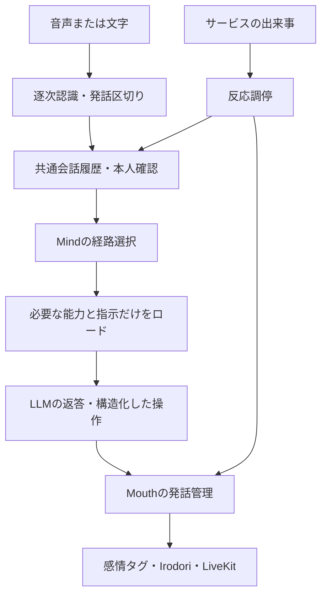

# 会話pipeline

> 責務：入力から返答までの実行順、共通履歴、経路選択、発話の調停。

この資料は音声・文字入力から返答、履歴、通知を組み立てる現在の実行順と状態の所有者を説明する。モデル設定は[実行設定](../operations/local-runtime-ja.md)、道具公開は[能力カタログ](capability-runtime-ja.md)、サービス入力の優先順位は[反応契約](service-events-and-reactions-ja.md)を正本とする。

## 入力から返答まで

1. `agent.make_pipeline`が入力部品を組み立てる。voiceではVAD、OpenAIまたはVoskの途中結果・確定結果、発話区切りを使用する。textではマイクを購読せずmanual入力とする。
2. `conversation_recording.py`と`Conversation`が、確定状態・発言ID・話者・時刻を記録する。途中の認識と確定した依頼を区別する。
3. `listener.py`は文字起こしの確定から議事録等の依頼を確認し、`game_intake.py`はゲームの構造化した依頼・明示停止を受け付ける。停止を推論の完了まで待たせない。
4. `turns.py`が声の区間、本人確認、記憶、接触等を返答の補足へまとめる。話者不明・「たぶん」を確かな本人に昇格させない。
5. `Ciel._pipeline_llm`が`Mind.route/build/tools_for`を使用する。付箋に受け付け済みの依頼を重複実行しない。
6. サービスの結果や発話要求は`Mouth`で順番・取消を管理し、`emotion.py`とIrodori経由で声・表情を送る。生成完了と最後まで発話したことは別に確認する。

## 経路選択

一般会話は短い指示・履歴のtalkerと、道具や確認を扱うmindをコードで選ぶ。道具結果の続き、内部通知、依頼、長い発言、ひかえめの会議などはmindで判断する。付箋になった依頼だけの発言はskipし、担当サービスからの報告と二重に返答しない。正確な判定順は`mind.py`の`route`を参照する。

ゲーム中は`agent.py`がmind経路を使い、道具のない返答から約束を再実行させる旧経路を通常のゲーム実行に使わない。計画と修復は[ゲーム側の作業契約](../games/game-work-contract-ja.md)が所有する。ローカルモードでは埋め込みAPIによる意味ルーター・例文学習を使わない。

mindへは能力の概要を渡し、`load_capabilities`で必要なサービスのスキーマと指示をロードする。実行時にも話者・コメントの権限と公開範囲を検証する。コメントからの道具結果の続きも、持ち主の依頼へ権限を昇格させない。

## 会話の組み立てと履歴

履歴の正本は部屋ごとの`Conversation`。LiveKitの`chat_ctx`を直接書き換えず、送信用の会話を組み立てる。人物像・保存同意等の常時指示、最近の発言、現在の日時・本人・作業・まとめ、今回の入力と道具結果を用いる。今回の入力を保存履歴とLiveKit側から二重に送らない。保持数等の変更は`mind.py`・`conversation.py`とテストを同時に更新する。

会話本文は原則接続中のメモリーに保持する。共通履歴は最大3000発言・合計200万字・1発言16000字。古い保持範囲の欠落と未確定・省略を検索結果に示し、見つからないことを未発言の証拠にしない。会話検索は同じ接続内の履歴だけを対象とし、人物DBや別会話の全文とは区別する。

人物メモ・関係・議事録は履歴のカーソルと確定状態を使う。永続化の同意は[共有記憶](../services/shared-memory-ja.md)、議事録の範囲は[議事録](../services/meeting-minutes-ja.md)が正本。デバッグ用の明示的なログ保存は[運用](../development/build-ja.md)で扱う。

## 発話・自発的な思考・付箋

`mouth.py`を発話の入口とし、各機能から無秩序に`generate_reply`しない。`initiative.py`の自発的な思考と`curiosity.py`の調査は、利用者の入力・作業の正式状態とは独立する。会話の番、出来事、発話済み・用済みの状態で調停し、生成しただけで通知を消費しない。

`Board`は依頼受付と説明用の付箋を持つ。体の現在状態やゲーム内の計画ツリーの正本にはしない。本人の記憶・検索・歌等の処理本体は[サービス境界](service-boundaries-ja.md)を使い、受付と発話は会話ホストが行う。

接触・被ダメージ等の即時表情はLLMを待たず、発話はTTL・優先順位・会話の世代を検証する。作業の状態と会話・リアクションは[表示契約](../app/work-display-contract-ja.md)に従って並行表示する。

## ローカル推論と正規化

ローカルLLMへ送る会話だけでsystemの補足を先頭へまとめ、連続assistantを順序を保って結合する。元の履歴・道具呼び出しと結果の境界は変更しない。末尾assistantがprefillと扱われる場合は現在の内部イベントを末尾へ渡し、過去の利用者の依頼を繰り返さない。thinkingの無効化・JSONと道具呼び出しは`models.py`・`mind.local_context`を参照する。

## 変更と確認の入口

| 変更 | 主な実装 |
|---|---|
| 音声認識と発話区切り | `agent.py`、`speech_input.py`、`vosk_stt.py`、`vosk_engine.py` |
| 経路と履歴の組み立て | `mind.py`、`turns.py`、`conversation.py` |
| 指示本文 | [プロンプト管理](prompt-management-ja.md)、`config/persona.toml` |
| 本人確認・保存 | `speakers.py`、`speaker_store.py`、`tools/memory.py` |
| 受付・付箋・発話 | `listener.py`、`game_intake.py`、`board.py`、`mouth.py` |
| 反応・音声・表情 | `reactions.py`、`emotion.py`、`irodori_tts.py` |

試験コマンドは[回帰テスト](../testing/regression-tests-ja.md)、確認済み範囲と未確認項目は[確認状況](../testing/verification-status-ja.md)を参照する。
