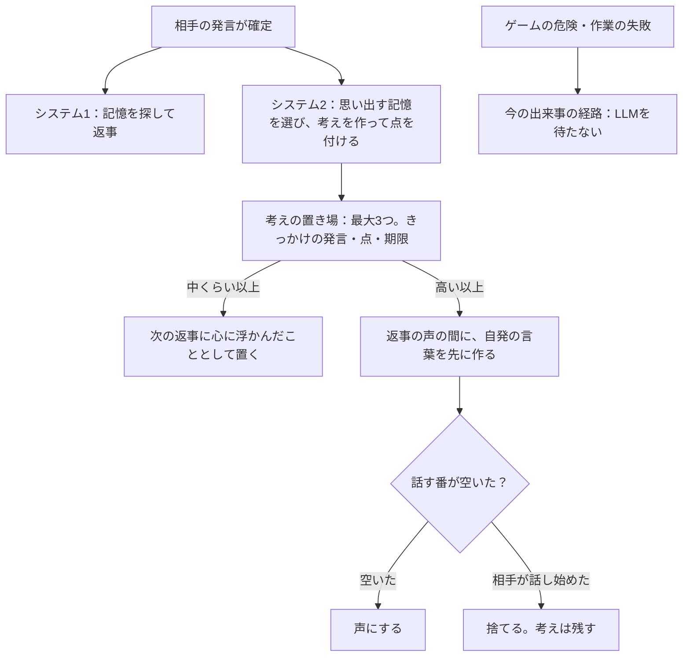

# 話し出す動機の設計（採用前）

> 責務：シエルが自分から話す・黙る・割って入るかを、考えの話したい気持ちと会話の様子から決める仕組みの設計案と、評価・移行段階・採用条件。

この資料は、[Inner Thoughts](https://arxiv.org/html/2501.00383v2)の8つの手がかりと5段階の話したい気持ちを、今のシエルのシステム2でどこまで実現できるかを整理した設計案です。まだ実装していません。今の発話の調停は[会話pipeline](conversation-pipeline-ja.md#発話自発的な思考付箋)、思い出しのシステム1・2は[関連性で思い出す記憶](../services/associative-memory-ja.md)が正本です。

## 論文の仕組み

会話と並行して、外には出さない考えを作り続けます。考えごとに話したい気持ちを付け、十分に高いものだけを話します。

1. **きっかけ：** 新しい発言のたびと、10秒の沈黙。
2. **取り出し：** 長期記憶・今の会話・前の考えから、関係の深いものを選ぶ（類似度×重要度×時間の減り。0.3以上）。
3. **考え：** システム1は直前の発言からすぐの考え、システム2は思い出した記憶からの考え（1回にシステム1を1つ、システム2を2つ。15語未満）。
4. **採点：** 8つの手がかり（関係・情報の隙間・影響・急ぎ・流れ・新しさ・釣り合い・場の勢い）について、話す理由と話さない理由を2つずつ挙げてから、1〜5で付ける。点は書き出し確率で重みを付けた平均にして、黙っている時間が長いほど少し上げる（1ステップごとに×1.02）。
5. **参加：** 番が空いていれば、基準以上で最も高い考えを話す。ほかの人の番なら、割り込みの基準を超えたときだけ話す。

利用者調査では、基準3.59の「積極的な参加者」が最も好まれました。基準4.09の「控えめな参加者」は最も評価が低く、システム1の考えをよく話す「話し続ける人」は流れを乱すと言われました。

## 前の「内なる考え」から分かったこと

2026-10〜11月に、論文を元にした「内なる考え」を入れて、11/16に外しました（`3c90939`）。その間に分かったことを、この設計の前提にします。

- **時間で考え直すと共有GPUを使い切る。** 遊んでいる間は約20秒ごとに考え、1回の開発の会話で返事16回に対して考えが28回、新しい入力が約6.4万トークンになった。
- **沈黙の秒数は、話す頃合いの手がかりにならない。** 人のほうが先に話す。話す番（シエルが話し終えて、相手が1.5〜4秒話し始めない間）のほうが自然だった。
- **話したい気持ちが3に固まる。** 5は66回考えて一度も出なかった。目安と例を足すと、4以上が64回中32回→40回に増えた。
- **用事として渡すと、返事は使わない。** 「言えたら添えて」は4回中0回だった。シエルの今の心の状態として置くと、使われ始めた。
- **切れ端やあいさつから、中身の薄い考えができる。** 何に反応した考えかを書かせ、中身の無い発言では考えないようにして、悪い考えが45%→19%に減った。
- **話す番が開いてから声になるまで1〜2秒かかり、その間に相手が話し始めることが多い。**

## 今のシエルの土台

| 部品 | 今していること | この設計で使うところ |
|---|---|---|
| システム1（返事、`mind`の役目） | 返事のたびに記憶を約12msで探し、返事を作る。返事のあとは`continuation`で続けて話すか（continue）、相手の番か（wait）を決める | 番がシエルにあるときの話し方。話す言葉は今までどおりここで作る |
| システム2（`MindRecall`、`brief`の役目） | 相手の発言が確定するたびに1回、記憶の候補（最大8件）から今の話に関係するものを選び、思ったことを1文書く。全部ローカルで1回約4.5秒。シエルが話している間も動き、間3秒の会話でも12/12で終わる | 考えを作って点を付ける係。呼ぶ回数を増やさず、この1回を広げる |
| 今のまとめ（`mind_brief`） | 発言が増えたら、話題・流れ・決まったこと・まだ決まっていないこと・人・シエルが言いたいことを書く | まだ決まっていないこと（情報の隙間）と、人ごとの様子（釣り合い）の材料 |
| 推論の譲り合い（`inference_activity`） | 相手が話している間と返事を作っている間は、背景の推論を送らない・取り消す | 先に作っておく自発の言葉を、同じ決まりで取り消す |
| おしゃべり度・その場の人 | quiet・normal・chatty と、solo・close・public | 話す基準を変える |
| 話者の確認・サービスの出来事 | 誰が話したか、ゲーム・作業・コメントの出来事と優先順位 | 釣り合いと急ぎの材料 |

## 方針

- **考えて点を付けるのはシステム2、いつ話すかは基盤が決める。** LLMは「何を話したいか・どれくらい話したいか」まで。番が空いたか、誰が話しているか、シエルが話しすぎていないかは、会話の記録とVADから計算して決める。LLMに秒数や順番を推し量らせない。
- **推論の回数を増やさない。** 考えと点は、相手の発言のたびに今動いている`MindRecall`の1回で一緒に出す。時間だけで同じ場面を考え直さない（[設計方針](../project/design-policy-ja.md)）。沈黙で上げる点は、推論をせず計算で上げる。
- **話す言葉はシステム1が作る。** 考えは心のメモのまま渡し、言い方は今の返事と同じ固定の指示・道具・履歴で作る。キャッシュを外さない。
- **論文との一致を採用の条件にしない。** 今の会話で、話しすぎ・黙りすぎ・遮りが減るかで決める。

## 8つの手がかりの分担

| 手がかり | 見る係 | 材料 | 実現できる範囲 |
|---|---|---|---|
| 関係 | システム1（探す）＋システム2（選ぶ） | 記憶の候補、今の会話、ゲームの様子 | **できている。** 思い出しの16課題で取りこぼし0・漏れ0 |
| 情報の隙間 | システム2 | 今のまとめの「まだ決まっていないこと」、相手の発言の言いかけ・食い違い | **できる。** 答えの出ていない質問、シエル自身の誤り、相手の誤解を見つけたら理由に書く。Webで調べる考えは、回数の上限を決めるまで作らない |
| 影響 | システム2 | 今の話題、シエルが最近話したこと | **できる。** 話を一歩広げる・深めるかを理由に書く。言い換えや相づちだけの考えは作らない |
| 急ぎ | 基盤＋システム2 | ゲームの危険・作業の失敗の出来事（今の優先順位）、シエル自身の誤り | **一部できる。** ゲームの危険は今のサービスの出来事の経路が先に話す（LLMを待たない）。シエルの言い間違い・相手の誤解の訂正だけを、システム2が急ぎとして付ける |
| 流れ | システム2 | 考えのきっかけになった発言 | **できる。** きっかけを書けない考えは作らない。話題が2発言以上移ったら捨てる（今の`STALE_TURNS`） |
| 新しさ | 基盤＋システム2 | シエルが最近話した文、前の考え | **できる。** シエルの最近の発言と埋め込み（ruri）で比べ、近い考えは計算で落とす。言い方の違う重なりはシステム2が見る |
| 釣り合い | 基盤 | 話者ごとの発言数・字数、シエルの割合、答えが返らなかった自発の数、その場の人 | **できる。** 計算でシエルの割合が高いときや、前の自発に返事が無かったときは点を下げる。何人かいる場で黙っている人へ振る考えは、`public`では作らない（その人のことを人前で話題にしないため） |
| 場の勢い | 基盤 | VADの話している・黙っている、話し終えてからの秒数、同じ人が続けて話しているか、コメントの勢い | **できる。** 相手が話している間と、同じ人が続けて話しそうな短い切れ目では話さない。シエルの返事のあとの沈黙だけを、話す番として扱う |

## 5段階の話したい気持ちの扱い

システム2は、考えごとに話す理由と話さない理由を2つずつ書いてから、1〜5を付けます。点は、1〜5の書き出し確率で重みを付けた平均にします（共有GPU APIは書き出し確率を返せる）。3に固まっても、3.2と3.8を区別できます。最後に、基盤が釣り合い・場の勢い・沈黙で補正します。

| 段階 | 点（補正後） | シエルの動き | quiet | normal | chatty |
|---|---|---|---|---|---|
| とても低い | 〜1.5 | 話さない。考えも残さない | 同じ | 同じ | 同じ |
| 低い | 〜2.5 | 残すが、自分からは話さない。シエルの返事のあと長く黙っていて、ほかに誰も話さないときだけ候補にする | 話さない | 話さない | 沈黙のあと候補 |
| 中くらい | 〜3.5 | シエルの次の返事に「[心に浮かんだこと]」として置く（今の仕組み）。合えば返事の中で話す | 呼ばれたときの返事にだけ置く | 返事に置く | 返事に置く。沈黙のあと候補 |
| 高い | 〜4.5 | 話す番（シエルが話し終えて、相手が話し始めない間）に、自分から1回話す | 話さない | 番が空いたら話す | 番が空いたら話す |
| とても高い | 4.5〜 | 相手の番でも、最初の短い切れ目で話す | 訂正だけ | 切れ目で話す | 切れ目で話す |

- 沈黙の補正は、話す番が空いてから相手が話し始めない秒数で、残っている考えの点を少し上げる。上げるのは計算だけで、推論はしない。
- 自発で話したあと返事が無ければ、次の自発の基準を上げる（話しかけすぎない）。相手が答えたら戻す。
- 基準は論文の利用者調査に合わせて、normalで3.6くらいから試す。4.1では控えめすぎた。

## 処理の流れ

1. **きっかけ：** 相手の発言が確定したとき（今の`MindRecall`と同じ）と、ゲーム・作業の出来事。時間だけでは考えない。
2. **考えと点：** `recall_mind.md`の出力を、選んだ記憶（`use`）に加えて、考え（1〜2つ。種類・きっかけ・話す理由・話さない理由・点）に広げる。記憶が無い場面でも考えを作れるように、候補が空でも呼ぶ（今は呼ばない。回数は相手の発言の数まで）。
3. **置き場：** 今の`Thought`を、きっかけの発言・点・期限を持つ複数の考えに広げる。話した考え（シエルの発言と埋め込みが近い）・期限切れ・話題が移った考えは消す。
4. **返事に置く：** 中くらい以上の最も高い考えを、今と同じく次の返事に1回だけ置く。
5. **話す番：** 高い以上の考えがあれば、シエルの返事の文を作り終えたところで（声の再生中）、同じ固定の指示・履歴で自発の言葉を先に作っておく。話し終えて約1.5秒、相手が話し始めなければ声にする。相手が話し始めたら捨てる。全部ローカルの最初の文字まで約6.5秒を、声の再生の間に隠すためで、前の版の「番が開いてから声まで1〜2秒」の問題も避けられる。
6. **割って入る：** とても高い考えは、相手の発言の途中の短い切れ目（0.5秒ほど）で話す。話している声を遮りはしない。

## 実現できない・しないこと

- **話している途中で遮る：** 声の認識は切れ目で確定するので、話の途中ではシステム2が考えを持てない。遮る自分の声で相手の発話の認識も崩れる。とても高い気持ちでも、最初の切れ目まで待つ。
- **表情・視線などの合図：** 今の入力に無い。
- **気になったことを自分で調べる：** 前の版で入れたが、回数が増えた。釣り合いと回数の上限を決めてから別の段階で扱う。
- **遊んでいる間に体でやりたいこと：** 計画と実行はゲーム側の[作業契約](../games/game-work-contract-ja.md)が持つ。この仕組みは話すことだけを扱い、ゲームの危険は今の出来事の経路に任せる。
- **大勢の配信コメントの釣り合い：** コメントは[反応の調停](service-events-and-reactions-ja.md)が持つ。この仕組みでは、声で話す人の釣り合いだけを見る。

## 方針との関係

[設計方針](../project/design-policy-ja.md)は「自発会話の次の候補は、別の思考・評価モデルを増やさず、同じsay/actループで発話後の継続と待機を選ぶ」としています。この案は、すでにある`MindRecall`の1回を広げるもので、新しい役目や呼び出しは増やしません。ただし、考えに点を付けて話すかを決めるのはシステム2なので、採用するときは方針の文を改めます。話す言葉は今の say/act ループで作ります。

## 評価と移行段階

| 段階 | 内容 | 確かめること |
|---|---|---|
| 0 | 基準を取る | 今の会話で、シエルが自分から話す数（今は返事の続き以外0）、返事が無かった数、遮られた数、推論の回数とトークン |
| 1 | システム2が考えと点を出す（話し方は変えない） | 場面別の採点（`eval_thought_judge.md`を元にする）、点の分布、確率の重み付けで3に固まらないか、1回の時間（今の約4.5秒から何秒増えるか） |
| 2 | 中くらい以上を返事に置く | 今の「[心に浮かんだこと]」と同じ測り方。返事の中で使われた割合 |
| 3 | 高い以上を話す番で話す（solo・normal） | 自発の数、返事が返った割合、相手と重なった数、番が空いてから声までの秒数、先に作って捨てた数 |
| 4 | 釣り合いと場の勢い（何人かの場） | 合成した声の複数人の台本で、シエルの発言の割合、人どうしの話への割り込み |
| 5 | とても高い・切れ目で話す | 訂正の場面で、誤りを早く直せるか、間違って割って入らないか |

- 測定は家の中のLiveKitで、推論をすべてローカルにして行う（[手順](../operations/local-livekit-ja.md#測定)）。OpenAIでの採点など料金がかかる確認は、先に見積もる。
- 指示文の変更は、[プロンプトの書き方](../../../agent-skills/skills/ciel-prompt-writing/SKILL.md)に従い、点の書き出し確率で前後を比べる。
- 段階ごとの採点の分け方は[ベンチマークの達成度](../../../agent-skills/skills/ciel-benchmark-progress/SKILL.md)に従う。

採用の条件：段階3で、話す番の自発が返事を遅くせず（返事の声までの中央値の差が回ごとの揺れの範囲）、推論の回数が相手の発言の数を超えず、遮り・話しかけすぎの記録が段階0より増えないこと。
