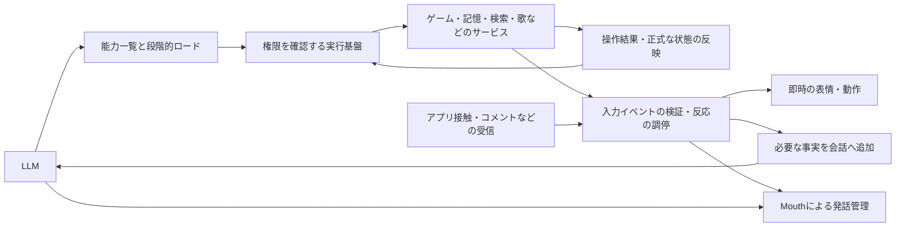

# シエルの設計方針（現在の正本）

更新：2026-11-10。設計判断の入口はこの文書です。日付付きの測定記録や過去の設計案から「最新」を推測しません。変更の手順は末尾にあります。

## 責務を分ける

シエルは会話と外部環境での活動を行うエージェントです。雑談のパイプラインにゲーム固有の計画器を継ぎ足す構成にはしません。

| 層 | 決めること・持つもの |
|---|---|
| LLM | 依頼の意味、必要な能力、引数、結果を受けた判断と発話 |
| 共通実行基盤 | 話者・権限、能力の公開範囲、呼び出し、期限・取消・重複防止、入力イベントの検証と反応の調停、確認済みの結果通知 |
| ドメインサービス（MCP） | ドメインの操作・検証・状態と、観測したイベントの発行。ゲームの経路探索、製作手順、局所修復など |
| 会話・音声のホスト | LiveKit、マイク・歌声の捕捉、発話の割り込み、画面通知、信頼できる話者の確定 |

MCPは操作の契約です。全機能を別コンテナにすることは必須ではありません。同じプロセス内の会話専用サービスと、別プロセスの共有サービスを区別します。会話専用サービスをネットワーク公開するには、認証・会話の分離・信頼できる話者情報の引き渡しを別途実装します。

操作・能力ロードと、標準pipeline向けの共通イベント検証・反応調停を実装済み。実機での遅延測定と本番反映は別に確認します。

## 能力を段階的に公開する

最初にサービスの短いID・概要だけを渡します。必要なサービスを `load_capabilities` で選ぶと、そのサービスの道具のスキーマと使い方を次の推論から渡します。複数サービスを同時選択できます。読み込んだことは実行権限を与えません。話者・コメントの権限と接続状態を呼び出し時にも確認します。

短いIDが必ず1トークンになるとは限りません。サービス、カテゴリ、道具を毎回別の推論で選ばせず、まずサービス選択だけを導入します。階層を増やすのは測定で必要と分かった場合です。直近のサービスは保持数を制限して再利用します。停止・状態確認は探索不要です。

本文の指示も道具と一緒に段階的に渡します。ただし人物像、話者確認、保存同意、公開範囲、割り込みなどの安全上必要な指示は常時保持します。一般の雑談にサービス選択の推論を追加しません。既存のゲーム受付は一度判断した依頼を再実行しません。

大きい結果は要約・出典・参照IDで受け取り、必要な範囲だけ再取得します。保持期限・サイズ制限と切り詰めを明示し、全文を履歴へ積み続けません。

## 基盤からも同じサービスを使う

利用者の依頼と自発的な処理は、同じドメインサービスを呼びます。検索、メモ整理・関係性・好みの更新、画像説明、配信データの取得には、基盤から呼ぶMCP境界も設けます。処理のたびにLLMの選択を増やしません。

LLMに公開する操作と、基盤専用の操作を分けます。対象人物、画像参照、資格情報、接続先は信頼できるホストが確定します。発話、割り込み、話者識別、音声・画像の受信、コメントへの返答判断は会話ホストの責務です。現在の分担と制約は[サービス境界の仕様](service-boundaries-ja.md)を参照します。

## サービスからの入力とリアクション

操作の依頼・結果と、非同期の入力イベントを両方扱います。接触・被ダメージ・コメント・歌の変化は、道具の読み込みとは独立に受信します。基盤が接続元・期限・重要度・権限を確認し、即時の表情・動作、会話への補足、発話へ振り分けます。反応の分類のためにLLM推論を追加しません。

痛がる表情などの即時反応はLLMや共有GPUを待たず、自然な発話はLLMとMouthが担当します。作業の正式な状態反映と、発話通知の順番・有効期限は分けます。コメントや歌の通常変化で会話・歌を不必要に中断させず、古い通知・重複・表情の上書きを管理します。

詳細は[サービス入力とリアクション](service-events-and-reactions-ja.md)。初版の共通契約と調停を実装し、接触・ゲーム・コメント・歌・作業結果・議事録・調査・画像の入力を接続しました。現在の呼び出し用MCP接続は操作ごとに閉じるため、継続受信の接続・ワーカーは別にライフサイクル管理します。

## 記憶と本人確認

記憶の公開操作は本人の思い出の参照・保存・削除・同意などの意味単位です。SQL、任意の人物ID、任意のDB接続先をLLMの引数にしません。ホストが確定した話者と既存の保存同意・DBスコープを維持します。コメントから本人の記憶を読み書きできません。

名前の仮登録と本人確認、声の保存、会話の保存同意は別です。記憶の保存はバックグラウンド処理になることがあるため、受付と保存完了を区別します。人物像・現在の本人・必要な好みなど、会話開始や各発言に必須の取得は基盤が行います。全DB入出力をLLMの道具呼び出しに置き換えません。

## 長い作業とゲーム

ゲーム内の計画・実行・観測・局所修復はゲーム側が担当します。共通基盤は目的、制約、残り時間、作業IDと確認済み状態を扱います。[実装済みの作業契約](game-work-contract-ja.md)がプロトコルの正本です。停止後の物理的な停止も確認します。未知の状態や通信障害を成功扱いにしません。

実用的な時間内に成功できなければ理由を報告して終了・確認待ちにします。[practical-v1](minecraft-benchmark-practical-ja.md)の期限を、GPU待ちや失敗の救済のために延長しません。構成・モデル・共有負荷を揃えて改修前後を比較します。[共有GPU API](shared-llm-api-ja.md)を利用し、Minecraft実測は自宅サーバーの専用環境で行います。

## 実装と根拠の参照先

| 対象 | 正本・記録 |
|---|---|
| サービス入力とリアクション | [共通イベント・反応調停の仕様](service-events-and-reactions-ja.md)、[導入時の検証](reactions-runtime-2026-11-10-ja.md) |
| サービス処理とバックグラウンド実行 | [責務と内部操作](service-boundaries-ja.md)、[整理後の検証](service-boundaries-2026-11-10-ja.md) |
| 能力カタログと会話内MCP | [契約と実装状況](capability-runtime-ja.md)、[導入時の検証](capability-runtime-2026-11-10-ja.md) |
| ゲーム作業 | [作業契約](game-work-contract-ja.md)、[ゲームMCPの設計](game-environment-mcp-design-ja.md) |
| 会話・音声 | [現在のパイプライン](conversation-pipeline-ja.md) |
| 検証 | [回帰テスト](regression-tests-ja.md)、[ベンチマーク](minecraft-benchmark-ja.md) |
| 過去のゲーム設計・測定 | [再設計の経緯](minecraft-execution-redesign-ja.md)、[移行時の実測](minecraft-work-refactor-2026-11-09-ja.md) |

## 方針を変えるとき

1. この文書の該当する判断を書き換え、更新日を変更します。提案・実装済み・未検証を混同しません。
2. プロトコルや公開道具を変更する場合、対応する契約、送受信処理、プロンプト、画面表示、テストを同じ変更に含めます。無言の旧形式フォールバックを追加しません。
3. 判断の背景や代替案を残す必要があれば `docs/decisions/` に記録し、ここからリンクします。古い判断には後継へのリンクを付けます。
4. 日付付き測定記録は当時の証拠として保持します。現在の仕様に書き換えません。変更した正本への参照を入口と関連資料に追加します。
5. 検証したソース、モデル、構成、結果、未検証事項を作業記録に残します。本番反映は確認済みコミット単位です。設計の更新だけでは配備済みになりません。
