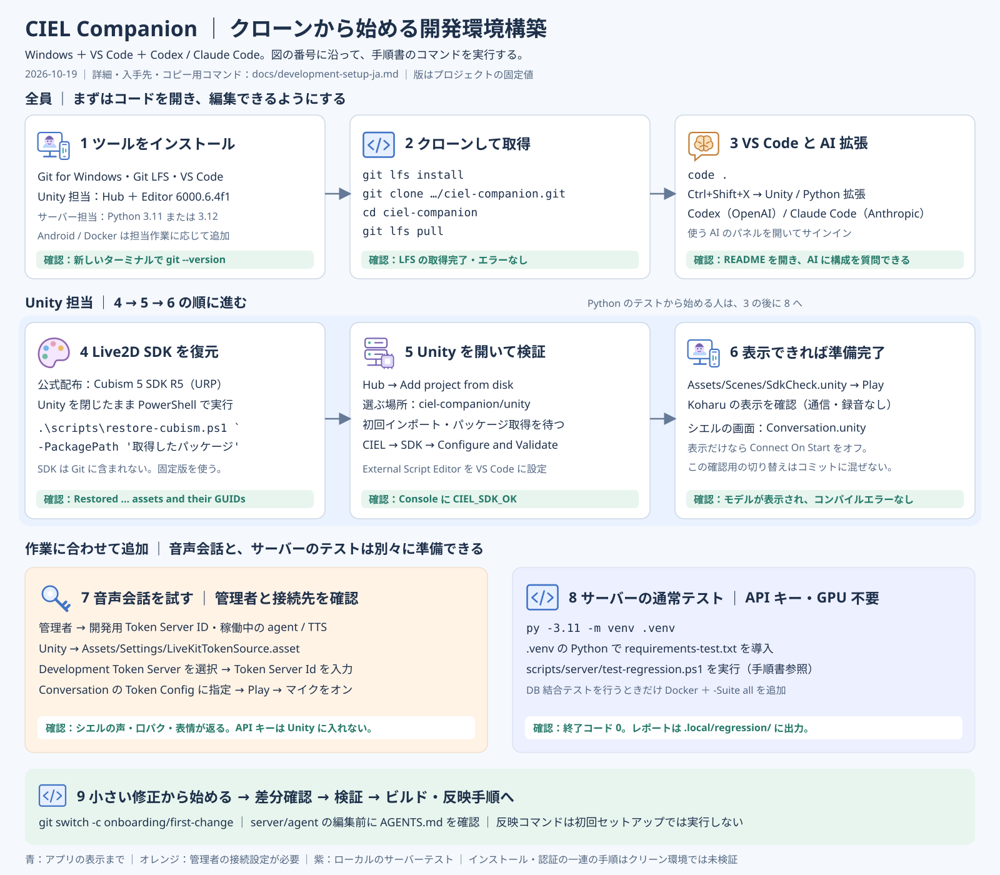

# 開発環境の構築

更新：2026-10-19（日本時間）。Windows PC と VS Code を使い、クローンから Unity の表示確認・最初の修正まで進める手順。コーディング AI は VS Code 拡張の Codex・Claude Code を使う。サーバーの通常テストは、GPU や API キーを用意せずに始められる。

[セットアップ図を開く・拡大する](development-setup-ja.svg) ／ [システム全体の構成](architecture-ja.md)



## 1 最初に入れるもの

アプリ開発は 1〜6、音声会話まで試す場合は 7 へ進む。Python のテストだけなら 1〜3 の後に 8 へ進める。

| ソフトウェア | 導入・設定 | 準備できた目印 |
|---|---|---|
| [Git for Windows](https://git-scm.com/install/windows) | Git Bash を含めてインストール。PowerShell から Git を使えるよう PATH を設定 | 新しいターミナルで `git --version` が通る |
| [Git LFS](https://git-lfs.com/) | Git for Windows に含まれていれば追加導入不要。見つからなければインストール | `git lfs version` が通る |
| [VS Code](https://code.visualstudio.com/download) | インストーラーの PATH 追加を有効にする。インストール後はターミナルを開き直す | `code --version` が通る |
| [Unity Hub](https://unity.com/download) と Unity Editor | Unity アカウントでサインインし、利用資格に合うライセンスを有効化。[アーカイブ](https://unity.com/releases/editor/archive)から **6000.6.4f1** を Hub で導入 | Hub の Installs に固定版が表示される |
| Android Build Support（Android 担当） | Hub の対象 Editor の Add modules で **Android Build Support・Android SDK & NDK Tools・OpenJDK** を追加 | Android ビルド対象が使える |
| Python **3.11 または 3.12**（サーバー担当） | [Python公式](https://www.python.org/downloads/windows/)から導入。NumPy などの固定依存に合わせ、このどちらかを使う | `py -3.11 --version` または `py -3.12 --version` が通る |
| Docker（DB 結合テスト担当） | Docker コマンドと Linux コンテナを使える環境を用意 | `docker version` で Client と Server が表示される |

この手順では Windows 上の PowerShell を使う。Unity はプロジェクトの固定版を導入し、パッケージの manifest / lock をそのまま使う。手元でのアプリ表示・通常テストに自宅サーバーと同じ GPU 環境は必要ない。

## 2 クローンして VS Code を開く

ソフトウェアを導入後、新しい PowerShell で実行する。クローン先の親フォルダーは任意。

```powershell
git lfs install
git clone https://github.com/magic-sword/ciel-companion.git
cd ciel-companion
git lfs pull
git lfs ls-files
code .
```

クローン済みなら `cd ciel-companion` 以降を実行する。リポジトリへのアクセスを求められた場合は、自分の GitHub アカウントにアクセス権を付与してもらう。LFS 取得時に権限・容量のエラーが出たら解消してから Unity を開く。

以後、指定がなければ **README.md があるリポジトリ直下**でコマンドを実行する。VS Code の Explorer に `unity/`・`server/`・`scripts/`・`docs/` が見えれば、正しいフォルダーを開けている。

## 3 VS Code とコーディング AI

`Ctrl+Shift+X` で拡張機能を開き、次を導入する。拡張 ID を検索する場合は `@id:openai.chatgpt` のように入力する。

| 拡張機能 | 発行元 / 拡張 ID | 用途 |
|---|---|---|
| [Unity](https://marketplace.visualstudio.com/items?itemName=VisualStudioToolsForUnity.vstuc) | Microsoft / `VisualStudioToolsForUnity.vstuc` | C# の補完・Unity デバッグ。依存する C# / C# Dev Kit も導入される |
| [Python](https://marketplace.visualstudio.com/items?itemName=ms-python.python) | Microsoft / `ms-python.python` | Python 編集と、8 で作る `.venv` の選択 |
| [Codex](https://developers.openai.com/codex/ide/) | OpenAI / `openai.chatgpt` | コード調査・修正・レビュー。導入後に Codex パネルを開いてサインイン |
| [Claude Code](https://code.claude.com/docs/en/vs-code) | Anthropic / `anthropic.claude-code` | コード調査・修正・レビュー。導入後に Claude Code パネルを開いてサインイン |

AI 拡張は利用できるアカウントを用意し、画面の案内に従って認証する。Codex と Claude Code は使う方から始めてよい。拡張の認証と、アプリ実行用の `OPENAI_API_KEY` は別の設定。AI 拡張のために `server/agent/.env` を作る必要はない。導入と起動は [Codex公式手順](https://developers.openai.com/codex/ide/)、[Claude Code公式手順](https://code.claude.com/docs/en/vs-code)を参照。

ここでは拡張のパネルを使う。Claude Code の単体 CLI は、統合ターミナルから `claude` コマンドも使う場合に追加する。[拡張とCLIの違い](https://code.claude.com/docs/en/vs-code#vs-code-extension-vs-claude-code-cli)

最初は README とこの手順書を開き、例えば次を頼む。

```text
README.md、docs/architecture-ja.md、docs/development-setup-ja.md を読み、
私の担当箇所の構成と、最初に確認するファイルを説明してください。
server/agent を変更する場合は、その配下の AGENTS.md も確認してください。
```

## 4 Live2D SDK を復元する

**Unity を開く前に行う。** SDK は Git 管理外なので、クローンだけでは揃わない。

1. [Live2D公式ダウンロード](https://www.live2d.com/en/sdk/download/unity/)で利用条件を確認し、**Cubism SDK for Unity 5 R5 の URP 版**を入手する。現行の復元スクリプトは、この配布物の SHA-256 に固定されている。
2. Unity が閉じていることを確認する。
3. `-PackagePath` をダウンロードした実際の `.unitypackage` のパスへ置き換えて実行する。

```powershell
.\scripts\restore-cubism.ps1 -PackagePath 'C:\path\to\CubismSdkForUnity-5-r.5.unitypackage'
```

`Restored ... Live2D assets and their GUIDs` が出れば復元済み。SDK は `unity/Assets/Live2D/` に展開され、Unity 6.6 用の互換修正が適用される。ハッシュ不一致なら、URP 版・R5 かを確認する。取得できない場合は管理者へ配布版を確認し、スクリプトのハッシュを書き換えて回避しない。

## 5 Unity を開いて SDK を確認する

1. Unity Hub の Projects → Add project from disk で **`ciel-companion/unity`** を追加し、6000.6.4f1 で開く。リポジトリ直下を Unity プロジェクトとして追加しない。
2. 最初のインポートとパッケージ取得が終わるまで待つ。LiveKit は `Packages/manifest.json` / `packages-lock.json` に従って取得される。初回はネットワーク接続が必要。
3. **CIEL → SDK → Configure and Validate** を実行する。確認シーンとローカル接続設定が生成される。
4. Console に **`CIEL_SDK_OK`** が表示され、コンパイルエラーがないことを確認する。
5. **Edit → Preferences → External Tools → External Script Editor** に **Visual Studio Code** を指定する。必要に応じて **Regenerate project files** を実行する。

Unity 側の `Visual Studio Editor` パッケージは、このリポジトリでは **2.0.26** に固定されている。VS Code の Unity 拡張との連携に使う。[Microsoft公式の連携手順](https://code.visualstudio.com/docs/other/unity)

C# の補完が出なければ、Unity から C# スクリプトをダブルクリックして `unity/` のプロジェクトを VS Code で開く。リポジトリ全体を AI に参照させるウィンドウと、Unity の C# 編集用ウィンドウを使い分けてもよい。

## 6 まず表示を確認する

1. Unity の Project ビューで **`Assets/Scenes/SdkCheck.unity`** を開く。
2. Play を押し、サンプルの **Koharu** が表示されることを確認する。ここでは接続・マイクを使わない。
3. Play を止めて **`Assets/Scenes/Conversation.unity`** を開き、Game ビューでシエルと UI の配置を確認する。

`Conversation.unity` は再生時に接続を試みる設定。接続設定のない状態でシエルの表示・タッチだけを Play で確認したい場合は、Hierarchy の **Conversation** を選び、**Ciel Conversation** コンポーネントの **Connect On Start** をオフにしてから再生する。この切り替えはローカルの確認用とし、保存・コミットするシーン差分に混ぜない。サンプル表示まで通れば、Unity 開発を始めるための基本環境は揃っている。

## 7 音声会話を試す場合

先に管理者から、**開発用の Token Server ID と利用してよい会話サーバー**を確認する。稼働している LiveKit Agents と TTS が必要で、クローンや SDK 復元だけでは会話できない。

1. Unity の **`Assets/Settings/LiveKitTokenSource.asset`** を選択する。5 のメニューで生成される、Git 管理外のファイル。
2. Inspector の **Token Source Type** を **Development Token Server** にし、**Token Server Id** に共有された ID を入力する。独自の発行 API を使う場合は、管理者の案内に従い **Endpoint** を選ぶ。
3. `Conversation.unity` の Hierarchy の **Conversation** を選択し、**Ciel Conversation → Token Config** に今のアセットをドラッグする。クローン直後は、元の参照先アセットが Git に含まれないため、参照の再設定が必要になる場合がある。
4. **Connect On Start** がオンであることを確認して Play。接続後に UI でマイク・スピーカーを確認し、マイクをオンにして話しかける。
5. シエルの声、口パク、表情が返ることを確認する。終わったら Play を止める。

アプリへ OpenAI や LiveKit の API Secret を入力しない。開発用 Token Server ID を含む接続設定とビルド済みアプリは、チーム外へ配布しない。初期設定のために **CIEL → Conversation → Create Scene** を実行する必要はない。このメニューは既存シーンを作り直す。

## 8 サーバーコードを編集・テストする場合

Python 3.11 の例。3.12 を使う場合は最初のコマンドを `py -3.12` に変更する。以下はリポジトリ直下から実行する。

```powershell
py -3.11 -m venv .venv
.\.venv\Scripts\python.exe -m pip install -r server/agent/requirements-test.txt
.\scripts\server\test-regression.ps1 -Python .\.venv\Scripts\python.exe
```

仮想環境の activate は不要。VS Code では `Ctrl+Shift+P` → **Python: Select Interpreter** で `.venv\Scripts\python.exe` を選ぶ。通常テストは外部 API をモック化し、GPU・モデル・API キーを使わない。終了コード 0 とレポートを確認する。DB 段階の `Not selected by --suite` は通常テストでは想定どおり。[結果の読み方](regression-tests-ja.md)

Docker で Linux コンテナが使える場合の DB 結合テスト：

```powershell
.\scripts\server\test-regression.ps1 -Python .\.venv\Scripts\python.exe -Suite all
```

通常テストの準備は、実際に会話サーバーを起動する環境とは別。実行用の依存は `server/agent/requirements.txt` と `Dockerfile` にあり、読み上げには GPU・モデル・参照音声が必要。

### 自宅サーバーへの反映を担当する人

初回セットアップの完了後、管理者と接続先・利用環境を合わせて [サーバーへのデプロイ](build-ja.md#サーバーへのデプロイ)へ進む。デプロイスクリプトは既存環境へ送信してコンテナを再作成するため、環境確認のコマンドとして実行しない。

| Git に含まれないもの | 確認する相手・場所 |
|---|---|
| SSH 接続先・アクセス権・自分の秘密鍵 | 管理者。決まったら `scripts/server/.env.local` に書く（見本は `scripts/server/.env.example`、書き方は [前提](build-ja.md#前提)） |
| OpenAI / LiveKit の資格情報 | 実行先の `server/agent/.env`。見本は `server/agent/.env.example` |
| DB パスワード | 実行先の `server/.env`。見本は `server/.env.example` |
| Irodori の参照音声 | 実行先の `server/tts-irodori/data/samples/*.wav`。通常のクローンでは取得されない |
| GPU・NVIDIA コンテナ環境とモデルキャッシュ | 自宅サーバー。`server/compose.yaml` と TTS の Dockerfile を参照 |

## 9 最初の修正へ進む

```powershell
git switch -c onboarding/first-change
git status --short
```

担当箇所を AI と確認し、小さい修正から始める。`server/agent/` の編集時は [AGENTS.md](../server/agent/AGENTS.md) を読む。プロンプト変更は [編集手順](../server/agent/README.md)と[管理方針](decisions/prompt-management-ja.md)に従う。実装後は差分と担当範囲の検証結果を確認し、[ビルド・反映手順](build-ja.md)へ進む。

## 困ったとき

| 症状 | 確認すること |
|---|---|
| `git` / `code` が見つからない | インストール時の PATH 設定を確認し、VS Code とターミナルを開き直す。VS Code は GUI の Open Folder でも開ける |
| PowerShell が `.ps1` を実行できない | `Get-ExecutionPolicy -List` で制限元を確認。組織管理端末は管理者に、このリポジトリのスクリプトの実行方法を確認する |
| `Live2D` がない・型が見つからない | 4 の SDK 復元を Unity を閉じて実行したか確認 |
| SDK の SHA-256 が違う | 5 R5 / URP 版かを確認。取得版が変わった場合は管理者へ相談 |
| LFS のファイルが復元されない | `git lfs pull` の認証・容量エラーを確認。通常のテキストのポインターのままでは使えない |
| Unity の赤いコンパイルエラー | 最初のエラーから確認。SDK 復元・LFS 取得・パッケージのネットワーク取得を再確認 |
| C# の補完が出ない | Unity 拡張、External Script Editor、プロジェクトファイル再生成を確認し、Unity から C# を開く |
| `Token Config` が Missing / None | 7 の手順で生成済みの `LiveKitTokenSource.asset` を指定 |
| シエルは表示されるが話せない | Token Server ID、接続状態、agent / TTS の稼働、マイクのオン・入力機器を確認 |
| Python 依存の導入に失敗 | Python 3.11 / 3.12 のどちらかか確認。通常テスト用は `requirements-test.txt` を使う |

## 参照先と確認範囲

図と手順はこのリポジトリの復元・SDK設定・会話接続・回帰テストのコードをもとに整理した。拡張機能の導入手順は上記の公式資料を 2026-10-19 に確認。新品の Windows 環境での一連のインストール、各自のアカウント認証、実際の音声接続はこの文書作成時には実行していない。
