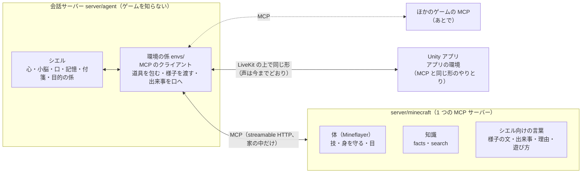

# ゲームとアプリを「環境」としてつなぐ（MCP の形にする設計）

状態：E1〜E3 を作った（2026-11-07、ブランチ `game-env-mcp`）。体の MCP の入口と、会話サーバーの `game_env.py`。試験は通ったが、本物のマイクラで一緒に遊んで確かめるのはまだ（13 章）。11 章の案は利用者が決めた（2026-11-07）。作るときに変えたことは 13 章。

今のマイクラの体（[マイクラで遊ぶ設計](minecraft-design-ja.md)）は動いているが、会話サーバーの中にマイクラのことが散らばっている。これを**ゲームの側が自分のことを全部持ち、会話サーバーは決まった形（MCP）でつなぐだけ**にする。アプリも同じ考え方で「シエルが使える道具と、シエルへの入力を出す環境」として扱う。そうすると、別のゲームを足すときに会話サーバーを直さなくてよくなる。

## 1. 何を解くか

### 1.1 今、会話サーバーに入っているマイクラのこと

| 場所 | 中身 | 困ること |
|---|---|---|
| `server/agent/minecraft.py` | 体との WebSocket、「[マイクラの様子]」の文の組み立て、出来事の選び方（`BIG_HURT`・`LOW_HEALTH`）、失敗の理由の文（`WHY_FAILED`）、次の手（`NEXT_STEP`）、技の名前・付箋の題、日本語の物の名前（`JA_NAMES`）、目的の係のマイクラ版（`Goals`：計画・実行・確かめ・直し方） | ゲームの決まりを会話サーバーが知っている。体の技を足すたびに、ここも直す |
| `server/agent/tools/minecraft.py` | 体の技を 1 つずつ道具にしたもの（`follow_me`・`collect_blocks` …）と、コメントから使ってよいか | 技と道具の二重持ち。体の `protocol.js` と形がずれる |
| `server/agent/mind.py` | 体を動かす頼みの言葉（`GAME_ASK`。「ツルハシ」「掘って」まで入っている）、`BODY_TOOLS`・`MOVING_CALLS`、遊んでいるかの判定（`playing = {'minecraft': …}`） | 別のゲームでは言葉も道具も違う。正規表現が増え続ける |
| `server/agent/config/prompts/minecraft.md` | 遊び方の指示（道具の使い方、ID の渡し方、木のツルハシは原木 3 本…） | ゲームの攻略の知識が会話サーバーのプロンプトにある |
| `server/agent/config/routes/minecraft.json` | 振り分けの例文（道具ごとのきっかけ） | 道具の名前に結びついている |
| `server/agent/eyes.py` | 絵の出どころ `minecraft`、見出し「[わたしの目で見た景色（マイクラ）]」 | ゲームごとに足すことになる |
| `server/agent/diary.py` | 日記の種類 `minecraft` | 同上 |
| `server/agent/agent.py` | 体・目的の係・振り分け・内なる考えへのつなぎを、マイクラ用に 1 つずつ書いている | ゲームを足すと、ここが倍になる |
| `server/agent/game_knowledge.py` | 知識の窓口（MCP）。道具の名前の頭（`minecraft_`）でゲームを見分ける | ここだけはもう MCP。名前の頭で見分けるのは仮の形 |
| アプリ（`CielConversation.Game.cs`） | 設定「マイクラ」のオン・オフ（`ciel.minecraft`）、`game.link`・`game.state` | ゲームの名前がアプリに入っている |

### 1.2 なぜ今こうなっているか

体（`server/minecraft`）が返すのは「機械の言葉」（`reason: 'needs_tool'`・`oak_log`）で、それを**シエルが話せる言葉**（「掘る道具が無い」「オークの原木」）に直す係が会話サーバーにしか無かった。小脳が道具を持たないので、頼みを心へ回す言葉も会話サーバーが持つしかなかった。どれも、その時に正しかった手当て。

直すのは「誰が持つか」だけ。**ゲームの言葉をシエルの言葉に直すのは、ゲームの側の仕事にする。**

## 2. 方針

| 項目 | 決めること（案） |
|---|---|
| つなぎ方 | ゲームは **MCP のサーバー**。会話サーバーは MCP のクライアント。道具・様子・遊び方の指示・出来事を、MCP の決まった形で出す |
| 会話サーバーが知ってよいこと | 「環境（ゲーム・アプリ）がある」「道具に印がある（体を動かす・読むだけ・時間がかかる）」「出来事に急ぎの度合いがある」。**ゲームの名前・技の名前・物の名前は知らない** |
| ゲームが持つこと | 技、技の確かめ、様子の文、出来事の選び方としきい値、失敗の理由の文と次の手、物の日本語の名前、遊び方の指示、振り分けの例文、目的の計画と直し方、知識（facts・search） |
| シエルが持つこと | 人格・記憶・心と小脳・口（いつ話すか）・付箋・目的の係の流れ（計画 → 実行 → 確かめ → 直す → 相談）・コメントの扱い |
| アプリ | 同じ形の「環境」にする。アプリが出せる道具（画面に出す・動きをする など）を、つないだときに会話サーバーへ知らせる。シエルの返事から、アプリで何かを起こせる |
| 足は今までどおり | 体（Mineflayer）は会話モデルを使わず、決まった技を動かす。その場でコードを書かせない |

## 3. 形



- 体と知識の窓口は、**1 つの MCP サーバーにまとめる**（今は WebSocket :8768 と MCP :8770 の 2 つ）。同じ版のデータ（minecraft-data）を使うので分ける理由が無い。
- 体は今までどおり会話とは別に動き続ける。会話が MCP でつなぎ、会話が終わったら切る（体はその場で待つ）。
- 外から入る口は増やさない。MCP のサーバーは 127.0.0.1 だけで待ち受ける。

## 4. ゲーム MCP の決まり（シエル向けの約束）

MCP のふつうの仕組みで足りるところはそのまま使い、足りないところだけ `_meta`（MCP が用意している、決まりの外の情報を載せる場所）に `ciel/` で始まる印を足す。この約束を「シエルのゲームの決まり」と呼び、版（`ciel/profile: 1`）を持たせる。

### 4.1 MCP の何を使うか

| MCP の仕組み | 使い道 | 今の何に当たるか |
|---|---|---|
| 道具（tools） | 技（ついていく・集める・作る・探す・渡す・掘る・止まる）、目（景色を見る）、知識（facts・search）、目的の計画と直し方 | `tools/minecraft.py`、`protocol.js` の `SKILLS`、知識の窓口 |
| 道具の注記（annotations） | `readOnlyHint`（読むだけ）・`destructiveHint`（壊す）。読むだけの道具はコメントからも使ってよい、の判断に使う | `FROM_COMMENTS`、`MOVING_CALLS` |
| 道具の返事の形（structuredContent） | `ok`・`reason`・`why`・`next`・`gained` などを決まった形で返す | `refused()`、`reasons()` |
| 絵の返事（ImageContent） | 景色の絵を道具の返事で返す | `look` → `seen` の base64 |
| 様子（resources） | `game://state`：シエルが読む文（日本語）と、目的の係が使う値。変わったら知らせ（`notifications/resources/updated`） | `Body.context()`、2 秒ごとの `state` |
| 遊び方の指示（prompts） | `play`：遊ぶあいだ心に渡す指示 | `config/prompts/minecraft.md` |
| 出来事の知らせ（notifications） | 倒れた・ダメージ・技が終わった など。MCP のふつうの知らせ `notifications/message`（ログ）に、logger `ciel.event` で載せる（13 章の 1） | `on_event`・`on_done` |
| 長い技（tasks） | 集める（数十秒）のように時間がかかる技。始めたらすぐ返し、終わったら知らせる | `do` → `started` → `done` |
| 持ち主に聞く（elicitation） | ゲームの側から「どちらにしますか」と聞きたいとき（あとで） | まだ無い |

### 4.2 道具の印（`_meta`）

```json
{
  "name": "collect",
  "title": "集める",
  "description": "見えている近くのブロックを掘って集める。block は英語の ID か呼び名（log・stone・coal など）",
  "inputSchema": {"type": "object", "properties": {"block": {"type": "string"}, "count": {"type": "integer", "minimum": 1, "maximum": 64}}, "required": ["block"]},
  "annotations": {"readOnlyHint": false, "destructiveHint": true},
  "_meta": {
    "ciel/role": "act",
    "ciel/long_running": true,
    "ciel/from_comments": false,
    "ciel/triggers": ["原木を集めてくれる？", "石を掘って丸石を集めて", "その辺の花を摘んできて"]
  }
}
```

| 印 | 意味 | 今の何に当たるか |
|---|---|---|
| `ciel/role` | `act`（体を動かす）・`look`（見る）・`know`（調べる）・`goal`（目的の計画・直し方。心には渡さない） | `BODY_TOOLS`・`MOVING_CALLS`・`GAME_CALLS` |
| `ciel/long_running` | 時間がかかる。付箋にして、終わりは出来事で届く | `Body.do` の付箋 |
| `ciel/from_comments` | 配信のコメントへの返事で使ってよいか。無ければ `readOnlyHint` で決める | `FROM_COMMENTS` |
| `ciel/triggers` | 振り分けの例文（その道具を呼ぶきっかけ）。2 段目の意味の近さで使う | `config/routes/minecraft.json` |

道具の名前は、**ゲームの側が自分の名前で始める**（`minecraft_collect_blocks`）。会話サーバーは名前を付け替えず、ゲームの名前で始まらない道具は使わない（ほかのゲームとぶつからないように）。遊び方の指示（prompt）の中の道具の名前と、そのまま合う（13 章の 2）。

1 段目の決まった言葉（以前の `GAME_ASK`）も、ゲームが決まりの resource（`game://profile`）の `route_words`（「ついてきて」「掘って」…の正規表現）として出す。会話サーバーは中身を知らずに使う。短い頼みを小脳に取られない、という今の働きは残す。

### 4.3 様子（`game://state`）

```json
{
  "text": "シエル：体力 18/20・空腹 15/20・持ち物 オークの原木×4、丸石×2・していること なし\n時刻：昼\n近く：magic_sword（持ち主） 3 ブロック、ゾンビ 12 ブロック\n足元：草ブロック",
  "label": "マイクラ",
  "playing": true,
  "fingerprint": "12,64,-30|oak_log:4,cobblestone:2"
}
```

- `text` は**ゲームが作る、シエルが読む文**。会話サーバーは「[マイクラの様子]」（見出しは `label` から）として心・小脳・内なる考えに渡すだけ。
- `playing`：今そのゲームの中にいるか。道具を渡すか・目的の係を動かすか・内なる考えで体を使うかは、これで決める（今の `body.linked and state.connected`）。
- `fingerprint`：目的の係が「小さな目標の前後で何か変わったか」を見る値。中身は会話サーバーは読まない（今の `Goals.snapshot`）。

### 4.4 出来事（`notifications/message`、logger `ciel.event`）

```json
{"game": "minecraft", "kind": "hurt", "urgency": "urgent", "key": "hurt",
 "say": "6 のダメージを受けた（体力 5/20）", "memorable": null}
```

| 項目 | 意味 |
|---|---|
| `urgency` | `urgent`（会話の途中でも、すぐの切れ目で短く）・`normal`（相手がだまったら）・`ambient`（様子に入るだけ。言わない） |
| `key` | 同じ種類の知らせを間引く鍵（30 秒に 1 回は会話サーバーの決まり） |
| `say` | 心へ渡す一文。**どれを言うか・しきい値（4 以上のダメージ）・文はゲームが決める** |
| `memorable` | 日記に残す一文（「マイクラでゾンビを倒した」）。null なら残さない |
| `task` | 長い技の終わりなら、その技の id と結果（4.5） |

会話サーバーの決まりは「急ぎの度合いで、いつ口に渡すか」と「間引き」だけになる。今の `on_event` の場合分けは、全部ゲームの側へ移る。

### 4.5 道具の返事と、長い技の終わり

```json
{"ok": false, "reason": "needs_tool", "title": "丸石を 3 個集める",
 "why": "掘る道具が無い（要る道具：wooden_pickaxe 以上）",
 "next": "start_goal で目的にすると、道具を作る段から係が進める",
 "gained": {"cobblestone": 0}, "short": false}
```

- `why`・`next` はゲームが書く（今の `WHY_FAILED`・`NEXT_STEP`・`reasons()`）。会話サーバーは中身を見ずに心へ渡す。
- `reason` は機械が見る短い言葉。会話サーバーが中身を見るのは、ゲームによらない少しだけ（`stopped`・`replaced`・`unlinked`：止められただけなので言わない、など）。この一覧もゲームが `ciel/quiet: true` で示せるようにする。
- 同じ頼みが何回目の失敗かは、会話サーバーが `title` で数える（ゲームによらない）。

### 4.6 目的の計画と直し方

目的の係（`goals.py`）はもうゲームを知らない作りなので、その「ゲームの係」を MCP の道具で出す。今の `minecraft.Goals` は丸ごとゲームの側へ移り、会話サーバーには 1 つの汎用の係（`envs/goals_adapter.py`）だけが残る。

| 目的の係が呼ぶ | MCP の道具（`ciel/role: goal`） | 返すもの |
|---|---|---|
| `plan(goal)` | `goal_plan {spec}` | 段の一覧 `[{label, tool, args, progress}]`。段は**そのゲームの道具と引数そのもの** |
| `run(goal, step)` | 段の `tool` を `args` で呼ぶ（長い技なら終わりまで待つ） | 4.5 の返事 |
| `check(goal, step, result)` | 返事の `progress`・`complete` を見る | 会話サーバーは数の意味を知らない |
| `repair(goal, step, result)` | `goal_repair {spec, step, result, remaining}` | 直した段の一覧と、直した理由の一文。直せなければ null（心に相談） |
| `snapshot()` | 様子の `fingerprint` | — |

`start_goal` の引数（今は `make_item`）も、`goal_plan` の `inputSchema` から作る。ゲームによって「作る」「建てる」「着く」など目的の形が違ってよい。

### 4.7 遊び方の指示と知識

- `config/prompts/minecraft.md` の中身は、ゲームの側の prompt `play` へ移す。会話サーバーは遊んでいるあいだ、これを心への指示の後ろに足すだけ。
- ただし**シエルらしさに関わる行**（「シエルは自分で考えて動くプレイヤー」「できなかったことをごまかさない」「シエルの体験として、その場の気持ちで 1〜2 文で言う」）は、どのゲームでも同じなので、会話サーバーの `config/prompts/game.md`（新規）に残す。ゲームの prompt は攻略と道具の使い方だけにする。
- 知識（`minecraft_facts`・`minecraft_search`）は、同じサーバーの `ciel/role: know` の道具になる。

### 4.8 目

`look` は ImageContent で絵を返す。会話サーバーは `eyes.see(data, source='game', label=…)` に渡す。見出しは「[わたしの目で見た景色（{label}）]」。`eyes.py` の `MINECRAFT` は `GAME` に変える。

### 4.9 体を動かせる会話は 1 つ

今と同じく、体を動かせる会話は 1 つだけ。会話サーバーは会話の始めに MCP でつなぎ、決まり・道具・指示を読む。体を受け持つのは、アプリの設定がオンになってから、決まりの `link_tool`（`minecraft_link {on}`。`ciel/role: link` で心には渡さない）を呼んだとき。ほかの会話が受け持っていれば `busy`。受け持っていない会話でも、知識（`know`）の道具は使える。受け持っている会話から 60 秒何も届かなければ、体の側が離れたことにする（会話サーバーは 20 秒ごとに ping を送る）。

## 5. 会話サーバーの側

### 5.1 足すもの

| 部品 | 中身 |
|---|---|
| `game_env.py` の `GameEnv` | 1 つのゲーム MCP へつなぐ係（公式の `mcp` の Python SDK の ClientSession）。道具の一覧を LiveKit の道具に包む（`raw_schema` の function_tool）、様子を持つ、出来事を口へ渡す、長い技を付箋にする。つなぐ先は `CIEL_GAMES`（例 `minecraft=http://127.0.0.1:8771/mcp`）。今の `CIEL_MINECRAFT_URL` と `CIEL_GAME_KNOWLEDGE` は 1 つにまとまった |
| `game_env.py` の `GoalsAdapter` | 4.6 の汎用の係 |
| `config/prompts/game.md` | どのゲームでも同じ、シエルとして遊ぶときの振る舞い（4.7） |

LiveKit の `mcp_servers`（今の `game_knowledge.servers()`）は道具しか扱わないので、様子・出来事・prompt・長い技のために、会話サーバーが自分で MCP のクライアントを持つ。道具を包む作りは、LiveKit の `MCPServerHTTP` と同じ考え方でよい。

### 5.2 なくすもの

- `minecraft.py`・`tools/minecraft.py`・`game_knowledge.py`（中身はゲームの側へ移るか、`envs/` の汎用の作りになる）
- `mind.py` の `GAME_ASK`・`BODY_TOOLS`・`GAME_CALLS`・`MOVING_CALLS`・`playing = {'minecraft': …}`（道具の印と様子の `playing`・`ciel/route_words` から決める）
- `config/prompts/minecraft.md`・`config/routes/minecraft.json`（ゲームの側へ）
- `agent.py` のマイクラ用のつなぎ（環境ごとに同じ書き方の繰り返しになる）

### 5.3 残すもの（ゲームによらないので）

- `PROMISE`（小脳が「渡しますね」と約束だけしたら心が続きをする）。シエル自身の言い方なので、ゲームによらない。
- 2 段目の意味の振り分け（`router.py`）。例文の出どころがゲームの `ciel/triggers` になるだけ。育った例文の DB（`route_examples` の `game` 列）もそのまま使える。
- 付箋（`board.py`）・口の why `game`・内なる考えの `act`・目的の係の流れ。

### 5.4 確かめ方（ゲームを知らないことの確かめ）

- `tests/` に**試験用の小さなゲーム**（MCP のサーバーを Python で 100 行ほど）を置き、マイクラ無しで「道具が渡る・様子が届く・出来事を言う・長い技の付箋・目的の計画と直し方・busy」を確かめる。
- `server/agent` の Python に `minecraft` の文字が無いこと（設定の例と文書を除く）を試験で確かめる。

## 6. アプリも「環境」にする

### 6.1 2 つの種類を分ける

アプリとのやりとりは、今 20 種類ほどの topic とメッセージがある（[システムの構成](architecture-ja.md) の「データのメッセージ」）。これを全部「シエルが呼ぶ道具」にはしない。

| 種類 | 例 | 誰が動かすか |
|---|---|---|
| **表示**（コードが送る） | 声に合わせた表情（`character.expression`）、付箋・目的・議事録・調査の状態、接続の問題 | 会話サーバーのコード。**会話モデルは通さない**（遅れと料金が増えるため。今のまま） |
| **アプリの道具**（シエルが選んで呼ぶ） | 画面にカードを出す、背景を変える、Live2D の動き（うなずく・手を振る）を出す、パネルを開く、リンクを開く（案） | 心。返事の中で「見せたい」「やってみせたい」ときに呼ぶ |
| **アプリからの入力** | タッチ、会話のしかた、音量、画像、ゲームのオン・オフ、目的の止める・続ける | アプリ。会話サーバーは MCP の知らせ（notifications）と同じ形で受ける |

### 6.2 アプリの道具の出し方

つないだとき、アプリが自分の出せる道具を知らせる（MCP の `tools/list` と同じ形）。アプリの版ごとに出せるものが違ってよい（古いアプリは出さないだけ）。

```json
{"jsonrpc": "2.0", "method": "notifications/ciel/app_hello",
 "params": {"app": "ciel-companion", "version": "0.9", "tools": [
   {"name": "show_card", "description": "画面に短いカード（題・本文・画像・リンク）を出す",
    "inputSchema": {"type": "object", "properties": {"title": {"type": "string"}, "body": {"type": "string"}}},
    "_meta": {"ciel/role": "show", "ciel/from_comments": false}},
   {"name": "play_motion", "description": "シエルの体の動き（nod・wave・tilt）",
    "inputSchema": {"type": "object", "properties": {"motion": {"enum": ["nod", "wave", "tilt"]}}}}
 ]}}
```

会話サーバーは、ゲームの道具と同じ包み方で `app_show_card` のように心へ渡す。呼ばれたら `tools/call` をアプリへ送り、アプリが結果を返す。

### 6.3 通り道

アプリに本物の MCP のサーバーを入れる必要は無い。**やりとりの形（JSON-RPC 2.0 の `tools/list`・`tools/call`・notifications）だけを MCP にそろえ、LiveKit の上を通す。** 答えを待つ呼び出しは LiveKit の RPC（会話サーバーの Python からは `perform_rpc`）が向いている。Unity の LiveKit SDK 2.1.0 で RPC が使えるかは確かめていない。使えなければ、今と同じデータのメッセージに id を付けて返事を待つ（11 章の 2）。

### 6.4 ゲームの選び方

設定の「マイクラ」スイッチ（`ciel.minecraft`）は、「一緒に遊ぶゲーム」の選択にする。会話サーバーが、つなげるゲームの一覧（MCP の serverInfo の名前と `label`）を `env.list` で送り、アプリはそれを並べるだけ。`game.link`・`game.state` は `env.link {game, on}`・`env.state {game, linked, playing, reason}` に変える。アプリからゲームの名前が消える。

### 6.5 移す順

全部を一度に変えない。今動いている表示（表情・議事録・調査・歌…）はそのまま残し、まず (1) ゲームのオン・オフと状態、(2) 新しいアプリの道具（カード・動き）から、この形にする。ほかの topic は、触るついでに移す。

## 7. ほかのゲームを足すとき

ゲームの側で作るもの：

1. MCP のサーバー（streamable HTTP、127.0.0.1）。名前と `label`（「マイクラ」）。
2. 技の道具（`ciel/role: act`）。引数を必ず確かめ、一覧に無いものは動かさない。
3. 様子の resource（`text`・`playing`・`fingerprint`・`ciel/route_words`）。
4. 出来事の知らせ（`urgency`・`say`・`memorable`）。
5. prompt `play`（攻略と道具の使い方）。
6. あれば：目（`look`）、知識（`know`）、目的の計画と直し方（`goal_plan`・`goal_repair`）。

会話サーバーは、`CIEL_GAMES` に 1 行足すだけ。目的の係が無いゲームなら、目的の道具は渡さない。体が無い「見るだけ」のゲーム（配信の画面を見て話すだけ、など）も、`act` を出さなければ同じ作りで扱える。

YouTube のコメントの取り込みも、同じ「環境」の形にできる（入力だけを出す環境。[マイクラで遊ぶ設計](minecraft-design-ja.md) の 7 章の共通の受け口）。これはあとで考える。

## 8. 安全

- ゲームの MCP は自分たちで書いたコードなので信用する。ただし**様子や出来事の文の中に、ほかのプレイヤーのチャットが入るときは、その部分に `trust: anyone` を付ける**。会話サーバーは今のコメントと同じく、信用できない入力として扱う。
- 体を動かす道具（`act`）は、コメントへの返事には渡さない（`ciel/from_comments` が無ければ `false`）。読むだけ（`readOnlyHint`）の知識はよい。
- 技の引数の確かめは、今の `protocol.js` と同じく体の側で必ずする（会話サーバーの確かめに頼らない）。
- アプリの道具も同じ。アプリは受けた `tools/call` の名前と引数を確かめ、知らない道具は動かさない。リンクを開くような道具は、出すなら持ち主が押してから開く。

## 9. 遅れと料金

- 会話モデルの呼び出しは増えない。MCP は家の中の HTTP なので、1 回数ミリ秒。
- 心に渡す道具の数は今と同じ（マイクラで 11 ＋ 目的 6 ＋ 知識 2）。道具の説明がゲームから来るだけ。
- 遊び方の指示（prompt）は遊んでいるあいだだけ足す。今と同じ。
- 試験は、試験用の小さなゲームで会話モデルを使わずに確かめる。会話モデルを使う試験（`bench_*`）は、振り分けを変える 4 の段だけ。回す前に料金を見積もる。

## 10. 進め方

各段で、今の遊び方が変わらないことを確かめてから次へ進む。合否は**一緒に遊んで今と同じように自然に動くか**を人が見て決める（数値だけで良いとしない）。

| 段 | 中身 | 確かめ方 |
|---|---|---|
| E1 決まり | この文書の 4 章を `docs/` の決まりとして固める。試験用の小さなゲームを書く | 試験用のゲームで道具・様子・出来事が往復する |
| E2 ゲームの側 | `server/minecraft` に MCP の入口を作る（体と知識を 1 つに）。今の WebSocket は残す。`WHY_FAILED`・`JA_NAMES`・出来事の選び方・`Goals`・遊び方の指示を JavaScript へ移す | 体の試験（`npm test`）。Ciel_Debug で MCP から技を呼ぶ |
| E3 会話の側 | `envs/` を作り、`minecraft.py`・`tools/minecraft.py` を置き換える。目的の係を汎用の係につなぐ | Python の試験。開発用の会話サーバーで「ついてきて」「石のツルハシを作って」「何が見える？」 |
| E4 振り分け | `GAME_ASK` と例文を、ゲームの `ciel/route_words`・`ciel/triggers` からにする | 決まった言葉の試験。料金を見積もってから `bench_compare` |
| E5 アプリ | `env.list`・`env.link`・`env.state`。アプリの道具（カード・動き）を 1〜2 個 | Windows と Android で、スイッチ・表示・道具 |
| E6 片づけ | WebSocket の入口と古い topic（`ciel.game`）を消す。`CIEL_MINECRAFT_URL`・`CIEL_GAME_KNOWLEDGE` を `CIEL_GAMES` に。`minecraft-design-ja.md` を直す | `server/agent` に `minecraft` の文字が無い |

## 11. 決めてほしいこと

| 項目 | 案 | ほかの手 |
|---|---|---|
| 1. 出来事の届け方 | **MCP の知らせを 1 つ足す（`notifications/ciel/event`）**。1 回で届き、急ぎの知らせが遅れない | MCP のふつうの仕組みだけで、出来事の resource を購読し、変わったら読み直す。決まりの外のものは無いが、毎回 2 往復になる |
| 2. アプリとの通り道 | **LiveKit の RPC**（返事を待てる）。Unity の SDK で使えなければデータのメッセージに id を付ける | 全部データのメッセージのまま |
| 3. 体と知識の窓口 | **1 つの MCP サーバーにまとめる** | 分けたまま（知識だけ先に入れ直せる） |
| 4. シエルらしさの指示 | **どのゲームでも同じ行は会話サーバーの `game.md`、攻略はゲームの `play`** | 全部ゲームの側（ゲームごとにシエルの振る舞いが変わりうる） |
| 5. アプリの道具 | まずカードと Live2D の動きの 2 つ | 背景・パネル・リンクも最初から |

## 12. 参考

- MCP の仕様（道具・resource・prompt・知らせ・`_meta`）：https://modelcontextprotocol.io/specification
- MCP の Python SDK（会話サーバーのクライアント）：https://github.com/modelcontextprotocol/python-sdk
- MCP の TypeScript SDK（`server/minecraft` で使っている）：https://github.com/modelcontextprotocol/typescript-sdk
- LiveKit の RPC：https://docs.livekit.io/home/client/data/rpc/
- 今の作り：[マイクラで遊ぶ設計](minecraft-design-ja.md)、[ゲームの知識](game-knowledge-design-ja.md)、[長い目的をやり遂げる](goal-runner-design-ja.md)、[会話の組み立て（pipeline）](conversation-pipeline-ja.md)

## 13. 作ったもの（2026-11-07）

### 13.1 体の側（`server/minecraft`）

| ファイル | 中身 |
|---|---|
| `src/ciel/words.js` | シエル向けの言葉（以前の `minecraft.py` から）：失敗の理由の文・次の手・日本語の物の名前・付箋の題・様子の文・出来事の選び方としきい値・技の終わりの知らせ |
| `src/ciel/goals.js` | 目的の係のマイクラの係（以前の `minecraft.Goals`）：段の作り方・段の結果（`complete`・`progress`）・決まった直し方 |
| `src/ciel/link.js` | 体と MCP のあいだのつなぎ役（以前の `minecraft.Body`）。体から見ると WebSocket の会話と同じ相手。命令は今までどおり `protocol.js` で形を確かめる |
| `src/ciel/hub.js` | 体の受け持ち（WebSocket の会話と合わせて 1 つだけ） |
| `src/ciel/mcp.js` | MCP の入口（:8771、127.0.0.1 だけ）。道具 13 個（体 9・見る 2・知識 2）と、目的の係の道具 3 個、受け持ちの道具、`game://state`・`game://profile`、prompt `play` |
| `src/ciel/play.md`・`routes.json` | 遊び方の指示（以前の `config/prompts/minecraft.md` の攻略の部分）と、振り分けの例文（以前の `config/routes/minecraft.json`） |
| `test/ciel.test.js` | MCP を本物の HTTP でつないで確かめる（体はにせもの） |

以前の WebSocket（:8768）と、知識だけの窓口（:8770）は、移り終えるまで残している（E6 で消す）。

### 13.2 会話サーバーの側（`server/agent`）

- 足した：`game_env.py`、`config/prompts/game.md`（どのゲームでも同じシエルの振る舞い）、`tests/fake_game.py`（試験用の小さなゲーム）、`tests/test_game_env.py`。
- 消した：`minecraft.py`・`tools/minecraft.py`・`game_knowledge.py`・`config/prompts/minecraft.md`・`config/routes/minecraft.json`。
- 変えた：`mind.py`（頼みの言葉と道具の役目をゲームの決まりから）、`agent.py`（会話の始めにゲームへつなぎ、道具と指示を決める）、`router.py`（最初の例文をゲームから）、`eyes.py`（絵の出どころを `game` に）、`tools/__init__.py`（コメントから使ってよいかをゲームの `ciel/from_comments` から）。
- 会話サーバーのコードにゲームの名前が無いことを試験で確かめる（`tests/test_game_env.py` の `NoGameNamesTest`）。

### 13.3 作るときに変えたこと

1. **出来事は `notifications/message`（ログ）で送る。** 決まりの外の知らせ（`notifications/ciel/event`）は、会話サーバーの MCP の Python の SDK（1.30.0）が形を確かめられずに捨てる（`Failed to validate notification`）。ログの知らせはどの MCP のクライアントでも受けられ、`data` に好きな JSON を載せられる。
2. **道具の名前の頭はゲームが付ける**（4.2）。遊び方の指示の中の道具の名前とそのまま合わせるため。育った振り分けの例文（DB の `route_examples`）の道具の名前は、前の名前（`give_item`）のまま残る。心へ回すかの判断には効くが、「体を動かす頼みか」の見分け（回しすぎを直す）には、新しい名前で育った例文から効き始める。
3. **体の受け持ちは専用の道具**（4.9）。会話サーバーの決まり（指示と道具は会話の始めに決め、会話の中で変えない）に合わせ、つなぐのは会話の始め、体を受け持つのはアプリの設定がオンになってからにした。
4. **MCP の部品は会話サーバーが読み込まれたときに読む。** この Windows では初めての読み込みに 2.7 秒ほどかかり、会話の始めの待ち時間（4 秒）を超えた。

### 13.4 確かめたこと・まだのこと

- 確かめた：体の側の試験 53 件（52 合格・1 件は前からの飛ばす設定）、会話サーバーの試験 490 件（全部合格）。本物の Node の MCP の入口（体だけにせもの）に本物の `GameEnv` を HTTP でつなぎ、受け持ち・様子・技の始まりと終わりの知らせ・付箋・景色の絵・目的の計画・様子の更新・離すまでが通った。
- まだ：**本物のマイクラで一緒に遊ぶこと**（声で「ついてきて」「石のツルハシを作って」「何が見える？」、倒れた・ダメージの知らせ、アプリのスイッチ）。合否は、今と同じように自然に動くかを人が見て決める。指示を 2 つ（`game.md` と `play.md`）に分けたので、代表的な会話で前後を比べることもまだ。
- 残り：E4 の振り分けは、例文と頼みの言葉をゲームから読むところまで作った（`bench_compare` は回していない）。E5 アプリ（`env.list` など。アプリは今の `ciel.game` のまま動く）、E6 片づけ。ゲームは今は最初の 1 つだけつなぐ。`start_goal` の引数は `make_item` のまま（ゲームの `goal_plan` の形から作るのはあとで）。
