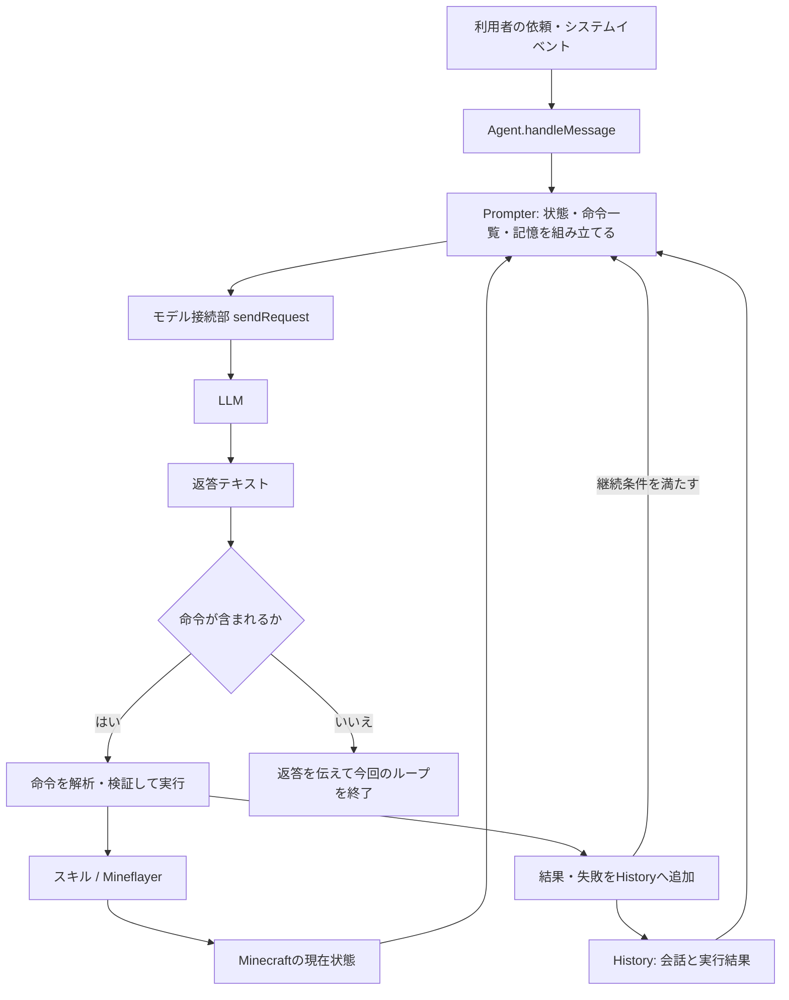
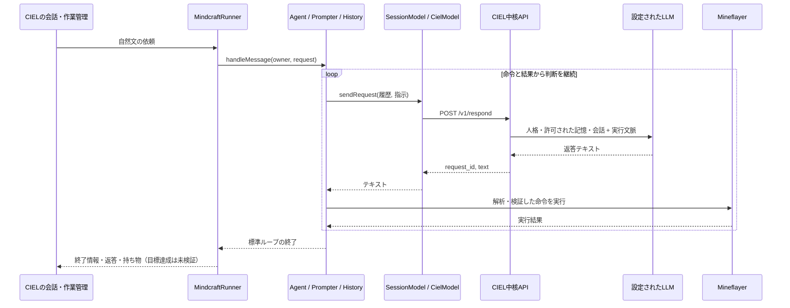

# MindcraftのLLM通信と推論・行動ループ

> 責務：固定版Mindcraftのモデル通信、観測・履歴・命令実行・継続判断の仕組みと、CIELへの接続点をコードから説明する。

Mindcraftは、Minecraftの状態を文章にしてLLMへ送り、返答に含まれる命令をMineflayerで実行し、その結果を次の判断へ戻すプログラムである。LLMが「次に何をするか」を選び、移動経路や採掘操作などの細部はJavaScriptの実行部が担当する。

本書の「推論ループ」は、アプリケーションがLLMを繰り返し呼ぶ制御のことを指す。モデル内部の思考過程そのものを観測した説明ではない。

## 説明の根拠と対象版

上流の[README](https://github.com/mindcraft-bots/mindcraft/blob/develop/README.md)には導入、モデル設定、タスクの説明とブログ・論文へのリンクがあり、[FAQ](https://github.com/mindcraft-bots/mindcraft/blob/develop/FAQ.md)には接続・実行時の問題への案内がある。「上流に説明が一切ない」とは扱わず、本書ではこのリポジトリで使う版の実装を追える形に整理する。

対象は[provenance.json](../../../server/minecraft/src/vendor/mindcraft/provenance.json)が記録する上流コミット `e1c1fc3ffa481506c2445fc639e16dba504b5920` と、CIEL fork `63014c0bd487b1df0829a94554e29fe3c7ef21a8`。上流の移動するdevelopブランチと同一とは限らない。以下のソースリンクはリポジトリ内の固定版を指す。forkによる変更ファイルもprovenanceに列挙されている。

CIELの構成・操作範囲は[Minecraftサービス](minecraft-design-ja.md)、依頼の受付・期限・取消・終了状態は[作業契約](../game-work-contract-ja.md)が正本。本書はコード読解であり、新しい実機試験や本番反映の証明ではない。

## 全体像



たとえば `!collectBlocks("oak_log", 4)` は「オークの原木を4個集める」という高水準の指示である。LLMが一歩ごとの移動やマウス操作を出すのではなく、既存のスキルが探索・移動・採掘を進める。

## LLMに何を送るのか

[Prompter](../../../server/minecraft/src/vendor/mindcraft/src/models/prompter.js)は、基本設定、用途別プロフィール、個別プロフィールの順に設定を重ねる。個別指定が優先される。通常会話のテンプレートは[既定プロフィール](../../../server/minecraft/src/vendor/mindcraft/profiles/defaults/_default.json)の `conversing` にある。

`promptConvo(history)`は、テンプレートの変数を現在の値で置き換え、`chat_model.sendRequest(messages, prompt)`を呼ぶ。

| 入力 | 中身と取得方法 |
|---|---|
| 基本指示 | Botの名前、応答の仕方、行動には命令を使うことなど。 |
| `$STATS` | `!stats`、`!entities`、`!nearbyBlocks`の実装を呼んで、状態・周囲の存在・ブロックを文章化する。 |
| `$INVENTORY` | `!inventory`の実装から得る持ち物。 |
| `$COMMAND_DOCS` | 利用できる命令の名前・説明・引数。禁止された命令を除く。 |
| `$MEMORY` | 過去の履歴を短く要約した文章。 |
| `$SELF_PROMPT` | 継続目標がある場合、その目標文。 |
| `$EXAMPLES` | プロフィールにある会話例から選ばれた例。 |
| `messages` | 利用者の依頼、Botの返答、命令の結果などの直近の履歴。 |

テンプレートが参照する項目だけを展開する。状態取得のためのこれらの関数呼び出しに、LLMが毎回 `!stats` 等を出す必要はない。通常は画像ではなく、ゲームのデータを文章化した観測で判断する。画像理解は別の `promptVision` 経路で、固定版設定の `allow_vision` は既定でfalse。

## どのようにLLMと通信するのか

モデル接続は[モデル選択部](../../../server/minecraft/src/vendor/mindcraft/src/models/_model_map.js)と各プロバイダーのクラスへ分離されている。Agentは共通の `sendRequest` を使い、具体的なSDK・送信形式は接続部が扱う。チャット用・コード用・画像用・埋め込み用のモデルを分ける設定があり、コード用と画像用は未指定ならチャット用を共用する。埋め込みは例やスキル文書の選択に使う補助処理で、行動の判断そのものではない。

固定版の[GPT接続部](../../../server/minecraft/src/vendor/mindcraft/src/models/gpt.js)では、次のように分岐する。

| 接続設定 | 呼び出し | 主な入力と返答 |
|---|---|---|
| カスタムURLなし | `openai.responses.create(...)` | `instructions`に組み立てた指示、`input`に整形した履歴。`output_text`を返す。 |
| カスタムURLあり | `openai.chat.completions.create(...)` | 指示と履歴を`messages`へ入れて整形する。`choices[0].message.content`を返す。 |

SDKにはAPIキー、必要ならbase URLやモデル別パラメーターを渡す。別のプロバイダーはそれぞれの接続部で形式を変換するため、「Mindcraftは必ずChat Completionsだけを使う」とは言えない。

内部の履歴形式と実際の送信形式も区別する。[strictFormat](../../../server/minecraft/src/vendor/mindcraft/src/utils/text.js)は、systemの履歴を `SYSTEM:` 付きuser文へ変換し、連続する同一roleを調整する。GPT接続部のカスタムURL経路では、先頭に加えた指示もこの整形を通る。

通常の命令経路では、モデルAPIの `tools` / `tool_calls` を渡してMinecraft操作を呼ぶ仕組みではなく、**モデルの返答テキストに埋め込まれた `!命令` をMindcraftが解析する**。この境界は、外側のCIELが使うMCPとは別である。

## 一回の依頼で回る判断ループ

中心は[Agent.handleMessage](../../../server/minecraft/src/vendor/mindcraft/src/agent/agent.js)。自然文を受け取った場合、おおむね次の順に動く。

1. 直近の自動行動ログと依頼をHistoryへ加える。
2. 履歴を取り出し、現在状態を含むプロンプトを組み立ててLLMへ送る。
3. 空の返答なら今回のループを終える。
4. 返答に命令があれば、最初の命令までを取り出す。後ろの命令や文章は実行対象にしない。
5. 命令の存在、引数の数・型・値域、ブロック名やアイテム名などを検証して実行する。
6. 返ってきた結果をsystemの履歴として加え、次のLLM呼び出しへ進む。
7. 命令を含まない通常の返答なら、返答を伝えて今回のループを終える。

命令の実装は[commands/index.js](../../../server/minecraft/src/vendor/mindcraft/src/agent/commands/index.js)、照会は[queries.js](../../../server/minecraft/src/vendor/mindcraft/src/agent/commands/queries.js)、行動は[actions.js](../../../server/minecraft/src/vendor/mindcraft/src/agent/commands/actions.js)にある。行動は[ActionManager](../../../server/minecraft/src/vendor/mindcraft/src/agent/action_manager.js)を介し、実行中の処理・中断・タイムアウト・出力ログを管理する。

概念的には「観測 → 判断 → 行動 → 結果の観測」を繰り返すReActに似た構成だが、専用の思考欄を必須にした実装ではない。`promptConvo`は返答に `</think>` があれば、その後ろを命令処理へ返す。

次は流れを示す架空の例で、実測ログでも必ず選ばれる手順でもない。

```text
利用者: オークの原木を4個集めて。
入力:   現在位置、周囲、持ち物、使える命令、直近の履歴
LLM:    木を集めます。!collectBlocks("oak_log", 4)
実行部: 近くの木を探す → 移動 → 採掘 → 結果を返す
履歴:   [採集結果、または見つからない・移動できない等の情報]
次の入力: 更新された周囲・持ち物と、採集結果を含む履歴
LLM:    [不足なら探索など次の命令／十分なら完了を伝える返答]
```

失敗した場合も、結果を読んだモデルが次の対応を選ぶ。必ず解決する保証や、すべての目標を網羅する固定の計画木があるわけではない。一方、個々のスキルや後述のNPCにはコードで決まる手順もある。

利用者が直接 `!命令` を入力した場合には、LLMを介さず実行する分岐もある。自然文の依頼と命令入力は同じ経路ではない。

### 続く条件と止まる条件

| 条件 | 動作 |
|---|---|
| 命令が結果文字列を返した | 履歴へ追加し、上限・割り込みを確認して次の判断へ進む。 |
| 存在しない命令や不正な引数 | エラーを履歴へ戻し、次の生成で修正できるようにする。 |
| 命令が結果を返さない | 今回のhandleMessageを抜ける。別の継続処理を開始する命令もある。 |
| 命令なしの返答、空の返答 | 今回のhandleMessageを抜ける。 |
| 応答回数上限、停止・割り込み | ループを抜ける。 |

固定版設定の `max_commands: -1` は、このループの応答回数に上限を設けないという意味。すべての実行期限をなくすという意味ではない。APIの失敗、個々の行動の期限、外側のCIELのwork期限は別に作用する。

`promptConvo`には最大3回の生成試行があり、生成エラーや他Botを装う出力を扱う。新しい生成要求に置き換わった古い返答も捨てる。ただしこれは、採集などの作業全体を必ず3回再試行する機能ではない。プロバイダーが通信失敗を通常の文字列に変換する場合もあり、すべてのAPIエラーがこの再試行に入るとは限らない。

## 継続目標と自動行動は別のループ

### SelfPrompterによる継続目標

`!goal("木材を集め続ける")`は、[SelfPrompter](../../../server/minecraft/src/vendor/mindcraft/src/agent/self_prompter.js)に目標を設定する。SelfPrompterは目標と「次は命令を出すこと」をsystemメッセージとして `handleMessage(..., -1)`へ渡す。

```text
継続目標を設定
  → 目標文でhandleMessageを呼ぶ
      → LLM → 命令 → 結果 → LLM …
  → handleMessageから戻る
  → 命令を使っていれば2秒待ち、目標文で再び呼ぶ
```

内側のhandleMessageだけで多数のLLM呼び出しを行えるため、2秒はすべての推論の周期ではない。Prompterにも別のcooldownがあり、固定版の既定プロフィールは3000ミリ秒を指定する。実際の間隔には推論時間と行動時間も加わる。

命令を使わない呼び出しが3回連続するとSelfPrompterは停止する。`!endGoal`も継続目標を止める。利用者からの新しい行動指示では競合する自己プロンプトを中断し、状態に応じて再開を管理する。ACTIVE / PAUSED / STOPPEDはこの内部機構の状態であり、CIELのwork状態と同義ではない。

### modes・自動食事・NPC

[Agent.update](../../../server/minecraft/src/vendor/mindcraft/src/agent/agent.js)は約300ミリ秒を目標とする更新処理から呼ばれ、modes、自発ループの再開、タスク終了判定を進める。更新に時間がかかれば実際の周期は延びる。**300ミリ秒ごとにLLMへ問い合わせる意味ではない。**

- [modes](../../../server/minecraft/src/vendor/mindcraft/src/agent/modes.js)は、設定された自己防衛、危険回避、詰まりへの対処、アイテム回収などを状態から判断する。
- 自動食事もMineflayer側の機能として設定される。毎回LLMの許可を得て食べる構成ではない。
- [NPCController](../../../server/minecraft/src/vendor/mindcraft/src/agent/npc/controller.js)は、設定済みのアイテム目標や建築目標がある場合、idleイベントから取得・建築の手順を進める。これはすべての自然文依頼で必ず起動する計画器ではない。自動目標設定の `promptGoalSetting` も残るが、Prompter側ではdeprecatedと記されている。

したがって、LLMの推論回数と体の操作回数は一致しない。LLMの一命令から多くの操作が実行され、自動行動が割り込むこともある。

## 記憶とコード生成の追加ループ

[History](../../../server/minecraft/src/vendor/mindcraft/src/agent/history.js)は、直近の履歴と要約記憶を持つ。固定版設定では履歴が15メッセージに達すると、古い5件を起点に、残りがassistantで始まらないところまで追加で取り出す。そのまとまりと以前の記憶をLLMへ送り、新しい要約へ置き換える。要約は500文字を超えると切り詰められ、注記が加わる。

つまり、行動判断以外にも記憶要約のためのLLM呼び出しが発生する。通常の履歴と要約は `bots/<name>/memory.json`、取り出された履歴は `bots/<name>/histories/` に保存される。保存された情報を次回起動時に読むかはロード設定と起動経路による。文脈を圧縮する仕組みなので、過去の細部がすべて次の判断へ届く保証はない。

任意コード生成を有効にした場合、`!newAction(...)`は[Coder.generateCode](../../../server/minecraft/src/vendor/mindcraft/src/agent/coder.js)へ進む。

```text
コード用プロンプト → LLMがJavaScriptを生成
  → コードを準備・検査 → 実行 → 出力を回収
  → 検査や実行のエラーを追加して修正生成（最大5試行）
```

固定版の `allow_insecure_coding` はfalseであり、CIELの現在の経路もこの機能を有効にしていない。通常の採集・製作が、毎回新しいJavaScriptを生成していると解釈しない。上流READMEもコード生成を有効にした実行には注意を求めている。

## このリポジトリではどこにつながるのか

CIELでは、Mindcraftの標準Agent部品を初期化し、モデル接続部を注入する。上流のスタンドアロン起動をそのまま走らせる構成ではない。



[MindcraftRunner](../../../server/minecraft/src/mindcraft/runtime.js)の `pursue` は元の自然文をAgentへ渡す。[SessionModel](../../../server/minecraft/src/mindcraft/session-model.js)は取消やモデルの差し替え後に遅れて返った結果を無効化する。[CielModel](../../../server/minecraft/src/mindcraft/ciel-model.js)は次のJSONをBearer認証付きで送る。

```json
{
  "request_id": "要求ごとのUUID",
  "messages": [
    {"role": "user", "content": "SYSTEM: Mindcraftの指示・観測\n利用者名: オークの原木を4個集めて"},
    {"role": "assistant", "content": "!collectBlocks(\"oak_log\", 4)"},
    {"role": "user", "content": "SYSTEM: 実行結果"}
  ],
  "response_format": "text"
}
```

これは形式を説明する例。メッセージは上流Mindcraftの`strictFormat`（`src/utils/text.js`）で作る。Mindcraftの指示とsystem履歴は`SYSTEM: `で始まるuserになり、続くuserは1つにまとまる。命令一覧などの固定部分は`/v1/reference`へ`SYSTEM: `付きで一度だけ登録し、ホストが人格の直後に置く。ホストは会話の記録を心と同じ形（`名前：発言`、出来事は事実の一文）で渡す（`mind.turn_message`）。システムメッセージはホストの人格だけで、クライアントの文はsystemにならない。

[CIEL中核API](../../../server/agent/ciel_core.py)はトークンに対応するセッションを確認し、[ホスト](../../../server/agent/core_host.py)が提供する人格・許可された記憶・会話文脈と合わせて推論する。Mindcraftが記憶の所有者を自由に選ぶ仕組みではない。結果は `{"request_id": "...", "text": "..."}`。取消には `DELETE /v1/requests/{id}` とローカルの通信中断を使う。

現在の統合では、Bot接続、認証、所有権、明示停止、古い処理によるI/Oの遮断、アプリ通知をCIELが担当する。上流の公開ゲームチャット受付・MindServer・別TTS・画像理解・任意コード生成は起動しない。上流の`cleanKill`（プロセスの終了と再起動）は体の停止として扱う。ただし`!smeltItem`の成功後に持ち物の更新だけを目的に出す再起動は、切断せず持ち物の窓を同期して続ける（`nativeExit`）。これを切断として扱っていたため、LLMが`!smeltItem`を直接使うと作業が`disconnected`で終わっていた。実行判断のプロンプトには、音声出力用の形式を付けない。

Runnerの正常終了値には `native_finished: true` と **`objective_verified: false`** が入る。これは「標準ループから戻った」と「原木が指定数そろった等の目的を検証した」を区別するため。`!endGoal`や自然文の完了宣言も、それだけでは外部の達成検証にならない。上流の専用Taskの `isDone()` による採点・終了判定、CIELのwork状態、利用者の依頼の達成は分けて読む。

## コードを読む順番

1. [Agent.handleMessage](../../../server/minecraft/src/vendor/mindcraft/src/agent/agent.js)：入力、LLM呼び出し、命令、結果の再投入、終了条件。
2. [Prompter](../../../server/minecraft/src/vendor/mindcraft/src/models/prompter.js)と[既定プロフィール](../../../server/minecraft/src/vendor/mindcraft/profiles/defaults/_default.json)：何をモデルに見せるか。
3. [GPT接続部](../../../server/minecraft/src/vendor/mindcraft/src/models/gpt.js)または[CielModel](../../../server/minecraft/src/mindcraft/ciel-model.js)：実際の通信形式。
4. [命令実行器](../../../server/minecraft/src/vendor/mindcraft/src/agent/commands/index.js)、[ActionManager](../../../server/minecraft/src/vendor/mindcraft/src/agent/action_manager.js)、[スキル](../../../server/minecraft/src/vendor/mindcraft/src/agent/library/skills.js)：文字列がゲーム操作になる過程。
5. [SelfPrompter](../../../server/minecraft/src/vendor/mindcraft/src/agent/self_prompter.js)、[History](../../../server/minecraft/src/vendor/mindcraft/src/agent/history.js)：長く続ける仕組みと文脈の圧縮。

遅さや停滞を調べる際は、モデル応答待ち、cooldown、行動の完了待ち、履歴要約、自己プロンプトの再開待ちを分けて確認する。任意コード生成を使う構成なら、その修正生成も追加される。単に「LLMが考えている」とまとめると、どこで止まっているかを見失う。
