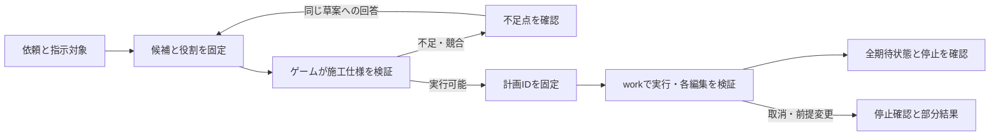

# Minecraftサービス

> 責務：Minecraft固有の体・計画・知識・視覚と接続先・変更入口。

この資料はMinecraft固有の体・知識・視覚の構成と操作範囲を説明する。接続は[ゲーム環境MCP](../game-environment-mcp-design-ja.md)、依頼の外枠は[作業契約](../game-work-contract-ja.md)、評価方法は[ベンチマーク](minecraft-benchmark-ja.md)が正本。

MindcraftがLLMへ送る情報と、命令・結果から判断を繰り返す仕組みは[LLM通信と推論・行動ループ](mindcraft-agent-loop-ja.md)を参照する。固定版のコードに基づき、上流の動作とCIELへの接続点を説明する。

## 構成と責務

Java版MinecraftとMineflayerの体を別サービスとして動かす。`server/minecraft/`がMCP入口、所有権、計画・レシピ、移動・採集・製作、実状態による確認・局所修復を持つ。ゲームの知識・日本語名・失敗理由もゲーム側で管理する。会話ホストにはMinecraft用の計画ツリーを持たせない。

| 部分 | 実装 |
|---|---|
| MCPと接続profile 2 | `src/ciel/mcp.js` |
| work 1の依頼・状態・取消 | `src/ciel/tasks.js` |
| 目標解釈・命令選択・結果再入力 | 上流`Agent.handleMessage`と`Prompter`・`History` |
| 低水準の所有権・切替 | `src/body-command.js`と`MindcraftRunner` |
| 表示文・日本語名 | `src/ciel/words.js` |
| 知識の検索と取得 | `src/knowledge/` |

ホストの`CIEL_GAMES`は`minecraft=http://127.0.0.1:8771/mcp`を指定する。接続だけでは体を取得せず、アプリからの有効化と所有権取得を必要とする。通常ワールドと専用ベンチマークは接続先も復元範囲も異なる。

体をRunnerへ接続するとき、`src/player-physics.js`で衝突判定の半幅を`Math.fround(0.6) / 2`へ合わせる。Vanillaのプレイヤー幅はfloatの`0.6F`であり、prismarine-physicsの既定値`0.3`との差が、Paper 1.21.11で壁・段差に接したジャンプの座標巻き戻しを起こす。経路探索の予測と実際の物理更新は同じ`bot.physics`を使う。サーバーのscale属性は変更しない。[上流の報告](https://github.com/PrismarineJS/mineflayer/issues/3911)と[現場の実測](../../testing/minecraft-results-ja.md#段差での座標巻き戻し)を参照する。

## 利用者の依頼

会話ホストは依頼意図と能力を選び、`minecraft.pursue_goal`へ元の自然文を渡す。上流Agent.handleMessageが標準プロンプト、実行履歴、観測、命令結果から判断・実行する。SelfPrompterとNPCも本物の上流クラスを使用する。CIEL独自の目標JSON・brain・材料計画・自動帰還は使用しない。失敗時は既存技へ代替せず、結果と未対応範囲を報告する。旧obtain_item・plan/step/repair・edit_regionと直接の採集・製作MCPツールは公開しない。

統合のため、Agent.startの部品初期化をinitializeComponentsへ抽出し、Prompterにモデル注入、Agentに命令の観測フックを追加した。判断ループとプロンプト本文は上流のまま。会話判断の指示文は、キャッシュのため固定行を先頭へ移す並べ替えだけを行い、固定部分は操作権の取得時に中核APIへ登録・準備する（[プロンプト管理](../../conversation/prompt-management-ja.md)）。standaloneのMindServer、公開ゲームチャット受付、独立TTS、vision、任意コード生成は起動しない。Bot接続と再接続、認証、明示停止、取消後のI/O遮断、アプリ通知はCIELが担当する。Paper/Mineflayerの衝突幅・製作同期の互換修正は残す。上流との差分はforkの`ciel`ブランチのコミットとvendorのprovenance.jsonで確認する（取り込み手順は[第三者依存](../../project/third-party-dependencies.md)）。

不足材料・未発見・道具不足等は制約に従って探索、判断待ち、中止へ進む。無期限探索をしない。失敗の説明と実際の停止確認を別に扱い、依頼の完了はゲームの実状態から報告する。停止後に遅い段や推論で再開しない。

## 主要タスクの拡張計画

以下の独自施工・対象指定の計画と実装は、現在のMindcraft標準構成では実行経路に使用しない。施工は自然文を標準Agentへ渡した場合の対応範囲で試し、厳密な座標・保存範囲・完成セルの保証は未対応。旧実装の詳細を現行機能の保証と解釈しない。

[MineDojo](https://docs.minedojo.org/sections/core_api/sim.html)の採集・生存・戦闘・技術ツリーと創作課題の区別、[CraftAssist](https://github.com/facebookresearch/craftassist)の建築・掘削・埋め戻し・停止、[TeamCraft](https://arxiv.org/html/2412.05255v1)の建築・整地・農業・精錬の課題群を参考にする。シエルは単体の共同作業者なので、まず範囲と完成状態を確定できる作業を実装し、複数エージェントや外観の良さを同じスコアに混ぜない。

| 段階 | タスク | 実装と評価の単位 |
|---|---|---|
| 1 | 整地、床・壁、穴の埋め戻し | prepare→workによる整地・床・壁・埋め戻しを実装。段階全体は受入評価中。[完了に向けた改修設計](#段階1を完了するための設計)で対象・保存条件・確認会話・埋め戻し・停止と再依頼を定義 |
| 2 | 照明、橋、階段、小屋 | 形状テンプレートからゲーム側で配置順と足場を計画。通行可能性、出入口、照度、転落、途中停止・再開を評価。未実装 |
| 3 | 精錬と収納 | 炉の投入・燃料・回収、指定チェストへの入出庫。生成数、消費、誤収納、満杯・燃料不足時の停止。未実装 |
| 4 | 農業・飼育・食料 | 耕地・植付け・成熟株の収穫・再植付け、給餌。成長待ちを操作時間と分け、未成熟株と種の維持を採点。未実装 |
| 5 | 探索・採鉱・運搬 | 既存採集・追従を自然地形、複数資源、帰還・受渡しへ広げる。到達、道具、受取人、帰還と停止を測る。基礎のみ既存実装 |
| 6 | 防衛・長期生存・自由建築 | 敵・食料・装備管理を組み合わせる。安全性と達成を別評価。自由建築の意匠は仕様確認と人の評価を併用。既存防御以外は未実装 |

段階1の施工は`minecraft_prepare_region`で読み取り専用の計画を作り、`minecraft.edit_region(plan_id)`で実行する。旧`minecraft_clear_region`・`minecraft_build_region`と指示棒の直接clear/floorは撤去した。移動と作業台回収は既存のbody操作を使う。最大64マス・距離32以内・Y=-64〜319で、範囲と材質の不足を質問する。配布範囲と測定済みのソースは[確認状況](../../testing/verification-status-ja.md)を参照する。

`src/spatial.js`が自然ブロック・建物・空間・材料を事前確認し、整地は上から、建築は下から行う。移動中の自動掘削・足場設置を禁止し、各編集後と全体終了時にブロックを確認する。任意コマンド・RCON・creativeは身体に渡さない。既存のbody所有権・取消・正式な完了通知を使う。資源の自動調達、巨大範囲の分割、家の自由設計はこの操作に暗黙追加しない。実機結果と未確認範囲は[確認状況](../../testing/verification-status-ja.md)を参照。

保護は静的な除去許可表と明示された保存範囲を使う。板材・チェスト等が除去対象にあれば編集前に停止する。石・土の人工物を自然地形と自動識別する機能は含まない。液体・重力ブロック・装置が監視範囲にあれば着手前に拒否する。専用ベンチマークには全領域のblock state・容器内容・イベントを記録する独立監査を追加した。

## 段階1を完了するための設計

以下は**実装済み・受入評価中の設計**。整地・床・壁・穴の埋め戻しを、依頼の確認から実状態の検証・停止まで一つの作業として扱う。合否と必要試行は[段階1の完了判定](minecraft-benchmark-ja.md#段階1の完了判定の設計)が正本。完了とは下表の有限範囲で共同作業できることであり、任意地形・自由建築への対応ではない。開発への反映と、ゲート全体の合格は分けて記録する。

### 完成させる操作と境界

| 操作 | 入力と完成状態 | 必須のケース |
|---|---|---|
| 範囲除去 | 両端を含む直方体と除去材質。対象を空気にし、保護対象を維持 | 起伏、空気の混在、複数段、負座標、既に除去済み |
| 高さを指定する整地 | X/Z範囲・残す地面のY・除去上限。ゲームが地面の一段上からの除去範囲を計算 | 「Y=64〜65を除去、地面Y=63は残す」と同じ完成状態。穴を埋める意味は暗黙に加えない |
| 床 | 水平な1層の範囲と材質。各セルが指定材質になる | 座標指定と地面2点の一段上、部分的に完成済みの床 |
| 壁 | XまたはZの一方が1マスの垂直面と材質 | 両方の向き、複数段、部分的に完成済みの壁 |
| 穴の埋め戻し | 底・上端を含む直方体と材質。範囲内の空気だけを埋め、既存の静的な土・石を残す | 深さ2段以上、不規則な穴、既に埋まったセル、上端に一致する平面 |

上限は現行同様、**編集範囲の直方体が64マス以下、全セルが開始位置から32ブロック以内、Y=-64〜319**。空気や既存完成セルを差し引いて上限を回避しない。範囲の分割を自動で繰り返して大規模施工へ拡張しない。床・壁・埋め戻しの配置材は現行5種（dirt/cobblestone/stone/oak_planks/glass）、手持ちだけを使う。材料の自動採集・製作、仮足場・橋・階段は段階2以降へ残す。

除去対象は明示された材質と、ゲーム側の静的な除去許可表の積集合に限定する。初期の許可表は土・草ブロック・石・丸石とし、砂・砂利・液体・原木・葉・容器・装置を含めない。既存の広い`NATURAL`正規表現を施工可否の根拠にしない。床・壁は同材質の既存セルだけを完成済みとして残し、異材質を置換しない。埋め戻しも空気以外を掘らず、容器・装置・不明なブロックを含む穴は着手前に拒否する。

指定材質が許可表外なら、指定を削って実行せず未対応として返す。範囲全体を空気にする依頼なのに、除去指定にない材質が混じっている場合も着手前に確認する。段階1の除去は直方体全体を空気にする操作に限定し、内部に残す物がある場合は、その物を含めない範囲への指定変更を求める。

「建物を壊さない」は材質だけでは保証できない。石や土の人工物を自然地形と自動識別する能力は段階1へ含めず、利用者の保護範囲と既知の保護ブロックを確実に維持する。人工物の有無が不明な条件付き依頼は、保護対象を確認できるまで編集しない。保護範囲が編集範囲と重なるときは、黙ってその部分を除外せず作業全体を開始しない。利用者が範囲を変更した場合だけ別の確定仕様にする。

### 発言から確定仕様を作る

1. 共通受付は発言ID、話者、接続世代と一緒に座標の出現箇所・数値・指示対象を固定する。同じYが二度現れても一つへ上書きせず、出典の文字位置を持つ候補として保持する。
2. ゲームが材質の別名と施工種別ごとのschemaを宣言する。共通受付は発言に含まれる材質だけを選択肢にし、材質・軸の欠落を補完せず質問する。共有ローカルLLMでは選択と引数の出力schemaを分ける。LLMは操作、材質、候補の役割（編集範囲・保護範囲・残す高さ・上限）、依頼か質問か、訂正かを選ぶ。整数や参照UUIDを生成させず、候補IDを選ばせる。全座標候補を役割へ対応付け、未処理・競合した候補があれば確認へ戻す。地面の一段上・両端を含む寸法の計算はゲーム側で行う。
3. 明示座標がある場合は過去の指差しへ代替しない。ただし「この2点の間をY=64まで」のように、今回の指差しと高さの併用を明示した依頼は役割を分けて使える。目線1点から面積・壁の方向・穴の深さは推測しない。
4. ゲーム側が全条件を正規化し、完成セル・変更セル・保存セル、必要材料、実行可能性を計算する。数値と寸法の短い説明はこの結果から作り、LLMが再計算しない。
5. 必須値が明確で条件が一致すればそのまま開始する。曖昧な場合だけ「残す地面はY=63、除去はY=64〜65でよいですか」など、未確定点と候補を示して聞き返す。質問・否定には施工しない。

施工の依頼意図は選択段階のLLMが文脈から判断する。ゲームの能力定義はvariantの意味・仕様・必要な座標と材質を宣言し、肯定・否定・継続依頼の定型表現は宣言しない。引用例や相談は実行せず、引用内容を実行する依頼は引用符だけを理由に拒否しない。範囲や材質が不足していれば草案で確認し、対象候補の出典と数値・現地の保護対象・施工可否はコードと準備検査で検証する。意味分類の誤りまでコードで保証するものではなく、口語・否定・引用・相談を実モデルで別に検証する。ローカルのゲーム受付は構造化出力とtemperature=0を明示し、会話の他の役目の生成設定は変更しない。

`role_prefixes`は「地面」「上限」のように座標ラベルの直前にあるゲーム宣言の接頭語で、対応する高さ候補を制約する。記載順で役割を推測せず、ラベルと逆の候補は復元時にも拒否する。接頭語のない表現は出典付き候補からの役割選択と、ゲーム側の上下関係検査を引き続き必要とする。

除去Yが範囲で指定されている場合、単一の地面・上限を要求するvariant（`required_height_mentions`あり）は選択段階で外す。明示した範囲をclearの編集対象、別の地面Yを保存対象として渡し、モデルが範囲の片端を捨ててlevelへ変換することを避ける。

例：「X=4〜6、Y=64〜65、Z=0〜1の土を除去。地面Y=63は残す」は、12マスの除去と直下6マスの保存へ解決する。「Y=64、いや65」や数値と寸法の不一致は、訂正前の依頼を無効にして確認する。`none`で通常会話へ戻した後、同じ未確定依頼を別の能力経路で実行してはいけない。通常の`load_capabilities`経路にも同じ確定仕様・検証を適用する。

確認待ちの草案は、依頼ID・版・確定済み項目・不足項目・元の対象ID・有効期限を持つ。補足発言はその草案にだけ結び、元の入力を黙って書き換えない。「はい」は直前の有効な確認への返答である場合だけ受け付ける。訂正・別依頼・停止・切断・話者変更で古い草案と遅い推論を無効にする。視線変更だけで受付済み対象を切り替えない。草案は最大60秒、参照期限と依頼全体の期限が先ならそこで失効する。失効後は再指定を求め、自動で新しい予算を作らない。

### ゲーム側の施工計画と実行

新規のMCPツール`minecraft_prepare_region`は施工仕様を検証し、ワールドを編集せずに計画を固定する。応答は`ready / needs_clarification / refused`、理由、欠けた項目、正規化した説明。`ready`だけが`plan_id`を持つ。実行はwork能力`minecraft.edit_region`へそのIDを渡す。サービスの内部データの設計は次のとおりで、外枠は[work契約の拡張設計](../game-work-contract-ja.md#施工能力の追加設計)に従う。

| データ | 保持する内容 |
|---|---|
| 依頼根拠 | request_id、草案の版、発言ID、所有者、接続世代、参照IDと出典 |
| 施工仕様 | operation、編集範囲、保存範囲、材質、条件、各候補の役割。保存範囲は最大4直方体 |
| 計画 | plan_id、仕様の指紋、身体の接続世代・次元、開始位置、読み取り時のblock state、変更セルと期待状態、足場・経路、必要材料 |
| 結果 | 計画セル数、確認済み完成数、実変更数、未完了セル、停止理由と停止確認、最終検証の時刻 |

例えば確認済みの除去仕様は次の形になる。これはprepareへの入力例。共通基盤が候補から数値を復元し、ゲーム側が各配列を検証する。`level`ではregionの代わりにX/Z範囲・残す地面と除去上限、指示棒ではselection_idと役割を使う排他的なschemaを設け、同じ対象の座標と参照を二重指定させない。

```json
{
  "request_id": "utterance-42",
  "draft_revision": 1,
  "spec": {
    "operation": "clear",
    "region": {"x1": 4, "y1": 64, "z1": 0, "x2": 6, "y2": 65, "z2": 1},
    "clear_blocks": ["dirt"],
    "preserve_regions": [{"x1": 4, "y1": 63, "z1": 0, "x2": 6, "y2": 63, "z2": 1}],
    "on_protected": "stop_before_edit"
  }
}
```

prepareは所有権下で行い、同じrequest_id・草案版・同じ内容の再送は同じ計画を返す。異なる内容の同一IDは競合。計画は最大60秒か元の参照期限まで、セッションに32件まで保持し、切断で無効化する。開始後は参照の自然失効で作業を中断せず、固定した計画と実状態を使う。自分が除去した始点を「選択変更」と誤判定しない。ワールド変更・所有権喪失は開始後も取消対象。

着手前に全セルと保存範囲を読み、材料、掘れる道具、立ち位置、順序、到達可能性を検査する。読み取り範囲は施工範囲・保存範囲・周囲2マス・支持ブロックと作業位置を含む最大4096セルとし、必要情報がこの上限を超えるか未ロードなら開始しない。既知の材料不足・保護物・足場不足を途中まで施工してから報告しない。

静的で確認可能な地形だけを対象にする。監視範囲の液体、重力ブロック、ピストン等の装置、支持の除去で変化する未対応ブロックを検出した場合は開始前に拒否する。境界の先まで影響が続く可能性を排除できなければ監視範囲を切り捨てて続行しない。自然地形は起伏した乾いた土・石、足場がある小さな穴・面で評価する。

除去は上から、配置・埋め戻しは支持がある下のセルから行う。完成状態で塞がれる通路や自分の立ち位置も計画時に考慮し、逃げ道が確認できない計画は拒否する。移動の自動掘削・範囲外への足場設置は禁止。各編集前に対象・支持・保護対象を再確認し、自分の確認済み変更だけをスナップショットへ反映する。他者の編集、材料消失、経路喪失で前提が変われば停止し、新しい仕様へ勝手に切り替えない。

`regionStances`は完成済みセルの上も候補にし、各編集時点の到達可能性・支え・視線を調べる。深い穴からの通常経路に失敗した場合、接地を待ち、観測済みの隣接1段だけをジャンプで越える修復を最大3回行う。元の予算を延ばさず、掘削・仮足場は追加しない。自分の足元を掘る、身体に重ねて置く、後で必要な退路を塞ぐ順序は使わない。

配置直後の角付近で経路予測が一時的に失敗した場合は、4tick待って同じ安全な作業位置への経路を再計算する。施工全体で最大3回、元の期限内に限定し、待機中の取消・前提変更後は再移動も編集もしない。これで到達できない場合だけ上記の1段修復を検討し、不能なら部分結果を残して停止する。

同じ高さで角に阻まれる場合は、この再計算回数の範囲内で、観測済み・頭上が空気・足場ありの隣接セルを1つ経由できる。目標へ近づくセルだけを選び、範囲外のブロックを変更しない。再計算で落下した場合は接地を再確認してから次の修復へ進む。

施工の経路移動は2秒の無移動で中断して修復へ進む。一般の移動・採集の8秒監視は変更しない。初回編集30秒やworkの期限を延ばすための待機ではなく、停止した経路の検出を早めるための施工専用設定である。

事前の読取とMinecraft側の編集確定は原子的ではない。前提変更を検出した後の追加操作を禁止し、既に発行済みの操作は停止確認まで監視する。同時編集の競合を絶対に防ぐためのワールドロックは段階1に含めない。G2では外乱の発火位置・時刻とin-flight操作を記録して採点し、他者の変更を上書きした場合は失敗として残す。競合を安全に止められないケースを確認したら、成功条件を緩めず、サーバー側の編集直前ガードを追加するか対応範囲を見直す設計判断が必要になる。

最終完了は、変更対象だけでなく完成済みセル・保存セルを含む全期待状態、体の解放、未完了操作なしで確定する。材料数は既存完成セルを除いた必要数を用い、配置数と消費数も記録する。範囲が最初から完成済みなら変更0で完了可能だが、現地確認を省略しない。

### 取消と再依頼

全処理は既存のbody所有権・取消トークンに従い、workの単調時計の残り時間を使う。`spatial.js`内部の独立した110秒期限は、workから受け取る残り時間へ置き換える。経路探索、装備、採掘、配置、結果待ちの各await前後で取消・世代・期限を確認し、後から返った結果で新しい編集を発行しない。

停止は体の停止を確認してから通知する。途中の編集は自動で巻き戻さず、完了した数と未完了範囲を報告する。停止後は自動再開しない。「残りを続けて」という新しい依頼で、同じ完成仕様と現地を再検証し、残りだけを新しい作業IDで実行する。完成済みセルを壊して作り直さない。通信障害で停止未確認なら新規作業を拒否し、確認できるまで状態不明を維持する。



### 実装順と既存経路の扱い

1. `target_candidates.py`・`game_intake.py`で候補の出典と役割、確認待ち・補足・取消を実装。Minecraft固有の地面・床・材質の規則はゲームのschemaと計画器に置く。確認文の数値は確定仕様から供給する。
2. `server/minecraft/src/`に施工計画器を追加し、`spatial.js`を共通実行器として全域事前検査・穴の埋め戻し・部分完成・停止・証拠を実装する。`tasks.js`のアイテム調達専用検証と表示を能力別へ分け、施工をworkへ追加する。
3. 座標と指示棒の施工を同じprepare→work経路へ統一する。従来の`minecraft_clear_region`・`minecraft_build_region`と`minecraft_pointed_action`のclear/floorを、別の無検証経路として残さない。公開定義・呼びかけ例・通常の能力ロード・ベンチマークを同じ変更で更新し、移動・作業台回収は既存body操作を使う。旧施工APIは公開定義と呼びかけ例から撤去済み。
4. 独立oracleと確認会話の評価を実装し、現行版を新評価器で測ってから改修版と比較する。既存の不具合例は回帰へ固定し、新しい未使用ケースを別に確保する。
5. 完了ゲートを通した版を配布し、通常ワールドの明示した小範囲で文字・指示棒・実マイクの結合を確認する。性能結果と配布確認を別記し、未実施があれば段階1全体の完了とはしない。

## 採集・製作の実行と再利用

現在は上流Agentの命令選択と採集・製作skillsをそのまま使う。以下の旧CIEL方式の目標固定・帰還後補充・修復は実行しない。標準動作の使用感を確認するまでは独自方式へ戻さない。

採集・移動・製作はMindcraftのnative skillsを使う。ブロック配置や積み上げ移動は維持し、建物の保護は`protection.js`で適用する。旧Runnerの採掘計画・土4個の事前調達・階段掘りは現在の実行経路ではなく、Mindcraftの動作として保証しない。

座標施工は例外として、CIELの検証済み計画の立ち位置・設置面・carefulMovementsを維持する。Mindcraftの汎用goToGoal/placeBlockでこれを上書きすると、移動中の掘削・足場設置が計画外の変更になるため、region executorから同じMineflayerの原子的な移動・採掘・配置を使う。通常の採集・移動にこの施工制限を適用しない。遠距離の持ち主はLocator Barの通知を短い移動目標へ変換してMindcraftの移動へ渡し、実体が見えてから接近する。

work開始時の所持数・帰還地点・最終目標を固定する。帰還後の実所持数が目標を下回れば、元の期限内で不足分を補充する。停止要求は帰還や補充にも適用する。成果は採掘総数ではなく、帰還後に保持している数で確認する。

`minecraft.pursue_goal`の目標は最終成果物であり、木のつるはしの材料を集めただけでは製作完了にしない。Mindcraftが選んだ次の命令と固定した最終目標を分けて保持する。

固定依存のMineflayer 4.39.0では、作業台のクリック途中で手元の予測とサーバーのカーソル・材料配置がずれる場合がある。`craft-sync.js`は作業台の各クリック後と出力取得前にサーバーのwindowを同期する。サーバー側に出力がなければ取り出さず、スロット・カーソル・実在庫を失敗の証拠へ残す。製作完了は実際の所持数増加で判定し、出力欄のローカル予測を成功根拠にしない。作業台を使わない手元の2×2製作も、`bot.craft`の実行中は同じくクリックごと・出力取得前に持ち物のwindowを同期し、終了後にも同期する。以前は作業台の製作だけが対象で、手元の製作ではサーバーに無い作業台・板材が体の持ち物に残り、Mindcraftが誤った持ち物から判断した。

Mindcraftの`!getCraftingPlan`は、3×3のレシピが必要で作業台を持たず16ブロック以内にも無い場合、作業台の製作を計画の先頭に加える（forkの`ciel`ブランチの修正、上流へ出せる一般的な修正）。以前は作業台を数えず、木のつるはしで原木を3本でなく2本と答えていた。石のつるはしでの丸石の採掘に必要な木のつるはしは、上流と同じく計画に含めない。

その製作中に自分で仮置きした作業台だけは、完成後に回収を試み、次の製作へ携行する。既存の作業台は回収しない。回収時の採掘許可はその1座標に限定し、取消後には開始しない。回収できない場合は結果に残す。これは物の調達・製作の内部処理であり、範囲施工へ材料の自動調達を追加するものではない。

## 指示棒と目線による対象指定

対象の観測情報は保持するが、独自pointed_actionの実行ツールは現在非公開。標準Agentへ座標を伝える自然文の依頼は可能であり、以下の厳密な対象検証付き実行契約は現行の保証に含めない。

`server/minecraft-pointing/`のPaperプラグインと、体の`src/pointing.js`を追加した。プレイヤーの画面中央の照準を最大32ブロックのray traceで調べ、最初に当たるブロック・面・選択時刻を取得する。画像認識やLLMで座標を推測しない。既存Vanillaへの自動導入はせず、導入用の`server/compose.pointing.yaml`を明示して使う。現在の配布範囲と実測は[確認状況](../../testing/verification-status-ja.md)を参照する。

- `/cielpoint`で持ち主専用の指示棒を受け取る。右クリックで始点を選び、しゃがんで右クリックすると終点を追加する。遠くのブロックも照準で指定できる。指示棒の操作では採掘・配置・作業台の画面表示を発生させない。
- 選んだ点には粒子、2点には水平範囲の輪郭を表示する。クリック選択は60秒で失効し、新しい始点選択で現在の表示を更新する。既に受付中の依頼は元のIDに固定する。
- `/cielpoint gaze`で目線指定を有効にする。クリックなしで現在見ている1ブロックを候補にし、会話へ渡した時点の対象を最大60秒保持する。`/cielpoint clear`で解除する。2点の範囲は指示棒で指定する。
- 「今指した場所へ行って」「この作業台を回収して」「選んだ2点の間の土を、この高さ1段だけ除去して」「選んだ地面の2点の上にオークの板材で床を敷いて」を扱う。「ここに建築して」だけでは寸法・材料が不足するため補足が必要。

公開操作`minecraft_pointed_action(selection_id, action)`の`move`は1地点への移動、`recover`は作業台1個の回収。2点の除去・床・高さを指定する整地はprepare→workへ渡す。床は同じ高さの地面上面2点の一段上をゲームが計算する。施工の最大64マス・距離32以内・材料・保護検証は共通に使う。自由建築や、目線だけによる2地点の自動区切りは未実装。

プラグインは設定された持ち主の操作だけを記録する。体は読取専用の選択ファイルからID・期限・次元を検証し、実行直前にブロックの一致を確かめる。退出・ワールド変更・再起動で選択を無効化する。回収は指定座標の作業台に限定し、同種の別ブロックを代わりに採集しない。ブロック消失と所持数増加を確認して完了する。

会話ホストは発話終了の状態通知で対象を取得し、確定した文字起こしのitem IDと接続世代へ紐付ける。文字起こしが先に確定した場合はその時点で取得する。文字入力では依頼受付開始時に取得する。異なるitemへ同じ発話の取得を流用しない。能力選択・引数生成・訂正は同じ観測を使い、再接続や取得失敗で古い観測を実行しない。

指示棒・座標移動・範囲施工には[対象候補の契約](../game-environment-mcp-design-ja.md)を適用する。移動・回収ではモデルが`target_id=T1`、施工ではC/D/P/R候補の役割と操作・材料を選び、システムが元の選択UUIDや正確な座標へ戻す。明示座標がある依頼では前の指差しを候補から外す。範囲の両端・単一の高さは受付、指した地面の一段上へ床を作る計算は体が担当する。対象と結べない能力も選択一覧から外す。

現在は短期のメモリーで発言と観測を固定し、DBへの音声・照準履歴の永続化は追加していない。発話中のクリック履歴の全保存や、遅れて届いた文字起こしから過去の視線を検索する機能は未実装。音声時刻対応は単体検証と人の実マイクでの検証を分ける。

照準の観測は目線指定中に毎250ms、会話への受け渡しは短い`references`だけ。固定指示や能力一覧を視線ごとに更新せず、追加のLLM判定も行わない。持ち主との対応は既存のMC_OWNERと会話側の所有者権限に従い、複数の会話利用者を自動対応させる機能ではない。

## プレイヤーの方向探索

現行の移動・追従は上流命令を使用し、旧PlayerLocatorによる接近処理は接続しない。遠距離で相手が見えない場合の探索成功は未保証。以下の独自探索処理は保持している旧実装の説明。

`minecraft_come_here`と`minecraft_follow_me`は、相手のentityを取得できないとき、Locator Bar用の`tracked_waypoint`通知を手掛かりに探す。追従中に相手を見失ったときも同じ探索へ戻る。`src/player-locator.js`が接続直後から通知を受信し、プレイヤー一覧のUUIDで相手を照合する。色・表示順・別プレイヤーの印から持ち主を推測しない。

通知の`vec3i`は位置、`chunk`はチャンク中心を探索の目安にし、`azimuth`は方向だけとして扱う。1.21.11の角度はJavaのyawと同じラジアン（南0、東−π/2）。最大16ブロックずつ経路探索し、相手を取得したら通常の接近・追従へ切り替える。目安の地点への到着をプレイヤーへの到着として報告しない。

1回の探索は最大60秒。手掛かりが無い・取り消された場合は`player_not_visible`、時間切れは`player_search_timeout`、道が無い場合は`no_path`で終える。経路の実行中も取得・取消・方向変更・期限を確認し、防御と停止は既存の所有権に従う。静止中には通知が更新されないため、手掛かり自体を経過時間だけで無効化しない。退出・死亡・respawn（ディメンション変更を含む）・切断で破棄する。方向表示が無効な環境や別ディメンションの相手を、任意座標照会で探す機能は持たない。

座標移動は`minecraft_go_to_place(x,z)`。場所名と座標の永続メモは未実装。

## 知識と視覚

ローカルのゲームデータ・Wiki取得済み情報を知識サービスから検索する。知識検索と公開Web調査は別の能力であり、外部検索が使えないローカルモードでもゲーム側の知識は利用できる。出典・対象バージョン・必要な範囲を示し、取得結果を履歴へ無制限に積まない。

視覚は体が提供する観測・画像を[画像入力](../../services/vision-design-ja.md)へ渡す。画像の生成、LLMによる理解、ワールドの正式な状態を区別する。ローカルモードでは現在の画像認識機能は利用不可であり、画像を読めたふりをしない。採点は見た目やLLMの主張ではなく評価器のRCON観測で行う。

## 出来事と安全

被ダメージ・死亡等は環境の出来事として発行する。ID・世代・順序・時刻を検証して、[反応基盤](../../conversation/service-events-and-reactions-ja.md)へ渡す。状態確定と痛がる表情・発話は独立して処理する。

体を共有できる会話数、同時操作、防御・食事の所有権はゲームサービスで制御する。コメントを持ち主の命令へ昇格させない。採点用RCONや任意コマンドはエージェントへ公開しない。

## 起動・調査・測定

サービス定義は`server/compose.yaml`等、固定するMinecraft・Node・SDK版はComposeとpackage-lockが正本。秘密・モデル・ワールドはGitへ入れない。EULA同意と既存の接続設定を維持する。

通常ワールドの調査は[デバッグスキル](../../../.claude/skills/ciel-minecraft-debug/SKILL.md)、復元を伴う評価は[ベンチマーク](minecraft-benchmark-ja.md)を使う。自宅の専用環境で確認し、手元PCで新しいMinecraftを起動して代用しない。現在の確認済み範囲は[確認状況](../../testing/verification-status-ja.md)を参照する。
