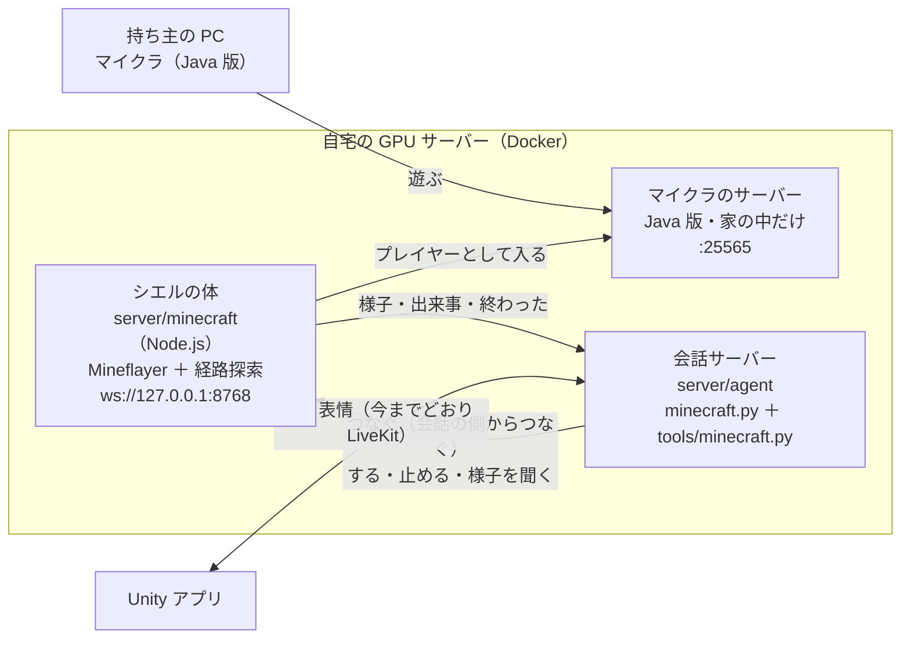

# シエルとマインクラフトで遊ぶ（設計）

> **2026-11-07 から：** 会話サーバーとのつなぎ方を、MCP の「ゲームの環境」に変えた（[ゲームとアプリを環境としてつなぐ設計](game-environment-mcp-design-ja.md)）。この文書の `minecraft.py`・`tools/minecraft.py`・`config/prompts/minecraft.md`・WebSocket の決まりは、そのときまでの形。今は、体の MCP の入口（`server/minecraft/src/ciel/`）がシエル向けの言葉・道具・遊び方の指示を持ち、会話サーバーは `game_env.py` でつなぐ。

状態：B1（マイクラのサーバーと体）と B2（会話サーバーとつなぐ）を作った（2026-11-05）。B2 は開発用の会話サーバーだけでつないでいる（`compose.dev.yaml` の `CIEL_MINECRAFT_URL`）。声で「ついてきて」「止まって」と頼み、体が動くのを確かめた（使い方は 12・13 章）。

## 1. 何を解くか

シエルがマインクラフトの世界に「体」を持ち、持ち主と一緒に遊ぶ。ついてくる、頼まれたものを集める、危ないときに声を上げる、見たことを話す、など。

- シエルの返事は、作るのに 2〜3 秒かかる。一歩ずつの操作（歩く・ジャンプ・狙う）を会話モデルにさせると、遅すぎて遊べない。
- ゲームの出来事は 1 秒に何十も起きる。全部を会話モデルに渡すと、料金がかさむうえに、シエルが実況ばかりになる。

そこで、**足はボットが動かし、シエルは「何をするか」だけを決める**。ゲームの出来事は、コードで選んだものだけをシエルに渡す。

## 2. 決めたこと

| 項目 | 決定 |
|---|---|
| 版 | **Java 版**（利用者、2026-11-05）。体には Mineflayer を使う。統合版は、体を持てる手段が乏しいので使わない |

## 3. 手法の選び方（調べたこと）

| 手法 | 例 | 採否 |
|---|---|---|
| ボットのライブラリ ＋ LLM の道具 | Mineflayer、Mindcraft、Minecraft 用の MCP サーバー | **採る**。Mineflayer に体を任せ、シエルの心に道具として渡す |
| LLM がその場で行動のコードを書く | Voyager、Mindcraft の newAction | 採らない。遅く、料金が高く、任意のコードを実行することになる |
| Mod の中の AI の仲間（NPC） | AI Companion 系の Mod、Player2 | 採らない。シエルの記憶・人格と二重になる |
| 画面を見てキーとマウスで操作 | OpenAI VPT、STEVE-1 | 採らない。研究用で、遅く重い |

Mindcraft は、それ自体が会話モデルの繰り返しを持つので、シエルの心と二重になる。そのまま組み込まず、道具の分け方と技（skills）の実装を参考にする。

## 4. 形



- **体（ボット）は会話とは別に動き続ける。** 会話サーバーは、アプリの会話ごとに始まって終わる（LiveKit の部屋ごと）。体を会話の中に作ると、会話を切るたびにシエルがログアウトする。体は独立したサービスにして、会話の側から WebSocket でつなぐ。
- **体を動かせる会話は 1 つだけ。** アプリの設定でマイクラをオンにした会話がつなぐ。別の会話がつないでいるあいだは、体は「使用中」と断る。
- **声はアプリから出す**（今までどおり）。ゲーム内の声（Simple Voice Chat）は後で考える（9 章）。
- 外から入る口は増やさない。体の WebSocket は 127.0.0.1 だけで待ち受ける。マイクラのサーバーは持ち主の PC から入るので家の中のネットワークに開くが、ルーターでは開かない。

### 4.1 マイクラのサーバー

- 自宅の GPU サーバーの Docker で動かす（`itzg/minecraft-server` など。Compose の `minecraft` profile にして、ふだんは止めておく）。
- 版は **1.21.11**。Mineflayer 4.39.0 の `testedVersions` は 26.1 まであるが、経路探索（mineflayer-pathfinder 2.4.5、2023 年）とブロック集め（mineflayer-collectblock 1.6.0）が新しい版で動くかは分からないので、1.21 系の最後にした。上げるときは、サーバーの `VERSION` と体の `MC_VERSION` を一緒に変える。
- シエル用にもう 1 つアカウントを買わないので、`online-mode=false`（アカウントの確認なし）にする。誰でも好きな名前で入れてしまうので、**家の中のネットワークだけ・ホワイトリスト（持ち主と `Ciel`）だけ**にする。配信で視聴者を入れるなら、シエル用のアカウントを用意して `online-mode=true` に戻す。
- `online-mode=false` のサーバーでは、プレイヤーの ID（UUID）がふつうと違う。Compose の `WHITELIST` に名前を書くと、ふつうの ID で登録されて入れないことがある。`rcon-cli whitelist add` も、ふつうの ID で登録するので入れなかった（2026-11-05）。そこで、`src/whitelist.js` で「OfflinePlayer:名前」から ID を作り、`whitelist.json` を書いて読み直させる（12 章）。
- サーバーのイメージは `itzg/minecraft-server:2026.10.1-java21`。体はブロックを壊さない・置かない（`carefulMovements`）。壊すのは「集める」で頼まれたブロックだけ。

### 4.2 体（`server/minecraft/`、新規）

Node.js（Mineflayer ＋ mineflayer-pathfinder ＋ mineflayer-collectblock）。会話モデルは使わない。

| 係 | 中身 |
|---|---|
| 技（skills） | ついていく・来る・場所へ行く・止まる・集める（ブロックの種類と数）・渡す・拾う・食べる・寝る。1 つずつ決まった JavaScript で書く（その場でコードを書かせない） |
| 身を守る（`src/guard.js`） | 会話を待たずに体が自分でする。6 ブロック以内の敵と、持ち主に 6 ブロックまで来た敵に、いちばん良い剣・斧で反撃する。クリーパーは叩かずに離れる。体力 6 以下か、近くに敵が 3 体以上なら、持ち主のほうへ（見えなければ敵から）逃げる。エンダーマン・ピグリンなど、手を出さなければ襲わないものには向かわない。守っているあいだ、技は待って、守り終えたら続ける。食べる・溶岩や落下を避けるのは、まだ |
| 様子 | 2 秒ごとにまとめる：場所・体力・空腹・時刻・天気・持っている物・近くのプレイヤーと敵・今している技 |
| 出来事 | ダメージ・倒れた・持ち主が倒れた・技が終わった／失敗した・プレイヤーが来た／去った・夜になった／朝になった・天気・チャット・守り始めた（`defend`）・倒した（`defeated`）・逃げた（`flee`）・守り終えた（`safe`） |

会話サーバーとのやりとり（JSON、`v:1`）：

| 向き | 例 |
|---|---|
| 会話 → 体 | `{"v":1,"type":"do","id":7,"skill":"collect","args":{"block":"oak_log","count":10}}`、`{"v":1,"type":"stop"}`、`{"v":1,"type":"chat","text":"…"}` |
| 体 → 会話 | `{"v":1,"type":"state",…}`、`{"v":1,"type":"event","kind":"hurt","amount":4}`、`{"v":1,"type":"done","id":7,"ok":true,"note":"原木を 10 個"}` |

技は時間がかかる（集めるのに数十秒）。体は `do` を受けたらすぐ「始めた」を返し、終わったら `done` を送る。

### 4.3 会話サーバーの側

| 部品 | 中身 |
|---|---|
| `minecraft.py`（新規） | 体へつなぐ。最新の様子を持ち、出来事を選んで（5 章）口や心へ渡す |
| `tools/minecraft.py`（新規） | 心が呼ぶ道具：`follow_me`・`come_here`・`go_to`・`stop_moving`・`collect`・`give_item`・`look_around`。つないでいるときだけ渡す。`FROM_COMMENTS` も書く（6 章） |
| `board.py` | 頼まれた技を付箋にする（種類 `game`、「原木を 10 個集める：実行中」）。終わったら完了／失敗。同じ頼みを二重に受けない |
| `mouth.py` | why に `game` を足す。技の終わり・危ない出来事は `say_latest('game')` で切れ目に言う |
| `mind.py` | `game` を `DEEP_WHY` に足す（知らせは心が話す）。つないでいるあいだは、送る会話に「[マイクラの様子]」を 1〜2 行足す（小脳にも渡す。見たことを話せるように）。体を動かす頼みの言葉（ついてきて・来て・取って・集めて・止まって など）を、つないでいるときだけ `REQUEST` と同じ扱いにして心に回す |
| `config/prompts/minecraft.md`（新規） | 一緒に遊ぶときの振る舞い。参照は `config/persona.toml`。本文を Python に書かない |
| アプリ | 設定に「マイクラ」のオン・オフと、つながっているかの表示。`ciel.game` の topic で送る |

`ついてきて` は短いので、今の振り分けでは小脳に行き、道具を持たない小脳が「はーい」と言うだけになる。そのため、頼みの言葉は**コードで**心に回す（pipeline の 0 章の 6）。

## 5. 出来事の選び方（モデルを使わない）

| 出来事 | 扱い |
|---|---|
| 頼んだ技が終わった・失敗した | 付箋を完了／失敗にして、切れ目で言う |
| シエルが大きなダメージ（4 以上）・体力が残り少ない・逃げた（`flee`） | すぐ言う（会話の途中でも、短く） |
| 守り始めた・倒した（`defend`・`defeated`） | 様子に入れる。倒したら、話す番に一言言ってよい |
| 持ち主が倒れた・シエルが倒れた | すぐ言う |
| 夜になった・雨が降り出した | 様子に入れるだけ。おしゃべりのときは、話す番に心が拾ってよい（気になっている付箋） |
| 近くに敵が来た | 様子に入れる。持ち主が気づいていなさそう（近い・後ろ）なら言う |
| 移動・小さなダメージ・拾った | 様子に入れるだけ |

同じ種類は 30 秒に 1 回まで。持ち主が話しているあいだは、すぐ言うもの以外は待つ。

## 6. 安全・道具の許可

- 持ち主のゲーム内チャットは、声と同じに扱う（設定したプレイヤー名だけ）。
- ほかのプレイヤーのチャットは、配信のコメントと同じく**信用できない入力**として扱う。コメントの溜まりに入れ、コメントから使ってよい道具だけを渡す。
- 体を動かす道具は、まず `FROM_COMMENTS` で「使わない」にする。配信で視聴者に動かしてもらうかは、あとで決める。
- 体の側でも、受けた `do` の技名を一覧で確かめる。一覧に無い技は動かさない（任意のコードは実行しない）。

## 7. 入力の受け口（YouTube と共通にする部分）

マイクラのチャットと YouTube のコメントは、どちらも「声とは別に届く、信頼度の違う文字の入力」になる。だから、受け口を共通にする。

- 入力の形：`source`（`voice`・`youtube`・`minecraft`）、`who`、`text`、`trust`（`owner`・`anyone`）、届いた時刻。
- `trust` が `owner` なら声の発言と同じに返す。`anyone` ならコメントの溜まり（[コメントへの返し方の設計](youtube-comments-design-ja.md) の 3 章）に入れて、話せる番に心が選ぶ。
- 今の `Mind.from_comment` は、入力の `trust` から決まる形にする（`anyone` の返事なら `tools.for_comments`）。
- つなぐ相手（体・YouTube の取り込み）は会話とは別に動き続け、会話の側からつなぐ。会話サーバーに外から入る口は作らない。

マイクラだけなら持ち主のチャットで足りるので、共通の受け口は段階 B4（ほかの人のチャット）か、YouTube の取り込みのときに作る。

## 8. 進め方

| 段階 | 中身 | 確かめ方 |
|---|---|---|
| B1 体だけ | マイクラのサーバーと体を Compose で動かす。体が入り、持ち主についていく。手元の WebSocket から技を送って動かす | 実際に一緒に歩く。会話モデルは使わない |
| B2 つなぐ | `minecraft.py`・道具（ついてくる・来る・止まる・周りを見る）・様子の行・危ない出来事。最初は環境変数で、つなぐ会話を決める | 声で「ついてきて」「止まって」「何が見える？」 |
| B3 手伝う | 集める・渡す・付箋・技の終わりの知らせ。アプリの設定のオン・オフ | 「原木を 10 個集めて」から渡すまで |
| B4 ほかの人 | 持ち主のゲーム内チャット、ほかのプレイヤーのチャット（共通の受け口） | 2 人で遊ぶ |

各段階の合否は、**一緒に遊んで楽しいか、シエルらしいか**を人が見て決める。数値だけで良いとしない。返事までの秒数と、遊んだ 1 時間の料金は測る。会話モデルを使う試験（`bench_*`）は、回す前に料金を見積もる。

## 9. あとで考えること

- 戦う（mineflayer-pvp）、建てる（設計図から置く）、作業台で作る。
- ゲーム内の声：Simple Voice Chat と、外の AI をつなぐ Easy LLM Voice で、シエルの声をシエルの位置から出す。
- 配信でマイクラを遊ぶとき、コメントから体を動かしてよいか。
- 体の見た目（スキン）。

## 10. 決めてほしいこと

| 項目 | 案 |
|---|---|
| マイクラのサーバーをどこで動かすか | 自宅の GPU サーバー（体と同じ場所。会話サーバーとサーバーの中だけでつながる） |
| 持ち主のプレイヤー名 | 設定（`.env`）に書く |
| 会話を切ったあとの体 | その場で待つ（ログアウトしない） |

利用者の決定（2026-11-05）：10 章の案のとおり。

## 11. 参考

- Mineflayer（対応版の一覧は `lib/version.js` の `testedVersions`）：https://github.com/PrismarineJS/mineflayer
- Mindcraft（Mineflayer ＋ LLM。道具と技の参考）：https://github.com/mindcraft-bots/mindcraft
- Minecraft 用の MCP サーバー（Mineflayer の道具の分け方の参考）：https://github.com/yuniko-software/minecraft-mcp-server
- Voyager（LLM が技のコードを書いて貯める）：https://arxiv.org/abs/2305.16291
- Easy LLM Voice（Simple Voice Chat と外の AI をつなぐ）：https://www.curseforge.com/minecraft/mc-mods/easy-llm-voice

## 12. 使い方（B1：体だけ）

置き場所：`server/minecraft/`（体）、`server/compose.yaml` の `minecraft`・`minecraft-body`（`minecraft` profile。ふだんの `docker compose up` では起動しない）。

| ファイル | 中身 |
|---|---|
| `src/main.js` | マイクラへ入る（切れたら 5〜60 秒で入り直す）、会話を待つ、2 秒ごとの様子、出来事 |
| `src/protocol.js` | 命令の形と、技の一覧・引数の確かめ方 |
| `src/skills.js` | 技（`follow`・`come`・`go_to`・`collect`）。一度に 1 つ。止めたときも `done` を 1 回送る |
| `src/guard.js` | 身を守る係（反撃・逃げる。どうするかは `pickThreat`）。守り終えたら「守り終えた hits=… kills=…」をログに出す |
| `src/movements.js` | 歩き方の決まり（ふだんは壊さない・置かない、集めるときだけ掘る） |
| `src/state.js` | 様子のまとめ |
| `src/send.js` | 手元から命令を送って確かめる（会話サーバーの代わり） |
| `src/whitelist.js` | アカウントの確認なしのサーバー用の `whitelist.json` を出す |

### 初回

マイクラの設定は、秘密を含まない別のファイル `server/.env.minecraft`（見本は `.env.minecraft.example`、Git・デプロイの外）に置く。`server/.env`（DB のパスワード）とは混ぜない。下のコマンドは自宅サーバーの `~/work/ciel-companion/server` で。

1. `server/.env.minecraft` に、`MINECRAFT_EULA=TRUE`（[マイクラの利用規約](https://www.minecraft.net/eula)に同意する場合）、`MC_OWNER=（持ち主のプレイヤー名）`、`MC_BIND=（自宅サーバーの家の中の IPv4 アドレス）` を書く。
2. 起動：`docker compose --env-file .env --env-file .env.minecraft --profile minecraft up -d --build minecraft minecraft-body`（入れ直し・止めるときも、同じ `--env-file` と `--profile` を付ける。付けないと、別の設定で作り直したり、何もしなかったりする）
3. ホワイトリスト：
   ```sh
   docker compose exec -T minecraft-body node src/whitelist.js Ciel （持ち主のプレイヤー名） Ciel_Debug | docker compose exec -T minecraft sh -c 'cat > whitelist.json'
   docker compose exec -T minecraft rcon-cli whitelist reload
   ```
4. 体は、外されても 5〜60 秒あけて入り直す。すぐ入れたいときは 2 と同じ形で `restart minecraft-body`。

### 確かめる

持ち主の PC のマイクラ（Java 版 1.21.11）で、マルチプレイ →「サーバーを追加」→ 自宅サーバーの家の中のアドレス。入って、`Ciel` がいることを見る。

`docker compose exec -T` から送るときは `SECONDS=` を付ける（外から止めてもコンテナの中に送り手が残り、つながったままになって、次の送り手が `busy` で断られた。2026-11-05）。

```sh
docker compose exec minecraft-body node src/send.js '{"type":"do","id":1,"skill":"follow"}'   # ついてくる。Ctrl+C で切ると、その場で待つ
docker compose exec minecraft-body node src/send.js '{"type":"do","id":2,"skill":"collect","args":{"block":"oak_log","count":5}}'
docker compose exec minecraft-body node src/send.js '{"type":"do","id":3,"skill":"go_to","args":{"x":100,"z":-20}}'
docker compose logs -f minecraft-body
```

`QUIET_STATE=1` を付けると、2 秒ごとの様子を出さない。テストは `server/minecraft` で `npm test`。

### 気をつけること

- `npm audit` で、Mineflayer がアカウントの確認に使う部品（yggdrasil の uuid）に中程度の注意が 8 件出る。体はアカウントの確認をしない（`auth: 'offline'`）ので、その部品は動かない。
- 道具が無いと掘れないブロック（石など）は、集めても増えない（`cannot_harvest`）。道具を作る・渡すのは B3。
- 身を守る係を試したとき（2026-11-05）：鉄の剣で、ゾンビ 1 体を 5 回叩いて、ダメージを受けずに倒した。その前、夜に体力 12・食べ物なしで敵に囲まれ、持ち主と一緒に倒されたので、囲まれたら逃げるようにした。食べ物を持って食べる、倒れたあと持ち主のところへ戻るのは、まだ。
- 倒れると持ち物を落とし、初めの場所で生き返る。ついていく技は `player_not_visible` か `died` で終わるので、もう一度頼む。

## 13. 使い方（B2：会話とつなぐ）

| ファイル | 中身 |
|---|---|
| `server/agent/minecraft.py` | 体へつなぐ係（`Body`）。会話の始めにつなぎ、終わったら切る。様子を「[マイクラの様子]」にし（`context`）、出来事を選んで口の why `game` で知らせる。倒した・倒れたは日記（`diary.py` の `minecraft`）にも 1 会話 1 回残す |
| `server/agent/tools/minecraft.py` | 道具 `follow_me`・`come_here`・`stop_moving`・`look_around`。体とつながっていないときは、心に渡さない（`mind.py` の `tools_for`） |
| `server/agent/config/prompts/minecraft.md` | 一緒に遊ぶときの振る舞いと、知らせの言い方。`CIEL_MINECRAFT_URL` があるときだけ、心と小脳の指示に足す |
| `server/agent/mind.py` | 体とつながっているあいだ、体を動かす・見る頼みの言葉（`GAME_ASK`）を心に回す。様子の行を心と小脳に渡す |

- つなぐ先は環境変数 `CIEL_MINECRAFT_URL`。今は開発用の会話サーバーだけに書いてある。アプリの設定で開発用（ciel-dev を呼ぶ）につなぐと、シエルの体とつながる。
- 体を動かせる会話は 1 つだけ。本番にも書くと、先につないだ会話が体を持つ。本番に入れるのは、アプリの設定でオン・オフを選べるようにしてから（B3）。
- 試したとき（2026-11-05）：「ついてきて」で心が `follow_me` を呼び、「はい、ついていきます！」と返した。「シエル、止まって」で `stop_moving`。「あれ、ついてくるの止められないかな？」は頼みの言葉に当たらず、小脳が「『止まって』と言ってくれたら」と返したので、「ついてくる」「止め」も頼みの言葉にした。

## 14. 使い方（B3：手伝う・アプリのスイッチ）

| 場所 | 中身 |
|---|---|
| 体 `src/skills.js` の `give` | 持ち物を渡す（そばへ行って、持ち主を見て投げる）。持っていなければ `not_have` |
| 体 `src/care.js` | おなかが減ったら（空腹 14 以下、または体力 14 以下で満腹でない）、持っている食べ物でいちばんおなかがふくれるものを食べる。腐った肉・クモの目・金のりんごなどは食べない。守っているあいだは食べない |
| 体 `src/state.js` の `nearbyBlocks` | 16 ブロック以内の原木・鉱石・溶岩・作業台・チェスト・かまどの数（10 秒ごと）。「木を集めて」で、心が近くの原木の種類を選べるように |
| `server/agent/tools/minecraft.py` | `go_to_place`（座標へ行く）・`collect_blocks`（集める）・`give_item`（渡す）を足した。どれもコメントからは使わない |
| `server/agent/minecraft.py` | 頼まれた技を付箋（種類 `game`、「oak_log を 10 個集める：実行中」）にする。同じ題の付箋が実行中なら `already_doing` を返して受け直さない。終わったら完了／失敗にする。体から切れたら、終わりを聞けない付箋は失敗にする |
| アプリ `CielConversation.Game.cs`・設定画面の「そのほか」→「マイクラ」 | 「マイクラで一緒に遊ぶ」のスイッチ（この端末に覚える）。つないだとき・変えたときに `ciel.game` の `game.link` で送る。会話サーバーは、オンのときだけ体へつなぐ。つながったか・マイクラに入っているか・つながらない理由（`busy`：ほかの会話が使っている、`unavailable`：その会話サーバーはつなげない）を `game.state` で返し、設定画面に「いまは：…」で出す |

- 体へつなぐのは、アプリのスイッチがオンの会話だけになった（それまでは `CIEL_MINECRAFT_URL` のある会話サーバーなら、いつもつないだ）。スイッチの既定はオフ。

## 15. 降りる・道が無いとき・うまくいかなかったとき（2026-11-05）

高い木の上で生き返り、ふだんの歩き方（壊さない・置かない・4 ブロックより下りない）では降りる道が無く、合流できなかった。また、技がうまくいかなかったとき、知らせが「途中でうまくいかなくなった」だけで、シエルは呼び直しも相談もしなかった。

| 場所 | 中身 |
|---|---|
| 体 `src/movements.js` の `escapeMovements` | 道が無いときの歩き方。自然のブロック（`NATURAL`：葉・原木・土・砂・石など）だけは掘ってよく、6 ブロックまで飛び降りる。板・ガラス・レンガなど、建物に使われやすいものは掘らない |
| 体 `src/skills.js` の `walk` | 来る・行く・渡すで、ふだんの歩き方で道が無ければ、`escapeMovements` でもう一度。ついていくは、離れたまま 6 秒動けなければ `escapeMovements` に替え、追いついたら戻す |
| 体 `src/skills.js` の `dig_down` | 足元を掘って降りる。`depth` を省けば、木の上から地面まで。自然のブロックだけ掘り、すぐ下が溶岩・水なら掘らない（`danger`）。掘れないブロックなら `cannot_dig` |
| 体 `src/state.js` の `footing` | 足元のブロックと、木の上なら地面からの高さ。様子に入れ、生き返ったとき木の上なら `on_tree` で知らせる |
| 体 `src/guard.js` | 逃げ始めたら 12 ブロック離れるまで逃げ続ける（6 ブロックでやめて、クリーパーから「逃げる・安全」を何十回も繰り返し、爆発で 13.8 減った） |
| 体の失敗の返し方 | 理由を決まった名前で返す（`no_path`：道が見つからない など）。途中までの成果（集めた数・降りた高さ）を `note` に入れる。集める技は、届かないブロックを飛ばして続け、頼まれた数に届かなければ `note.short` に理由を入れて返す |
| `server/agent/minecraft.py` の `on_done` | うまくいかなかったら、理由・できたところ・同じ頼みで何回目かを知らせる。知らせは口の why `game` で、話の切れ目を待つあいだに届いた分を 1 つにまとめて 1 回で言う（`mouth.say_latest` の `merge`）。分けると 2 回続けて話して 2 回目は古いことを言い、1 つだけ残すと前の知らせが消えた |
| `config/prompts/minecraft.md` | 1 回目で理由に合う手があれば、変え方を言って道具を呼び直す。2 回目以上か手が無ければ、困っていることと理由を伝えて相談する。木の上なら `dig_down` で降りてから呼び直す |

試したとき：木の上（地面から 12 ブロック）から `dig_down` で 4 ブロック掘って 10 ブロック降りた。

## 16. スキン（2026-11-06）

置き場所と入れ方は [assets/minecraft/skins/README.md](../assets/minecraft/skins/README.md)。

- **見せ方**：サーバーはアカウントの確認なしなので、公式のスキンは届かない。持ち主の PC のマイクラに CustomSkinLoader（手元のスキンを読む）と Ears（立体の耳・尻尾）を入れ、持ち主の画面でだけ表示する。Paper のプラグイン（SkinsRestorer）は、スキンを外部のサービス（MineSkin）へ送る必要があるので使わなかった。
- **作り方**：絵は Codex（役割分担どおり）。v01 は下絵はよかったが、64×64 にしたところで、ゴーグルのような目・ランダムな点の髪で崩れた。ユーザーがよいと示した人気のスキン 4 つから、かわいく見える決まり（前髪で顔の上 5 段を覆う、目は低く離して幅 1・高さ 2＋うるみ 1 ドット、ほほのピンク、口・鼻なし、横の髪で顔を包む、ランダムな点を使わず色味をずらした影）を言葉にして渡した（絵そのものは渡さない。他人の作品なので写さない）。顔の候補 A〜D からユーザーが D を選び、体と博士を作り直した。
- **耳と尻尾**：Ears の設定はスキン左下の 4×4 に決まった色で書く（耳：頭の上・中央、尻尾：下へ 3 節）。絵の場所と向きは、Ears の公開コードを手元のブラウザで動かして割り出した（ユーザーの許可を得て）。耳は、大きすぎる → ネズミの耳に見える（丸い形と真ん中のピンク）→ 頭からはみ出してリボンに見える、を直し、頭の幅（板の 4〜11 列目）の中に幅 3 の三角形、ピンクなし、で決まった。
- **細かい直し**：胸のハートと、おへそが真ん中からずれていた。幅 8 の体の真ん中は 3・4 列目のあいだなので、1 ドットや奇数の幅では真ん中にならない。左右対称の偶数の幅にした。

## 17. シエルの目（2026-11-06）

体が今いる場所から見た景色を 1 枚の絵にし、シエルが自分の目で見たものとして話す。詳しくは [シエルの目から見る](minecraft-vision-design-ja.md)。

- 体の命令に `look`（id が要る）を足した。返事は `seen`（`jpeg` は base64、`width`・`height`・`facing`）か `error`（`not_spawned`・`eye_unavailable`）。
- 心の道具 `look_at_view`（コメントからは使わない）。数と名前だけの `look_around` はそのまま。
- 体のイメージに、画面の無い Chromium（Playwright の headless shell）を入れた。視点のページは 127.0.0.1:3007（`EYE_PORT`）だけで開く。

## 18. 見えるものだけ・呼び名・物を作る（2026-11-06）

声で試して分かったこと：「今何が見えてる？」に、地中に埋まった鉱石の話をした。体が送る「近くのブロック」は、ボットが知っている 16 ブロックの中を壁越しに数えていた（プレイヤーなら見えない）。「花を集めて」には、心が `flower` で頼み、体は知らない名前としてすぐ断ったのに、心は「集め始めます」と言った。

- **見えるものだけ**（`src/sight.js`）：目の高さから、空気に面した面の真ん中へ視線を飛ばし、別のブロックに当たらずに届けば見える（向きは問わない。見回せば見える）。草花のように当たりの形が無いブロックも見える。様子の「近くのブロック」（原木・鉱石・草花・水・溶岩・作業台など）と敵は、見えるものだけにした。敵は、見えなくても 5 ブロックまでなら気づく（足音）。身を守る係（guard.js）は今までどおり。
- **見たものを覚える**：見えたブロックは 4096 個まで覚える（さっき見た木へ戻れる）。集める（collect）のは、今見えるか前に見たブロックだけ（埋まった鉱石へ掘り進まない）。掘ったブロックにつながる同じ種類のブロック（木の幹の上のほう）も知っていることにする。
- **呼び名**（`src/names.js`）：`flower`・`log`・`leaves`・`ore`、持ち物の名前（`dirt` → 草ブロックも、`cobblestone` → 石も、`coal`・`raw_iron` → その鉱石と深層の鉱石）、複数形（`oak_logs`・`poppies`）を受ける。
- **始める前に断る**：知らない名前（`unknown_block`・`unknown_item`）、掘る道具が無い（`needs_tool`、いちばん弱い道具の名前を添える）は、`started` の代わりに `error` で返す。会話サーバーは道具の返事に理由の文（`why`）を入れ、心がその場で正直に言う。
- **物を作る**（技 `craft {item, count}`・道具 `craft_item`）：作業台が要る物は、見て知っている作業台（32 ブロックまで）へ行き、無ければ持っている作業台を足元のそばに置く。材料が足りなければ、足りない物と数を返す（`missing_materials`・`no_table`）。何を先に集める・作るかは心が決める（ツルハシの手順は config/prompts/minecraft.md）。
- 「見えてる」「見て」「作って」「ツルハシ」なども、心に回す言い方に足した（mind.py の GAME_ASK）。「見える」だけでは「見えてる」に当たらず、軽いモデルが様子の文だけで答えていた。

## 19. ふつうのプレイヤーのように歩く（2026-11-06）

「ついていく」で、高い木の上から降りられず、シエルが旋回し続けた。歩き方が「壊さない・積まない・4 段まで」で、詰まりの見分けが「6 秒動かない」だったので、旋回して動いているあいだは詰まりと分からなかった。ユーザーの言葉：「一般的なプレイヤーであれば普通に飛び降りたり、自然ブロックを壊したり、手持ちのブロックを積み上げて足場を作ったり、近くのブロックを掘って回収し、足場にしたりする」。

- **ふだんの歩き方**（`playerMovements`。ついていく・そばへ行く・場所へ行く・渡す・集める）：初めから、4 段まで飛び降り（ダメージ 1 まで）、自然のブロック（NATURAL）は壊し、手持ちの土・丸石などを足場に積む（`SCAFFOLD`。板・原木のような作るのに使う物は積まない）。板・ガラス・レンガなど建物に使うものは壊さない。身を守る係（guard.js）は今までどおり、壊さない・積まない。
- **詰まりの見分け**：相手から離れたまま、8 秒のあいだ 1 ブロックも近づかず、その場から 4 ブロック以上動いていなければ詰まり（旋回しても分かる。相手が走って離れていくときは、動いているので詰まりにしない）。
- **詰まったら**：
  1. 足場が 4 個より少なければ、近くの見えている土（ツルハシがあれば石も）を掘って集める。そのうえで、体力が 8 残る高さまで飛び降りる歩き方に替える（体力 20 なら 12 段、14 なら 9 段、少なければ 4 段）。
  2. それでも詰まって木の上なら、足元を掘って降りる（dig_down と同じ）。
  3. それでもだめなら `no_path`（`stuck`）で技を終え、心に返す。
- 自宅サーバーで確かめた：高さ 15 の木の上から、約 8 秒で詰まりを見分けて飛び降り、地面まで降りた（ダメージ 5）。高さ 3 の木からは 5 秒で相手のそばまで来た。
- **見張り**（`watched`）：歩く・集めるあいだ（goto・collectblock）、8 秒のあいだ動かず・掘らず・置かずなら、行き先を取り消して `Stuck` で終える。集めるときは、そのブロックをあきらめて次へ。mineflayer-pathfinder は、道を歩き終えたのに行き先に届いていない（原木が葉に隠れて見えない位置）と、探し直さずに待ち続け、止める合図（`stop`）も効かない。原木を集める技が 14 分止まった（2026-11-06）。
- **水を避ける**：ふだんの歩き方では、水・溶岩の 1 マスを 10 歩分の遠回りとみなす（`liquidCost`、既定は 1）。水の中では掘るのが 5 倍遅く（原木 1 本 15 秒）、泳ぎながらでは進めず、落ちた物も拾えなかった（試験のプレイヤーを池に置いて確かめた）。
- **掘る前に地面を待つ**（`groundedDig`）：mineflayer は掘り始めた瞬間に掘る時間を決め、足が浮いていると 5 倍にする。足が地面に着くのを 2 秒まで待ってから掘る。5 秒以上かかる掘り方はログに残す。
- **落ちた物を拾う**（`pickUpNear`）：collectblock は、掘ったブロックの真ん中から 0.5 以内に落ちた物しか拾わない。掘ったあと、まわり 4 ブロックに落ちている物を拾いに行く。
- **スポーンの守り**：「原木を集めて」で、掘っても掘っても原木が減らず空振りした（2026-11-06）。原因は、マイクラのサーバーの `spawn-protection=16`。スポーンから 16 ブロックの中は管理者しか壊せず、管理者でないシエルが掘ると、サーバーが元に戻す。この守りは管理者が 1 人もいないあいだは働かず、持ち主を管理者にした（`op`）ことで働き始めた。`server/compose.yaml` の `SPAWN_PROTECTION=0` で切った。切ったあと、同じ場所で原木 3 本を 15 秒で掘って拾えた。上の水・地面・拾う直しは、この調べの途中で見つけた別の手当て。

## 20. デバッグ用のボット `Ciel_Debug`（2026-11-07）

体や目を試すときに、シエル（`Ciel`）とは別に入れるボットの名前は `Ciel_Debug` にする（前は `CielEye`）。配信に映っても、デバッグ役だとひと目で分かるように。見た目はシエルの 2P カラー（形はそのまま、黒い服に緑のターミナル色の光）で、スキンは [assets/minecraft/skins/](../assets/minecraft/skins/README.md)。ホワイトリストには `Ciel`・持ち主・`Ciel_Debug` の 3 人を入れる（初回の 3）。試作の `~/work/ciel-eye-proto/proto.js`（自宅サーバー、Git の外）もこの名前で入る。

体を調べる・試す手順と道具（Ciel_Debug で体と同じ技を記録しながら試す `run.sh`、動いている体の中を読む `peek.sh`）は、スキル [ciel-minecraft-debug](../.claude/skills/ciel-minecraft-debug/SKILL.md) にまとめた。

## 21. 途中の物から作る・自分から動く（2026-11-07）

「ツルハシを作って」で止まって見えた。体の「作る」は 1 段（板と棒からツルハシ）しか作れず、原木だけでは「板と棒が足りない」で終わった。足りない物も、持っていない桜の板（`cherry_planks`）と返した。心は原木を 1 個だけ集め、「次は作業台のところで作る」と言ったきり、道具を呼ばなかった（プロンプトに「頼まれていないのに、長い手順を勝手に進めない」とあった）。

- **途中の物から作る**（`planCraft`）：作る前に手順を決める。板・棒・作業台（`PARTS`）が足りなければ、持っている原木から先に作り、作業台が近くに無ければ作って置く。ほかの材料（原木・丸石・鉄など）は、集める物として「足りない物」に返す（`oak_log×2` など）。作り方が何通りもあるとき（板の種類）は、持っている物でいちばん足りる作り方を選び、同じならオーク・丸石を選ぶ（深層岩・ブラックストーンは後）。
- 原木 3 本だけ持った試験のプレイヤーで、板・棒・作業台を作って置き、木のツルハシまで 2 秒で作れた（自宅サーバー）。
- **心は自分から動く**：ユーザーの方針（「頼まれてないこともやってくれた方が嬉しい」）。`config/prompts/minecraft.md` から「勝手に進めない」「2 回目以上は聞く」を外し、次を書いた。
  - 頼まれた目的は、途中の段が終わるたびに次の段の道具を自分で呼び、最後まで進める。段ごとに聞かない。
  - 頼まれていなくても、遊びに役立つこと・やってみたいことは自分から始めてよい（始めたことは短く伝える）。持ち主が止めたら・別のことを頼んだら従う。
  - うまくいかなければ、まず自分で手を変えて呼び直す。自分では手が無いときだけ相談する。
- 「できた」の知らせに「目的の途中なら、次の段の道具を呼んで続ける」を添えた（minecraft.py の on_done）。
- 配信のコメントからは体を動かせない決まり（`FROM_COMMENTS`）は、見ている人に体を操られないための守りなので残す。

## 22. ゲームの知識（2026-11-07、設計）

「石のツルハシを作って」で、木のツルハシまでは自分で作れたが、丸石が見える所に無く止まった。「土の下には石がある」というプレイヤーの知識が無く、調べる手段も無かった。知識はプロンプトに書かず、ゲームの側に知識の窓口（MCP）を置いて、心が要るときに調べる形にする。設計は [ゲームの知識の窓口](game-knowledge-design-ja.md)。

## 23. 決まった場面だけの手当てを外す（2026-11-07）

「木の上」だけを見分ける作りを外した。高さ 1 の切り株の上でも「木の上。ふつうに歩いては降りられない」と心に伝え、心が「まず地面に降りてから」と考え込んで止まった（11-05 に作ったときは、壊さない・飛び降りない歩き方だったので合っていた）。ユーザーの方針：特定の条件だけを解決する作りは、かえって心の足を引っ張るので入れない。様子をそのまま渡し、どうするかは心が決める。

- 外したもの：足元の「木の上・地面からの高さ」（`state.js` の `footing` は足元のブロックの名前だけ）、生き返ったときの `on_tree` の知らせ、「ついていく」で詰まったときの「木の上なら足元を掘って降りる」段、`dig_down` の「深さを省けば木の上から地面まで」、会話サーバーの「木の上」の文、プロンプトの「木の上なら dig_down」。
- 残したもの：`dig_down`（足元を depth ブロック掘って降りる。depth は要る）は、どこでも使える動きなので残す。「ついていく」の詰まりの見分けと、足場を集めて高めの段差も飛び降りる手当ても、場面を問わない動きなので残す。

## 24. 長い目的をやり遂げる（2026-11-07、設計）

「石のつるはしを作って」で、作業台に原木を使ったあと「原木×1 が足りない」と返ったのに、心が原木を集めずに木のつるはしを 2 回続けて頼んだ。段が増えるほど、心が毎回一から次の手を決めるのは難しい。目的を心の外の決まった流れ（計画 → 1 つずつやる → 結果で確かめる → 理由を見て計画し直す）で回し、今の目的・段をアプリと配信の画面に見せる。調べたことは [長い目的をやり遂げる仕組み（調べたこと）](long-horizon-planning-research-ja.md)、設計は [目的の係](goal-runner-design-ja.md)。

## 25. 探す技（2026-11-07）

丸石が見える所に無く、石のつるはしの途中で止まった。プレイヤーなら、土の下を掘るか、周りを歩いて探す。体の技 `find {block, how}` と、心の道具 `find_blocks` を足した。見つけたら止まり（見つけたブロックは覚える）、集めるのは今までどおり collect。

- `how=walk`：始めた所から 8 方向へ、16・32・48 ブロックの輪で歩いて見回す（木・花・砂など、地面の上の物）。1 か所へ向かうのは 30 秒まで（水辺を回り込み続けて 90 秒かかった）。行けない方は飛ばす。
- `how=dig`：向いている方へ階段状に掘り下げながら見る（石・鉱石など、地中の物。上り道が残る）。1 段ごとに、前の足の高さ・頭の高さ・前の 1 段下を掘って降りる。自然のブロックだけ掘る。掘る先やその隣に水・溶岩があれば止める（`danger`）。素手で落ちないブロックに当たれば止める（`needs_tool`）。24 段まで。
- `how=auto`：ツルハシが要るブロック（石・鉱石）なら dig、ほかは walk。ふつうは心が知識（minecraft_search）を見て選ぶ。目的の係が自分で探すときは auto。
- 目的の係（[目的の係](goal-runner-design-ja.md)）：集める段が `not_found` なら、先に探す段（how=auto）を足す。探しても無ければ、探す段の失敗として心に相談する。
- 自宅サーバーで Ciel_Debug で確かめた：森の地面（-19.5, 70, 41.5）から石を dig で探し、土を 6 ブロック掘って 2 段下りたところで石が見えて止まった（6 秒）。水辺（20.5, 67, 44.3）では、掘る前に水に気づいて止まった。カボチャを walk で探すと、4 分で 23 か所ほどを回った（近くには無かった）。

## 26. 湖の上で探せなかった（2026-11-07）

石のつるはしの目的で「丸石を探す」段が 0.3 秒で `not_found`（掘った数 0・`stopped_at: cave`）になり、目的が止まった。シエルの足元（-28.5, 66, 43.5）は、湖の上に張り出した薄い地面だった（高さ 65 が草、63〜64 が空気、62 が水）。auto は石ならすぐ dig を選び、dig は向いている方の 1 段下に足場が無いと、その場で諦めていた。プレイヤーなら、まず見回し、固い地面に移ってから掘る。

- `how=auto`（ツルハシが要る物）：先に 16 ブロックの輪で歩いて見回す（山肌・崖に出ていることが多い）。無ければ dig。
- `how=dig`：掘り始める前に、4 方向それぞれで「水・溶岩に触れない・降りた先に足場がある・自然のブロックだけ」を確かめる（向いている方から順に）。足元のどの向きも駄目なら、16 ブロック以内の見えている自然の地面のうち、そこから掘り始められる近い所へ移ってから掘る。水に当たる・洞窟に抜ける・掘れない物に当たったら、6 ブロック以上離れた別の場所で掘り直す（3 か所まで）。道具が要る（`needs_tool`）と、深くまで掘って無かったときは、やり直さず返す。
- Ciel_Debug で同じ場所から確かめた：auto は歩いて 1 か所目で丘の石が見えて止まった（9 秒）。dig は、湖の上をやめて 2 ブロック先の地面へ移り、8 ブロック掘って 2 段下りたところで石が見えた（8 秒）。土と葉を少し掘った（(-14, 69〜72, 43) と (-29, 64〜67, 44〜47) のあたり）。

## 27. 丸石が 2/3 で止まった（2026-11-07）

探す段のあと、「丸石を 3 個集める」段が 9 秒で止まり、理由は「うまくいかなかった」だった。シエルの持ち物は丸石 2・土 1。collect は、道を作るときに掘れた土も「集めた数」に数え、丸石 2 と土 1 で 3 個集めたと終えていた（`short` なし）。目的の係は丸石が 2/3 で足りず、理由が無いので「error」として止めた。

- collect は、そのブロックから取れる物（minecraft-data の `drops`。石 → 丸石、石炭の鉱石 → 石炭）とブロックそのものだけを数える。
- 目的の係：体が終えても頼んだ物が足りなければ `not_found` とみなし、探す段から続ける（`minecraft.Goals.run`）。止まったときの記録（`goal paused`）に理由（`why`）を残す。

## 28. 穴の中で作業台を置けなかった（2026-11-07）

石のつるはしを作る段で `no_room`（作業台を置く場所が無い）になり、目的が止まった。シエルは自分で掘った 1 マスの穴の中（-14.4, 68, 43.5）にいて、作業台を置く処理は足と同じ高さの「空いていて下が地面」のマスしか探していなかった。

- 置く場所を、足と同じ高さ・1 段上・1 段下の順に、2 マス先まで探す（水の中は除く）。置けなかった場所は飛ばす。
- それでも無ければ、プレイヤーと同じく、横の自然のブロック（下が地面、掘っても水・溶岩が流れ込まない）を合う道具で 1 つ掘って場所を空けてから置く。
- Ciel_Debug で穴の底（-15.5, 65, 43.5）から石のつるはしを頼むと、横の石 (-16, 65, 42) を掘って作業台を置き、作れた（8 秒）。作業台はそこに残してある。
- 置けなくても止まりっぱなしにならないよう、目的の係に小さな目標（[目的の係](goal-runner-design-ja.md) の 8 章）を足した。

## 29. 「もう一本」の計画が作る段だけになった（2026-11-07）

石のつるはしを 1 本作ったあと「もう一本」を頼むと、目的の計画が「石のツルハシを作る」だけになり、作ると丸石が足りずに失敗した。計画し直しても同じ計画が 3 回出て（「材料が足りないので、計画を直した」×3）止まった。心が start_goal をもう一度呼んでも、止まっている目的の「あとで」に並ぶだけだった。

- 原因：作り方の計画（`src/craft-plan.js` の `planCraft`）が、作りたい物そのものも「持っている分を使う」扱いにしていた。石のつるはしを 1 本持っていると、1 本の目的は「もう足りている」になり、足りない物が出なかった。
- 直したこと：
  - `planCraft` は、作りたい物そのものは持っていても「もう k 個」作る（途中の物＝板・棒・作業台だけ、持っている分を使う）。体の技 craft・事前の確かめ・目的の計画（`goal-plan.js`）が同じ部品を使うので、全部に効く。試験 `test/craft-plan.test.js`。
  - 目的の係：計画し直しても今の残りの段と同じなら「直した」にしない（`minecraft.Goals.repair`）。理由を付けて止まり、心に相談する。
  - 目的の係：止まっている目的と同じ物の start_goal は、あとに並べず計画からやり直す（`goals.GoalRunner.start`）。
- Ciel_Debug で、石のつるはし 1 本・丸石 1 個・棒 2 本から石のつるはしを頼むと、「丸石が 2 個足りない」と返るようになった（前は足りない物なし）。

## 30. 体の MCP の入口を自宅サーバーに入れた（2026-11-07）

[ゲームとアプリを環境としてつなぐ設計](game-environment-mcp-design-ja.md) の体の MCP の入口（:8771）を、自宅サーバーの体に入れた（ブランチ `game-env-mcp`）。本番の会話サーバーは今までどおり WebSocket（:8768）でつなぐ。

- 入れた直後、体が起きられずに落ち続けた（11:09〜11:11 UTC、2 回）。1 回目は、送るときに `knowledge` を外したため `src/knowledge/` の新しい `main.js` が届かなかった。2 回目は、`src/knowledge/main.js` の「直接起動したか」の確かめがファイルの名前（`main.js`）だけで比べていて、体の `src/main.js` から読み込んだときにも :8770 を開こうとし、知識の窓口のコンテナとぶつかった。比べ方を、ファイルの場所全体にした。
- 確かめたこと：開発用の会話サーバーのコンテナの中から、会話サーバーの `GameEnv` で体の MCP につないだ。準備 0.57 秒（道具 13 個・遊び方の指示）、受け持ち、様子、`minecraft_facts`、景色の絵（初めは 9 秒）、目的の計画、「来て」→「止まって」で付箋が「やめた」で閉じる、離す。WebSocket の入口も答える。
- 体の `minecraft_search` は `not_ready`：本番の `compose.yaml` は体に手元の Wiki（`./minecraft/knowledge/data`）を渡していない。ブランチの `compose.yaml` では渡すので、本番に入れたら使える。

## 31. 原木を 1 本取ったところで止まった（2026-11-07）

開発用の会話（20:17〜20:19 JST）で、「石のピッケル作って」から目的「石のツルハシを作る」が始まり、原木を 1 本取ったところで止まった。

- 何が起きたか：目的の係が段「オークの原木を 2 個集める」で体の集める技を動かしている途中（20:18:00）、調べものの知らせに答えた心が、自分でも `minecraft_craft_item`（板を作る）を呼んだ。体の技は一度に 1 つなので、係の集める技が「ほかの頼み」（`replaced`）に替わり、目的は止めて待つ扱いになった。この止まり方は知らせを出さないので、だれも続けなかった。心はそのあと棒を作り、石のツルハシで丸石が足りずに止まった。シエルの持ち物は原木 1・板 2・棒 4。
- 直したこと（会話サーバー）：係が体で段を進めているあいだは、心の体を動かす道具（`ciel/role: act`）を体へ送らず `goal_running` で返す（止める道具・見る道具・知識はよい。心に任せた段 `mind` のあいだは使える）。`GoalRunner.body_step`。段が `replaced` で止まったら、止まって待っていることと `resume_goal` を心に知らせる。`config/prompts/game.md` に `goal_running` の受け方を足した。
- 前からあった弱さ（MCP にする前の `minecraft.py` でも、心の技と係の技は取り合えた）。今回それが出た。

