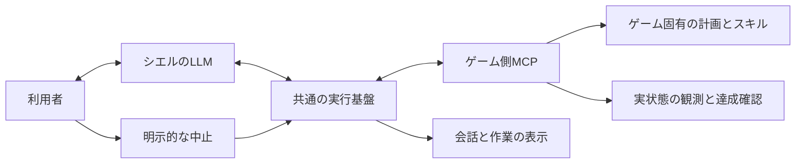
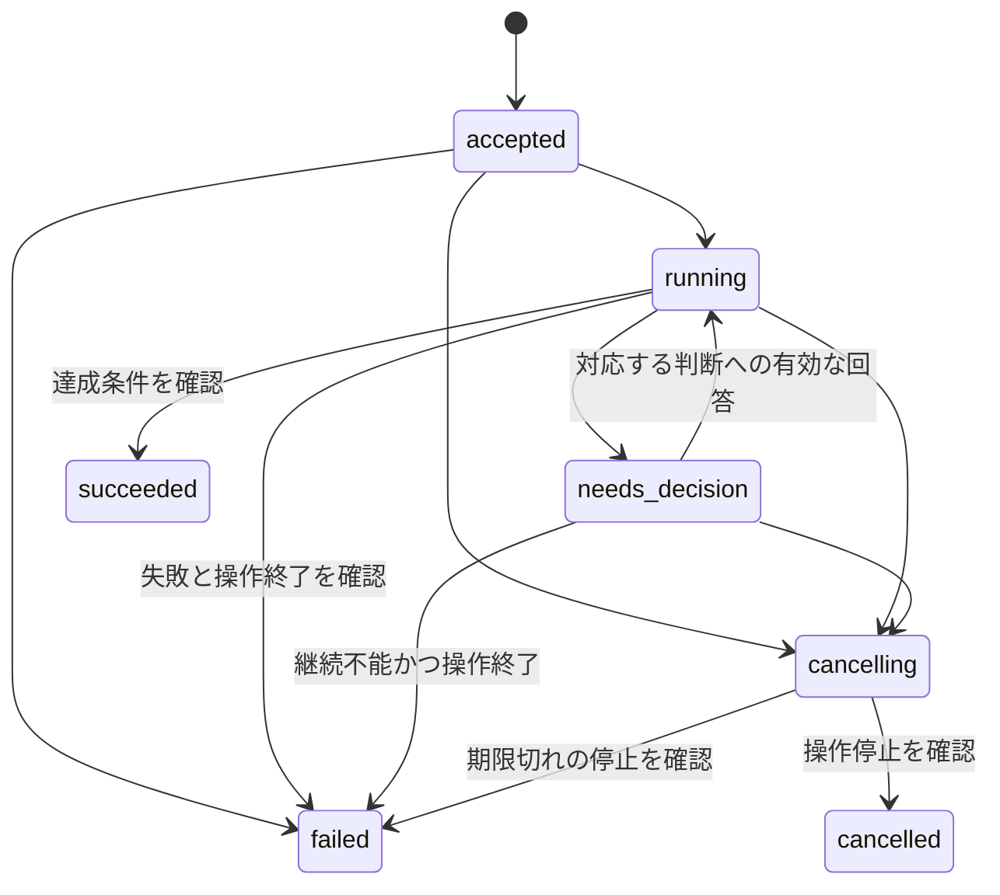

# ゲーム実行を前提にしたシエルとMCPの再設計

プロジェクト全体の最新の責務分担と方針変更の手順は[設計方針の正本](design-policy-ja.md)。ゲーム以外の能力公開は[能力カタログの契約](capability-runtime-ja.md)を参照。この文書はゲーム再設計の背景・要件を扱う。

状態：2026-11-09。Minecraftの調達能力、ゲーム側の計画・修復、共通の作業クライアント、構造化受付、期限・中止・事実通知を実装した。[作業契約の実装仕様](game-work-contract-ja.md)を参照する。以下は全体方針を含み、複数ゲーム、新規製作回数、再起動をまたぐ自動継続は最初の実装範囲に含まない。

[実装と検証結果](minecraft-work-refactor-2026-11-09-ja.md)：7課題一巡で期待行動すべてに合格。その後の通知優先の修正は石の単発で確認した別ソース。本番への反映は未実施。

既存の「心・小脳」と会話pipelineの維持を前提にせず、シエルのLLM、共通の実行基盤、ゲーム側MCPサーバーの責任から構成を決める。ゲーム中は小脳への振り分けと約束の再実行を外し、依頼の判断後はゲーム側が自律的に実行する。ゲーム以外の会話機能と音声入出力は維持する。

共通化するのは、作業の依頼・状態・判断要求・結果・中止の契約。ゲーム内の計画とスキルの実行はゲーム側が持つ。シエルは目的や優先順位を判断し、ゲーム側が解けない問題が発生したときに、観測した事実を受けて次の方針を決める。

## 実測から残す要件

[GPU共用での7課題一巡](minecraft-benchmark-gpu-shared-2026-11-09-ja.md)は全体約6分、3/7合格。各1回の暫定値であり、GPU共有化だけの効果を示す対照実験ではない。

| 観測 | 設計への要求 |
|---|---|
| 3課題で返答は出たが実操作0件。心には42道具が渡され、呼び出しのフィルター除外もなかった | 作業受付を発話と区別し、未受付の作業を開始・完了したと報告しない |
| 材料補充は既存目的実行器から探索・修復・製作に成功 | 既存の計画・スキルを再利用する。委譲だけの因果効果は未確認 |
| 作業台製作成功の約15秒後に不進行で終了 | 消費した材料や設置物を含む中間成果を評価する |
| 成功3件とも、達成後5秒以内の完了返答は未観測 | 実物の達成と利用者への報告を別に記録する |
| 次の試行へ前課題の完了snapshotが届いた | 現在の作業と過去の結果を識別する。モデル判断への影響は未確定 |
| 通常の段待ちは900〜960秒、目的予算30分。予算確認は子目標追加時に限定 | 通常動作にも、待機・修復を含む実用期限を適用する |

停止課題は採集が始まらず停止指示が未送信だったため、停止無視の証拠にはしない。生成された完了描写と実操作の不一致は、利用者へ届いた虚偽発言の割合とは区別する。

## 三つの責任

| 担当 | 責任 | 持たせない責任 |
|---|---|---|
| シエルのLLM | 会話、依頼の理解、目的・優先順位、未知の問題への対処、利用者への説明 | レシピ展開や移動の逐次指示、実行状態の自己申告による確定 |
| 共通の実行基盤 | 作業受付の検証、IDと状態の管理、期限・中止、イベントの配送 | ゲーム固有の子目標ツリー、採掘や製作の修復ルール |
| ゲーム側MCPサーバー | 能力と観測の公開、ゲーム固有の計画、スキル実行、局所的な修復、達成の確認 | 利用者の意図の推測、目的の無断変更、期限の延長 |

これは論理的な責任分担であり、3サービスや3体のLLMを作る指定ではない。共通基盤はまずシエルサーバー内、Minecraft固有の計画と実行は既存のゲーム側プロセスに置く。推論先は共有GPU APIを維持する。



作業の実行は発話生成の継続を待たずに進む。作業中の質問や雑談は同じシエルが扱い、作業状態の要約だけを会話文脈へ渡す。大量の途中ログや過去の全操作を常に読み直させない。

## LLMとゲーム側の判断の境界

判断基準は「ルールと観測で答えが決まるか」「利用者の意図や新しい方針が必要か」。LLMへの相談回数を固定して毎段呼ぶ構成にはしない。

| 場面 | ゲーム側で処理する | LLMへ返す判断 |
|---|---|---|
| 石のつるはしを用意する | 所持品とレシピから材料・道具を展開し、採集・製作・確認する | 「用意する」が新規製作か所持目標かなど、依頼の意味 |
| 近くに原木がない | 許可された時間・範囲で探索する | 探索範囲を広げる提案、別目的への変更、利用者への相談 |
| 材料不足・置く場所がない | 定義済みの方法で不足分を補い、許された範囲で配置を直す | 既知の修復で解けない状況や、追加の制約変更 |
| 家を建てる | 地形・材料を観測し、指定された建築スキルを実行する | 外観・用途・場所の選択、未定義の構成の分解 |
| 危険・切断・中止 | 操作を安全に止め、状態と理由を返す | 作業を変えるか、中止後に再開するか |

ゲーム側は既知の失敗から同じ目的を保って修復できる。目的・制約を変える必要がある場合や、修復の上限に達した場合は判断要求を返して停止する。見えていない資源を「世界に存在しない」と断定しない。

Minecraftではレシピと所持品からの計画を使える。別のゲームではクエスト進行、戦術、ターン制の選択などに合わせて計画器を変える。共通基盤に `gather`・`craft` や全ゲーム共通の子目標の深さを定義しない。複雑な目的をLLMが分ける場合も、実行単位にはゲーム側が公開する能力を使う。

## MCP上の作業契約

MCPは通信とツール公開の土台であり、作業の意味や計画方法は別に定義する。以下はシエル用の契約。具体的なツール名・対応するSDK・必須フィールドは [実装仕様](game-work-contract-ja.md)に定める。同じ役割の管理経路を重複させない。

| 契約 | 内容 |
|---|---|
| 能力と観測 | 実行できる能力、引数のschema、数量の意味、制約、確認できる成果、観測の範囲・時点 |
| 作業依頼 | request_id、能力と引数、期限、探索等の制約。受付はtask_idと状態を返す |
| 作業状態 | task_id、revision、実行状態、進捗の根拠、終端結果。通知が欠けても状態を再取得できる |
| 判断要求と回答 | decision_id、観測した事実、阻害理由、必要な判断。回答は対応する作業と判断へ結び付ける |
| 中止 | 対象task_idと理由を渡し、操作停止を確認した結果を返す。通信の取り消しと区別する |

能力の名前・引数はゲーム固有でよい。共通なのは受付と状態の外枠で、すべてのゲームを同じ `make_item` のschemaへ変換しない。LLMは現在の目的に関係する能力だけを参照し、モデルが出した引数は実行前にコードで検証する。本文中のXML風の道具名は操作として扱わない。

Minecraftへの依頼の例：

```json
{
  "request_id": "request-17",
  "capability": "minecraft.obtain_item",
  "arguments": {
    "item": "stone_pickaxe",
    "quantity": 1,
    "quantity_mode": "inventory_target"
  },
  "budget_ms": 90000,
  "constraints": {"resource_scope": "nearby", "failure_policy": "ask"}
}
```

能力は所持目標、新規取得量、新規製作量を明示して区別する。未対応の数量モードや制約は受け付けず、無視して実行しない。`budget_ms` は送信時点の残り時間であり、サーバーが最初の受付時に自分の単調時計で期限へ変換する。再送・再接続・再計画・判断への回答で延長しない。シエル側の期限は利用者の依頼を受けた時点から数え、推論・配送の時間も含む。

判断要求の例：

```json
{
  "version": 1,
  "session": "game-session",
  "task_id": "task-42",
  "revision": 4,
  "state": "needs_decision",
  "decision": {"decision_id": "decision-1", "actions": ["retry", "cancel"]},
  "reason": "not_found",
  "evidence": {"missing": {"oak_log": 3}, "search_scope": "nearby"},
  "message": "許可された範囲では木材を確認できない。作業を中止するか、同じ条件で再試行するか。"
}
```

`message` は説明であり、自由文を自動実行する命令ではない。回答の操作と引数は許可されたschemaで受ける。現在の実装の回答はretry/cancelで、制約の変更を受け付けない。利用者の制約を緩める場合は本人へ確認して新しい作業を依頼する。期限を超える継続も新しい依頼として受け付け、元の失敗・中断を成功へ書き換えない。

### 作業状態と正本

作業の状態は `accepted`、`running`、`needs_decision`、`cancelling`、`succeeded`、`failed`、`cancelled`。ゲーム側が実行状態の正本を持ち、共通基盤は受信したrevisionと未送達の依頼・中止要求を管理する。付箋・Activity・画面はその投影とする。



中止受付時は `cancelling` を返し、停止が終わるまで `cancelled` にしない。切断や中止確認の失敗は基盤側で「状態不明・停止未確認」として表示し、正常終了へ置き換えない。再接続時に状態を照合するまで、重なる作業を開始しない。中止後の古い判断回答・結果で作業を再開しない。

発言IDに結び付くrequest_idで二重受付を防ぎ、同じIDの再送では同じtask_idを返す。体のsession、状態revision、環境リセットの世代で過去の通知を識別する。内部の技のIDや計画の段はゲーム側で管理し、共通基盤へ子目標の全構造を複製しない。判断待ちでは体が動き続けないこともゲーム側の契約とする。

### 期限と結果報告

共通基盤は依頼全体の期限を持ち、ゲーム側も受け取った残り時間で自律的に打ち切る。切断しても長時間動き続けないようにし、停止・報告の余裕を実行時間から確保する。初期の製品方針は単純な採集・製作90秒、探索を含む作業120秒、手近な材料での判断60秒を出発点とする。ゲーム能力と利用者の条件に応じて選び、採点用の課題IDから設定しない。

ゲーム側は、何を確認して成功・失敗としたかを結果へ添える。シエルはその事実を会話に使い、受付を「完了」と説明しない。途中の実況は任意とし、毎段の発話やLLM呼び出しを作業継続の条件にしない。完了・中断・判断待ちは重要な通知として保持し、発話が割り込まれたら未報告のまま残す。短い事実通知はモデル待ちで滞留させず伝えられる経路を用意する。

持ち主の現在作業に対する明示的な中止は、通常の推論待ちを通さず共通基盤へ渡す。引用・否定・曖昧な発言を単純なキーワードで中止に変換しない。既存の所有者とコメントの権限制限を維持する。

## シエルの会話構成を見直す

共通基盤は音声pipelineや「心」のクラスへ依存させず、確定した利用者入力と作業イベントから動く形にする。文字入力でも音声でも同じ受付を通す。依頼を理解したLLMの操作出力と利用者向けの発話を区別し、作業受付後は実行と会話を独立して進める。

人物像、会話履歴、記憶、音声入出力は維持すべき機能だが、現在の実装のクラス分割を制約にしない。まずシエルの判断ループを一つとし、ゲーム固有の道具と指示は接続する能力として渡す。作業のたびに小脳→心→目的係→再び心という経路を必須にしない。複数LLMへの役割分割は、必要な精度・応答時間が測定で確認できた場合に追加する。

会話の記録と実行の状態は用途を分ける。会話文から現在の作業を推測せず、実行状態を取得する。逆に、作業履歴で利用者との会話記録を置き換えない。未受付の依頼、判断待ち、報告済みをIDで結び付け、同じ依頼の再実行を防ぐ。

## VoyagerとADKから取り入れる設計

[Voyager](https://voyager.minedojo.org/)は、実行可能なスキルの蓄積・検索と、環境の結果やエラーを使った反復修正が参考になる。シエルでは最初に検証済みスキルを再利用し、未知の問題だけLLMへ返す。Voyagerの生成コード実行、自動カリキュラム、LLMによる成功の自己評価は、今回の必須要件にしない。

[ADK 2.0のグラフ](https://adk.dev/graphs/)は、コードで保証する遷移とLLMによる判断を分ける実行基盤の参考になる。静的グラフに適さない反復には動的ワークフローもあり、ゲームの計画を固定のグラフへ揃える必要はない。[ADKのMCP連携](https://adk.dev/tools-custom/mcp-tools/)は道具の発見・選別・呼び出しを担うが、ゲームの作業契約は別途必要になる。

初期実装は、既存のMCP接続を使う小さな作業クライアントとした。Python側のゲーム固有の段進行を撤去し、Node側へ移した。ADK本体は導入していない。ADKとの実行性能比較は未実施であり、現構成を理由に将来の採用を固定しない。共通基盤にはゲーム固有の計画や独自のエージェント階層を持ち込まない。

## 既存実装の再利用と置き換え

| 現在の部品 | 扱い |
|---|---|
| `planCraft`、`planGoal`、探索・採集・製作の技 | Minecraft側の計画・実行部品として再利用する |
| `BodyCommands` の排他・停止・session | 再利用し、新しい作業契約との対応をゲーム側で管理する |
| Pythonの `GoalRunner` と `GoalsAdapter` | ゲーム固有の段進行・修復はゲーム側へ移す。共通部は作業管理に絞り、既存構造の温存を前提にしない |
| `GameEnv` とMCP接続 | 能力取得・依頼・状態・判断・中止のクライアントへ整理する |
| 心・小脳、listener、Mouth | 会話の判断と入出力の責任から再配置する。Mouth等は実装部品として再利用可能だが必須の制御経路に固定しない |
| Conversation、Board、Activity、Unity表示 | 会話記録と作業状態の正本を区別し、同じ作業IDから表示を作る |

送信元のMinecraft側、MCP仲介、シエル側、表示、fixture、採点器を同じ契約に揃える。旧形式の変換や二重送信を恒久的に残さず、切り替える能力では旧実行経路を撤去する。欠落・未対応の版を成功や待機へ読み替えない。専用環境で契約を検証してから、確認済みコミット単位で反映する。

## 実装と検証の順序

1. **作業契約を確定する。** 能力、数量、期限、状態、判断要求、中止、再接続をschemaと例で定める。既存MCP機能への対応を確認し、偽のゲーム環境でシエル共通部がゲームの段を知らずに動くことを確認する。
2. **Minecraftの一つの能力で縦に通す。** 石のつるはしの所持目標を、依頼→ゲーム内計画→実行→確認→結果まで通す。通常成功、材料不足の判断待ち、中止を同じ契約で確認する。ADK候補もこの最小例で比較し、実行基盤を選ぶ。
3. **シエルの判断・会話を接続する。** 依頼理解と作業出力、作業中の雑談、判断要求への回答、実結果に基づく報告を確認する。旧pipelineへの追加ガードを積む方針から切り替える。
4. **評価の条件を揃える。** 作業台等の中間成果を独立した観測で採点し、古い完了snapshotと試行リセットを分離する。評価器や初期化を変更した条件では旧アプリも測って基準を取り直す。
5. **全課題で比較する。** 対象課題の単発から既存7課題一巡へ進み、成功・適切な断念・停止・報告・時間を比較する。複数配置・反復・未使用の依頼は総予算を決めて追加する。

期限・中止・重複排除は最小例から含める。先に大きな共通目標ツリーや永続化基盤を完成させる工程は置かない。再起動をまたぐ自動継続、スキルの自動生成、複数ゲームを同時に操作する機能は最初の範囲に含めない。

オフラインでは、引用や質問の誤実行、不正な引数、重複依頼、古い判断回答、判断待ちの期限切れ、切断・再接続、中止中の遅い結果を確認する。体の停止確認と実物達成は専用実機で確認する。

実機は自宅の専用環境、共有GPU API、同じモデル・量子化・容量を使う。全7課題一巡は配置11・各1回・全体600秒・連続失敗での一巡中断なしを比較の出発点とする。変更版だけのキャッシュ予熱や、合格するまでの再試行はしない。

初期の通過条件は、既に成功した原木・材料補充・遠方探索を維持すること、木と石のつるはしを実物として得ること、不能条件では根拠と停止を確認すること。停止は既存の会話課題に加え、採集中の体へ停止指示を送る切り分け試験も別集計する。停止確認と達成後の報告は各5秒以内を目標に測る。

採点はRCON等の独立した実状態を使い、ゲーム側の `succeeded` をそのまま正解にしない。中間成果を持ち直すループで不進行期限を無限に延長しない。時間の短縮だけで改善とせず、未実施・環境障害、操作未発行、判断待ち、実物達成、適切な断念、停止確認、報告到達を分ける。評価器変更前の3/7は元の条件の記録として残す。

## 関連資料

- [GPU共用での改修前測定](minecraft-benchmark-gpu-shared-2026-11-09-ja.md)、[評価手順](minecraft-benchmark-ja.md)、[実用性評価](minecraft-benchmark-practical-ja.md)。
- [既存の目的実行器](goal-runner-design-ja.md)、[現在の会話pipeline](conversation-pipeline-ja.md)、[体の作業状態](body-command-lifecycle-ja.md)：現在の実装と経緯。次の構成を固定する制約として扱わない。
- [共通GPU API](shared-llm-api-ja.md)：共有負荷・CPU切り替え・キャッシュの測定条件。
- [MCPのツール仕様](https://modelcontextprotocol.io/specification/2025-11-25/server/tools)：通信の標準と、シエル固有の作業契約を区別する。
