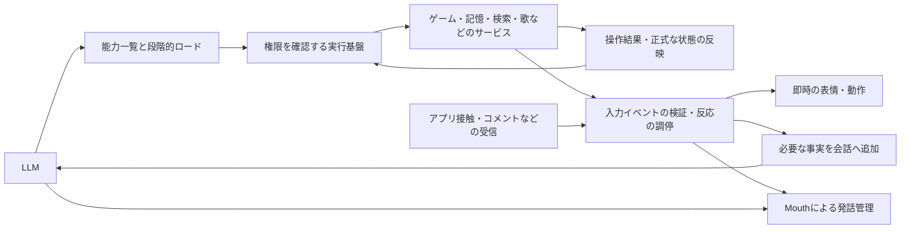

# シエルの設計方針（現在の正本）

> 責務：責任分担と採用する設計判断。詳細スキーマ・コマンド・測定値は各正本へ委ねる。

更新：2026-11-10。設計判断の入口はこの文書です。日付付きの測定記録や過去の設計案から「最新」を推測しません。変更の手順は末尾にあります。

## 責務を分ける

シエルは会話と外部環境での活動を行うエージェントです。雑談のパイプラインにゲーム固有の計画器を継ぎ足す構成にはしません。

| 層 | 決めること・持つもの |
|---|---|
| LLM | 依頼の意味、必要な能力、引数、結果を受けた判断と発話 |
| 共通実行基盤 | 話者・権限、能力の公開範囲、呼び出し、期限・取消・重複防止、入力イベントの検証と反応の調停、確認済みの結果通知 |
| ドメインサービス（MCP） | ドメインの操作・検証・状態と、観測したイベントの発行。ゲームの経路探索、製作手順、局所修復など |
| 会話・音声のホスト | LiveKit、マイク・歌声の捕捉、発話の割り込み、画面通知、信頼できる話者の確定 |

MCPは操作の契約です。全機能を別コンテナにすることは必須ではありません。同じプロセス内の会話専用サービスと、別プロセスの共有サービスを区別します。会話専用サービスをネットワーク公開するには、認証・会話の分離・信頼できる話者情報の引き渡しを別途実装します。

操作・能力ロードと、標準pipeline向けの共通イベント検証・反応調停を実装済み。実機での遅延測定と本番反映は別に確認します。

## 能力を段階的に公開する

サービスの短いID・概要と、少数のよく使う個別操作を渡します。名前の仮受付・保存状態照会と、停止・状態等の既存の即時入口は、発言元が許可する範囲で直接呼べます。他の操作は`load_capabilities`で探索し、完全なスキーマ・版・使い方を会話末尾のtool結果として渡します。`execute_capability`から現在の許可と正規スキーマを検証して実行し、能力を読んでも公開するツール集合と固定systemは増やしません。読み込んだことは実行権限を与えず、話者・コメントの権限と接続状態を呼び出し時にも確認します。

短いIDが必ず1トークンになるとは限りません。サービス、カテゴリ、道具を毎回別の推論で選ばせず、まずサービス選択だけを導入します。階層を増やすのは測定で必要と分かった場合です。直近のサービスは保持数を制限して再利用します。停止・状態確認は探索不要です。

本文の指示も道具と一緒に段階的に渡します。ただし人物像、話者確認、保存同意、公開範囲、割り込みなどの安全上必要な指示は常時保持します。一般の雑談にサービス選択の推論を追加しません。既存のゲーム受付は一度判断した依頼を再実行しません。

大きい結果は要約・出典・参照IDで受け取り、必要な範囲だけ再取得します。保持期限・サイズ制限と切り詰めを明示し、全文を履歴へ積み続けません。

ゲームを受け持っているときの依頼受付も、workと体の操作を同じ候補として扱います。短い説明から能力を選び、選択した能力だけの詳細を渡して引数を生成します。ホストにゲーム固有の依頼文の一致判定を増やさず、実行前の権限・接続・スキーマ検証と、明示停止の即時経路を維持します。受付済みの依頼を通常会話から二重に実行しません。能力数による遅延・誤選択と、身体操作の到着・停止を別々に評価します。

## 基盤からも同じサービスを使う

利用者の依頼と自発的な処理は、同じドメインサービスを呼びます。検索、メモ整理・関係性・好みの更新、画像説明、配信データの取得には、基盤から呼ぶMCP境界も設けます。処理のたびにLLMの選択を増やしません。

LLMに公開する操作と、基盤専用の操作を分けます。対象人物、画像参照、資格情報、接続先は信頼できるホストが確定します。発話、割り込み、話者識別、音声・画像の受信、コメントへの返答判断は会話ホストの責務です。現在の分担と制約は[サービス境界の仕様](../conversation/service-boundaries-ja.md)を参照します。

## サービスからの入力とリアクション

操作の依頼・結果と、非同期の入力イベントを両方扱います。接触・被ダメージ・コメント・歌の変化は、道具の読み込みとは独立に受信します。基盤が接続元・期限・重要度・権限を確認し、即時の表情・動作、会話への補足、発話へ振り分けます。反応の分類のためにLLM推論を追加しません。

痛がる表情などの即時反応はLLMや共有GPUを待たず、自然な発話はLLMとMouthが担当します。作業の正式な状態反映と、発話通知の順番・有効期限は分けます。コメントや歌の通常変化で会話・歌を不必要に中断させず、古い通知・重複・表情の上書きを管理します。

詳細は[サービス入力とリアクション](../conversation/service-events-and-reactions-ja.md)。初版の共通契約と調停を実装し、接触・ゲーム・コメント・歌・作業結果・議事録・調査・画像の入力を接続しました。現在の呼び出し用MCP接続は操作ごとに閉じるため、継続受信の接続・ワーカーは別にライフサイクル管理します。

## アプリの状態表示

作業と会話・リアクションは並行して表示する。サービスのwork状態をそのまま区別し、判断待ち・停止確認中・状態不明を一括の停止状態にしない。空の段一覧から進捗率を生成しない。残り予算と完了予測を区別し、状態確認の有効期間を持たせる。操作は表示していた作業ID・版に固定する。[作業・会話の表示契約](../app/work-display-contract-ja.md)が通知・UI・ベンチマークの正本。goal.state / goal.control v2への移行をソースに実装済みで、本番反映とUnityの実機描画は別に確認する。

## 記憶と本人確認

記憶の公開操作は本人の思い出の参照・保存・削除・同意などの意味単位です。SQL、任意の人物ID、任意のDB接続先をLLMの引数にしません。ホストが確定した話者と既存の保存同意・DBスコープを維持します。コメントから本人の記憶を読み書きできません。

名前の仮登録と本人確認、声の保存、会話の保存同意は別です。記憶の保存はバックグラウンド処理になることがあるため、受付と保存完了を区別します。人物像・現在の本人・必要な好みなど、会話開始や各発言に必須の取得は基盤が行います。全DB入出力をLLMの道具呼び出しに置き換えません。

## 長い作業とゲーム

ゲーム内の計画・実行・観測・局所修復はゲーム側が担当します。共通基盤は目的、制約、残り時間、作業IDと確認済み状態を扱います。[実装済みの作業契約](../games/game-work-contract-ja.md)がプロトコルの正本です。停止後の物理的な停止も確認します。未知の状態や通信障害を成功扱いにしません。

実用的な時間内に成功できなければ理由を報告して終了・確認待ちにします。[practical-v1](../games/minecraft/minecraft-benchmark-ja.md)の期限を、GPU待ちや失敗の救済のために延長しません。構成・モデル・共有負荷を揃えて改修前後を比較します。[共有GPU API](../operations/shared-llm-api-ja.md)を利用し、Minecraft実測は自宅サーバーの専用環境で行います。

## 資料を更新するとき

[資料一覧](../README.md)がファイルごとの責務を定義し、[文書管理](documentation-policy-ja.md)が更新・統合・履歴の扱いを定める。方針変更ではこの文書と対象の契約・実装を同じ変更で更新する。詳細な履歴はGitへ置き、現在の仕様へ日付付きの報告書や旧方式を併記しない。

検証済みの条件・ソース・結果・未確認項目は[確認状況](../testing/verification-status-ja.md)を置き換える。実装・ビルド・実モデル・実機・配布を区別し、確認済みコミット単位の本番反映を維持する。

## ローカル音声入力

音声認識は会話ホストの入力部品として扱い、LLMが選ぶ道具にはしない。local切替ではCPUのVoskを既定とし、途中結果と確定結果を区別する。文字試験は明示的なtext設定を維持し、OpenAIへ自動で戻さない。[ローカル音声認識](../services/local-stt-ja.md)に配置・設定・実測・精度の制約を記録する。

認識品質を改善する選択肢としてCPU Whisperを明示指定できる。会話ホストのVADで区切り、確定認識を非同期に行う。名前は語彙ヒントで伝え、認識後の一律置換で一般語や操作対象を書き換えない。起動準備で認識モデルもロードする。LLM重み・MCPの権限や道具選択とは独立した変更として比較する。

改善前後は同一の正解付き録音で認識精度と応答時間を別に評価する。[音声会話ベンチマーク](../testing/voice-benchmark-ja.md)で、人/合成・条件・モデル・共有負荷を固定し、相づちと本返答、観測できた遅延と失敗数を区別する。

音声会話の高速化では起動中の準備時間を許容し、準備完了後の会話を優先して改善する。モデルと音声経路の準備、会話と背景推論の資源配分、最初の自然な一文までの待ち時間を扱う。準備時間と会話遅延を分け、確認・権限・入力精度を省略して速くしない。[会話pipelineの設計](../conversation/conversation-pipeline-ja.md#音声会話の低遅延化)に実装順序と未実装範囲を置く。

標準pipelineの返答は能力を利用できる一つの経路へ集約する。通知や発言の長さだけで別の重い会話経路へ切り替えず、詳細な操作説明はMCP能力のロード時に渡す。本人確認・保存同意・公開範囲は常時の短い指示と実行基盤の両方で維持する。議事録は確定した会話のツール呼び出しで受け付け、文字起こしの断片を別のLLMへ並列送信して開始しない。

ローカルの背景推論は会話へ推論枠を譲る。中断するのはモデル要求であり、記憶の永続化トランザクションではない。保留した保存要求や目標は保持する。内発的な思考は会話・調査結果・環境の変化を契機にまとめて見直し、時間経過だけで同じ状況の思考を繰り返さない。共有APIは最初のトークンを待つ間も取り消しを検知し、上流推論へ伝える。実装・専用環境での実測・通常サービスへの配布は別に記録する。

## 推論方式は本番・開発で選択する

ローカル推論を開発専用の実装にしない。同じ会話基盤で本番・開発のbackendを独立に指定し、共有LLM APIとCPUの音声認識を利用する。本番はserver/.env、開発はserver/.env.devで設定し、変数名はCIEL_LLM_BACKEND等に統一する。資格情報とDBパスワードだけをserver/.env.sharedで共有し、動作設定・Webhookは環境ごとに独立させる。開発で本番の.envやagent/.envを読み込まず、本番のlocal指定を開発へ暗黙に継承しない。[共通の実行設定](../operations/local-runtime-ja.md)が設定・移行・反映の正本。構成の実装・検証と稼働中サービスへの反映は区別し、現行の配布範囲は確認状況を参照する。

## ローカル画像入力

画像の受信・保持・参照IDは会話ホスト、モデルへ送る直前の検証・縮小は共有推論APIが担当する。アプリやゲームごとにモデル入力サイズを別管理しない。既定は縦横比を保つ256×256以内の縮小で、画像エンコーダーはCPU、言語側は従来のGPU/CPU制御を維持する。APIが画像能力を公開した場合に既存の画像経路を有効にし、未対応・接続失敗をクラウドへの自動切替で隠さない。詳細は[画像契約](../services/vision-design-ja.md)と[共用API](../operations/shared-llm-api-ja.md)。
