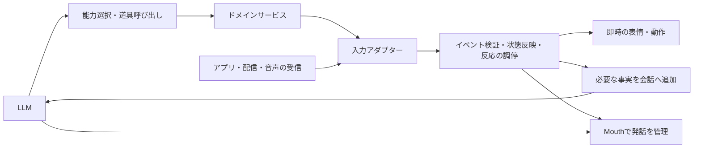

# サービス入力とリアクションの設計

更新：2026-11-10。状態：**標準pipeline向けの初版を実装済み。実機の反応時間・本番反映は未確認**。各サービスの受信アダプターから共通キューへ接続する。[設計方針の正本](design-policy-ja.md)と[現在のサービス境界](service-boundaries-ja.md)から参照する。

採用理由と影響は[決定記録](decisions/service-input-reactions-ja.md)。実装・検証の記録は[共通反応基盤の導入](reactions-runtime-2026-11-10-ja.md)。コードと通信形式を更新した。本番反映は行っていない。

## 操作と入力を両方扱う

シエルは依頼に応じて道具を選ぶだけでなく、体への接触、ゲーム内の出来事、コメント、音楽の変化を受け取って反応する。サービス境界には、操作の依頼・結果と、依頼に起因しない入力イベントの二つを設ける。

能力の段階的ロードは、LLMに公開する道具と使い方を絞る仕組み。イベントの受信は接続・購読の設定に従い、道具を読み込んでいなくても重要な入力を受け取る。通知を受けたことは、サービスの操作権限や本人の保存同意を増やさない。

初期実装は会話単位の有界キューとコードによる規則で構成する。既存Mouthを発話の入口として使う。各イベントの分類のために別のLLM推論を追加しない。

## 初版の接続経路

| 入力 | 受信アダプター | 共通基盤の処理 |
|---|---|---|
| 頬を引っ張る | Unityが強さに応じて表情を変え、LiveKitのタッチ通知を送る。TouchReactionsが検証・正規化し、待機・発話は共通基盤へ、会話中の補足は対応ID付きで渡す | タッチv2のID・時刻・世代を検証し、端末の即時表情と後続反応を対応付ける |
| Minecraftの被ダメージ | ゲームMCPの`ciel.event`通知。大きな被害・低体力を緊急扱いし、GameEnvからMouthへ渡す | input_v 1の発行情報を検証し、即時の半泣き表情・優先順位・有効期限を適用する |
| YouTubeコメント | API取得後、Poolで選択・集約。履歴に記録し、話せるタイミングで返答する | 安定した選択IDとコメント時刻を使い、コメント由来の権限・30秒の期限を維持する |
| 歌の途中解析 | `/live`を周期的に呼び、LiveCuesからメーター・ハート・短いコメント・表情をアプリへ送る | 観測時刻と曲の世代を検証し、音声生成を追加せず表情を調停する |
| 作業完了・失敗 | 作業状態を更新し、確認済みの結果を通知する | 作業状態は先に反映し、結果の発話を別のwork.resultとして管理する |

`reactions.py`が入力検証・有界キュー・発話と表情の優先順位を担当する。Mouthの旧通知キューは撤去し、議事録・調査結果・画像入力の通知も、既存の`say_latest` APIから共通基盤へ送る。ゲーム入力は作業通知に置き換えられない。発話生成と音声出力でも期限・割り込みを再確認する。

## 責務

| 担当 | 責務 |
|---|---|
| ドメインサービス | ダメージ量・残り体力、歌の変化などの観測、ドメイン状態の確定、イベントの発行 |
| 入力アダプター | 接続元の確認、既存の通信を共通イベントへ正規化、接続世代と会話への対応付け |
| 共通実行基盤 | 状態反映、重複排除、有効期限、待ち合わせ、優先順位、反応済み情報の管理 |
| 会話ホスト・Unity | マイク・画像・端末通信、即時の表情・動作、発話の割り込みと再生 |
| LLM | 必要な事実を受けた自然な反応、会話の続き、許可された範囲での次の判断 |

歌の変化検出はサービス側、どう表情に表すかは反応方針側が担当する。ゲームの逃避や停止など、物理的な安全に関わる既存の制御はゲーム側で継続し、LLMの反応を待たせない。

## 実装した共通イベント契約

これは入力アダプターから基盤へ渡す内部契約。MCPやLiveKitの全メッセージをこの形式に置き換えるものではない。接続元ごとの通信形式は後述する。

| 項目 | 意味 |
|---|---|
| `v` | 共通契約の版。初版は1 |
| `event_id` | 同じ出来事の再送でも変わらないID |
| `source_epoch`・`seq` | 発行元の起動・接続世代と、その世代内の順序 |
| `kind` | 登録済みのイベント種別。例：`game.damage`、`touch.pull`、`comment.received`、`song.change` |
| `occurred_at` | 発生時刻。送信遅延や再接続後の古い入力を判定する材料 |
| `ttl_ms` | リアクションの有効期間の希望値。ホストの種別別上限を超えて延ばせない |
| `payload` | サイズ制限した観測事実や参照ID。自由なシステム指示を入れない |

接続元、会話、操作主体、公開範囲、ホストの受信時刻は、信頼できる入力アダプターが付与する。送信本文だけで権限や発生元を自己申告できない。重要度はホストの種別別方針で決める。

重複キーは接続元・会話・世代・イベントIDの組。順序が必要な状態には`seq`を使い、前の世代の遅延通知で現在の状態を巻き戻さない。未知の版・種別、不正な本文は拒否して診断する。

有効期限の待機管理にはホストの単調時計を使う。受信前の遅延は発生時刻・接続世代・再同期情報から別に確認し、未来の発生時刻で期限を延長しない。別プロセスの単調時計同士を比較しない。新規接続時は現在の状態を取得し、過去のダメージなどをリアクションとして再生しない。

YouTube本文などの外部テキストは発言データとして渡し、システム指示として扱わない。コメントの反応から起動した推論と道具の続きでも、コメント由来の権限制限を維持する。異なる権限の入力を一つの「持ち主の発言」にまとめない。

## 三つの反応先

1. **即時の表情・動作**：強い頬引っ張りの半泣き、被ダメージ時の痛がる表情など。コードで反応し、LLMや共有GPUの待ち時間に依存させない。既に端末で出した表情は、後から届く同じイベントで再発火させない。
2. **会話への文脈追加**：観測事実を短く補足する。必ず新しい推論・発話を起動するわけではない。連続した被害や歌の変化は必要な範囲に集約する。
3. **発話を伴う反応**：基盤が話す契機を作り、LLMが反応を生成し、Mouthが再生する。話す直前にも期限と現在の状況を確認する。生成中に期限切れ・取消になった反応は再生しない。

「痛い」と言わせることと、痛がる表情を即時表示することは別に検証する。LLMが毎回同じ言葉や表情を出すことは保証しない。低遅延が必要な短い音声反応を設ける場合も、反応IDで後続発話との重複を防ぐ。

表情は優先度と有効期限を持つ一時的な指定として管理する。痛がる表情の保持中に、遅れて届いた通常のLLM表情や歌の表情で上書きしない。指定が切れたら現在の適切な表情へ戻す。

受信済み、状態反映済み、表情の送信要求、発話済みは別に管理する。表情を出しただけで、発話まで完了したとは扱わない。再送で保留中の反応を増殖させず、発話が中断された場合は実際の再生状況と現在の文脈から再開・省略を判断する。

## 優先順位と混雑時の規則

状態の更新と、注意・発話の優先順位を別に扱う。作業の終端状態や取消確認は、発話の順番にかかわらず即時反映する。発話を省略しても成功・失敗・取消の記録は失わない。

| 入力 | 反応方針 |
|---|---|
| 利用者の停止操作、物理的な緊急事態 | 既存の停止・安全処理を直接実行し、LLMの順番を待たない |
| 強い接触・大きな被ダメージ | 即時の表情を優先。必要な短い発話は通常通知より先に扱う |
| 持ち主の会話 | 通常の会話を継続。緊急でない通知は自然な切れ目に添える |
| 作業結果・調査結果 | 状態は先に確定し、結果の発話は期限内に一度だけ行う |
| コメント・歌の通常変化 | 選択・集約・間引きし、会話や歌を継続できる範囲で反応する |

緊急でも無制限に発話を割り込ませない。即時の表情は先に出し、音声を割り込ませる重大度と条件を明示する。歌唱中の通常変化は表情・メーターを中心とし、コメントや通常の結果通知は保留・失効させる。初版では、所有中のゲームの`died`だけが歌の捕捉・解析・歌用発話を停止し、マイクを通常会話へ戻す。通常の被ダメージ・接触・コメントは歌を中断せず、表情を先に出して音声を保留・失効させる。

現在の反応期限は、歌の一時的変化3秒、接触・被ダメージ5秒、コメント・作業結果・議事録・調査結果・画像入力30秒。`reactions.POLICY`で管理する。作業状態自体にこの期限を適用しない。

キューの件数・本文量・重複記録には上限を設ける。混雑時は古い低優先度の反応を先に捨て、連続イベントを集約する。緊急入力には専用枠を確保し、反映すべき正式な状態はキューと別に同期する。到着順だけで処理しない。

## 通信とライフサイクル

共通イベント契約はシエル内部の入力契約であり、MCPの標準機能を独自に再定義するものではない。ゲームは既存の持続するMCP接続の通知、端末はLiveKit、歌とYouTubeは基盤の取得処理から入力アダプターへ渡す。すべてをMCPのプッシュ通知に変更する必要はない。

現在の`call_service`は操作ごとにtransportを閉じる。この接続を、操作終了後の継続通知の受信先として扱わない。継続受信するワーカー・接続と、その停止・再接続は会話のライフサイクルで管理する。会話終了後の入力や、ゲームの体を受け持っていない接続からの体感反応を遮断する。

## 実装段階と受け入れ条件

1. 実装済み：共通イベント型、有界キュー、コードによる調停。既存Mouthと作業状態管理を利用する。
2. 実装済み：接触と被ダメージの接続、即時表情、会話への補足、作業通知との競合防止。
3. 実装済み：コメントと歌の接続、コメント権限の維持、歌唱中の抑制、表情の優先指定。
4. 計測用記録を実装済み。実モデル・実機による表示／音声の遅延測定は未実施。

各機能の移行時は、その機能の既存の直接発話・直接通知を同じ変更で新しい経路へ揃える。旧経路と新経路から二重に反応する状態を残さない。Unityの即時反応は維持し、対応IDと表情の所有規則を追加する。

オフラインでは仮想時計と模擬サービスで、未ロードサービスの入力、重複・期限切れ・順序逆転・再接続、コメント権限、歌唱中の抑制、キュー満杯、会話終了、作業結果と被ダメージの同時到着を確認する。出力に現れたイベントIDだけを反応済みにし、取消・生成失敗で未発話のイベントを処理済みにしない。

実機では接触→表情、被ダメージ→表情／最初の音声、コメント→選択／返答、歌の変化→表情の時間と取りこぼし・重複・不要な割り込みを測る。ローカルモデルと共有GPU負荷を記録し、推論時間と基盤の待ち時間を区別する。以前の単体600件・DB9件の記録と、今回の入力基盤の検証結果を区別する。

計測ログはイベントID、種別、各段階の時刻と破棄理由を中心とし、本文・画像・APIキー・本人の記憶を通常ログへ残さない。異なる時計の区間を単純に差し引かず、同じ時計で測れる基盤内の遅延と実機での全体遅延を分けて記録する。

## 初版の具体的な上限と通信形式

キュー64件、重複記録・発話追跡・文脈への対応付けはそれぞれキー最大512件。観測payloadのJSON表現は8,192文字、発話要求は16,000文字が上限。同じ発生元・種別の待機反応は最新に集約し、溢れた場合は低い優先度から落とす。正式な作業状態はこのキューへ入れない。

| 通信 | 現在の形式 |
|---|---|
| Unity→agent `user.touch` | v2。`event_id`、`source_epoch`、`seq`、`occurred_at`と従来の接触内容。v1は受け付けない |
| Minecraft MCP `ciel.event` | 既存の出来事に`input_v=1`、発行ID・世代・順序・発生時刻を付与。メタデータのない通知は反応に使わない。profile 2 / work 1の状態契約は維持 |
| agent→Unity `character.expression` | v2。`priority`と`expires_unix_ms`を追加。旧版・期限切れ・大きな時計ずれは拒否する |
| YouTube・歌・議事録・調査・画像 | 基盤アダプターが内部v1イベントを生成。コメントには元の時刻、歌には解析要求時の観測時刻と曲のIDを使う |

入力の待機は単調時計、機器間の発生時刻・表情期限はUTCを使用する。機器の時計同期が前提であり、1秒を超える未来時刻などは拒否する。時計差の自動推定は未実装。古いクライアントへの互換フォールバックはないため、agent・minecraft-body・Unityを同じ確認済みの一式で更新する。

発話の状態は`queued`、`generating`、`spoken`、`cancelled`、`expired`、`superseded`、`overflow`、`disconnected`などで記録する。ハンドルの終了だけでは発話済みにせず、空でない助手発言と割り込みなしを確認する。発言が確認できなければ`unconfirmed`とする。文脈へ渡した通知もIDで保持し、古い通知の返答で新しく届いた通知を消費しない。

`expression_requested`はホストからの送信要求、`expression_local`は端末側で反応したという入力の対応付けであり、画面に表示されたことのACKではない。Unityの適用時刻の返信や物理スピーカーからの再生確認は未実装。C#コンパイルとオフライン確認を、実機の表情・声の品質や遅延の検証と混同しない。

モデル要求には`reaction_id`を付け、同じイベントの生成時間と基盤の待ち時間を区別できるようにする。低優先度の反応中でも、利用者の会話を優先し、割り込まれた発話の古いツール継続は再開しない。

## アプリへの表示

作業の正式な状態と会話・リアクションの表示は[作業・会話の表示契約](work-display-contract-ja.md)で管理する。作業中にも発話・コメントへの返答を別行に表示する。画面の「話しています」は会話の状態であり、すべての入力イベントが発話済みという保証ではない。入力キュー・破棄理由・内部IDをそのまま配信画面へ流さない。
