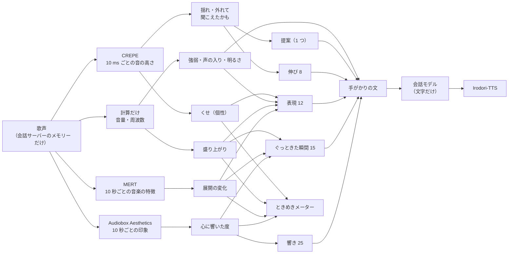

# シエルが歌を聴くときに使う AI モデル

更新：2026-10-29（日本時間）。シエルが歌を聴くときに使う AI モデルについて、次の 3 つをまとめた。
- それぞれがどんなモデルで、何が得意で、何が苦手か
- どうしてその手がかり（指標）にそのモデルを使っているか
- 選ばなかったモデルと、その理由

点数の計算は [シエルが歌を聴く仕組み](singing-scoring-ja.md)、決めた経緯は [歌を聴く決定記録](decisions/singing-ja.md)、調べた研究は [歌を聴く機能の調査](singing-evaluation-research-ja.md) を参照。

## 1. ひと目で

歌声を聴くのは、自宅の GPU で動く 3 つのモデル。歌声は外へ送らない。言葉にするのは文字の会話モデルで、手がかりの文だけを受け取る。

| モデル | ひとことで | シエルで任せていること | 動く場所 |
|---|---|---|---|
| **Meta Audiobox Aesthetics** | 音を聴いて「聴き手の印象」を 1〜10 で付ける | 心に響いた度（CE）。どこで響いたか | 自宅 GPU |
| **MERT-v1-95M** | 音楽の聞こえ方を、数の並び（特徴）にする | 展開の変化（曲の雰囲気が変わった所） | 自宅 GPU |
| **CREPE（tiny）** | 1 つの声の音の高さを 10 ms ごとに出す | しゃくり・フォール・ビブラート・揺れ・外れて聞こえたかもしれない音 | 自宅 GPU |
| OpenAI の会話モデル（`gpt-realtime-2.1-mini`） | 文字から、シエルらしい話し言葉を作る | 手がかりの文を、感想の言葉にする（歌声は聴かない） | OpenAI |
| Irodori-TTS | 文字をシエルの声にする | 感想を声で話す | 自宅 GPU |

**AI を使っていない手がかりもある。** 盛り上がり・強弱の幅・声の入り・声の明るさ・息は、音量と周波数の計算だけで出している（4 章）。歌っている途中のひとことも、AI に作らせず、決まった文から選んでいる。

## 2. 歌声を聴く 3 つのモデル

### 2.1 Meta Audiobox Aesthetics：聴き手の印象を点数にする

**どんなモデルか。** Meta が 2025 年に出したモデル（[論文](https://arxiv.org/abs/2502.05139)、[GitHub](https://github.com/facebookresearch/audiobox-aesthetics)）。音を聴いて、人が付けそうな評価を次の 4 つの軸で予想する。

| 軸 | 意味（論文の定義） | シエルでの扱い |
|---|---|---|
| **CE**（Content Enjoyment） | 主観の良さ。心を動かすか、技と表現、聴いた人の体験 | **使う**。心に響いた度 |
| PQ（Production Quality） | 録音の技術的な質。はっきりさ、強弱、周波数のバランス、広がり | 平均だけ記録する。点数には使わない |
| PC（Production Complexity） | いくつの音が重なっているか | 使わない |
| CU（Content Usefulness） | 作品の素材として使いやすいか | 使わない |

**学び方。**
- 話し声・効果音・音楽を同じくらいずつ、約 9.7 万本（約 500 時間）集めた。
- 158 人の聴き手が、それぞれを 4 つの軸で 1〜10 で評価した（1 本につき 3 人）。
- 聴き手は、録音の質（PQ）と複雑さ（PC）で専門家の評価と相関 0.7 以上の人だけを選んだ。
- 中身は WavLM 型の音声エンコーダー（Transformer 12 層・768 次元）で、軸ごとに予想する頭を別々に学習した。
- 10 秒ずつ聴く作り。

**得意なこと。**
- 「正しさ」ではなく、**聴き手がどう感じたか**を予想するように作られている。
- 音楽で、人の CE の評価との相関は 0.75（論文の AES-Natural）。
- 1 本 10 秒で軽いので、区間ごとに出して「曲のどこで響いたか」の曲線にできる。

**苦手なこと。**
- 素人のアカペラ向けには作られていない。スマホのマイクでアカペラを録ると 4〜5 あたりに固まる。
- 録音の質（マイク・部屋）にも引っぱられる。
- 聴き手の好みは人によって違う。論文自身も「人の評価は主観」と書いている。

**どうして心に響いた度にこれを使うか。**
- 研究の調査では、好きな歌声は機械で測った正しさでは説明しにくく、聴いた印象のほうがよく説明できた（[調査](singing-evaluation-research-ja.md) の 7 章）。
- CE はちょうど「感情を動かすか・表現」を聴き手の目で見た軸で、シエルの「一人の聴き手として」という考えにいちばん近い。
- 公開されていて、自宅の GPU で動き、ライセンスも CC-BY 4.0 で使いやすい。

**苦手さへの対策。**
- 値をそのまま点数にしない。**同じ歌の中で**どこが高いかを見る。
- 点数とメーターでは、3〜7 を 0〜1 に広げて使う（[仕組み](singing-scoring-ja.md) の 4 章）。
- 録音の質に引っぱられる PQ は点数に入れない。

### 2.2 MERT-v1-95M：音楽の聞こえ方を「特徴」にする

**どんなモデルか。** 音楽 AI の研究者の集まり m-a-p（Multimodal Art Projection）が作った、音楽向けの学習済みモデル（[論文、ICLR 2024](https://arxiv.org/abs/2306.00107)、[配布ページ](https://huggingface.co/m-a-p/MERT-v1-95M)）。点数は出さない。音を聴いて、その聞こえ方を 768 個の数の並び（特徴）にする。似た聞こえ方の音は、似た並びになる。

**学び方。**
- 人の評価は使わない（自己教師あり学習）。音の一部を隠して、隠した所を当てる練習をする。
- 当てる答えは 2 人の「先生」から作る。
  - 音色の先生：音を細かい部品に分けて覚え直すモデル（RVQ-VAE）
  - 音楽の先生：音の高さ・和音を表す CQT（定 Q 変換）
- そのため、**音色と、音の高さ・和音の両方**が特徴に入る。
- 95M 版は約 2 万時間の音楽で学習している。24 kHz の音を聴き、Transformer 12 層・768 次元で、1 秒に 75 個の特徴を出す。
- 論文では、曲のジャンル・感情・楽器・調・歌唱法など 14 の課題で良い成績だった。

**得意なこと。**
- 音量だけでは見えない変化をとらえられる。たとえば次のような変化で、特徴が大きく変わる。
  - 声の音色が変わった
  - 歌い方が変わった（張る・ささやく）
  - 音の高さの使い方や雰囲気が変わった
- 小さい（95M）ので、自宅の GPU で 4 分の歌を数秒で見られる。

**苦手なこと。**
- 特徴そのものには意味が書いていない。「変わった」は分かっても「良くなった」かは分からない。
- どの層が何に向くかは課題によって違い、配布ページも「試して選ぶ」としている。
- ライセンスは **CC-BY-NC 4.0（非商用）**。

**どうして展開の変化にこれを使うか。**
- 曲の展開が変わる所は、感動のきっかけになりやすい（[調査](singing-evaluation-research-ja.md)）。
- 展開の変化は音量の上下だけでは見えないことが多い。MERT は音色と音の高さの両方を見ているので、「雰囲気が変わった」を 1 つの距離で表せる。
- そこで、10 秒ごとの特徴を前の区間と比べて、違いが大きい所を展開の変化とした。

**シエルでの使い方の細かいところ。**
- 第 7 層（12 層の中ほど）を時間で平均して使う。中ほどの層には、音色と曲の構造の両方が出やすいと見て選んだ。**層を比べる試験はまだしていない。**
- ときめき度の点数には直接入らない。「ぐっときた瞬間」と「表現」の理由として入る。

**これから。**
- 利用者の反応（「うれしい」「そこじゃない」）が集まったら、MERT の特徴の上に小さな判定器を学習させて、シエルの好みを育てる土台にする候補。
- アプリを公開する前には、外すか、使い方を見直す必要がある。

### 2.3 CREPE（tiny）：1 つの声の音の高さを出す

**どんなモデルか。** ニューヨーク大学が 2018 年に出した、音の高さを出すモデル（[論文、ICASSP 2018](https://arxiv.org/abs/1802.06182)）。シエルでは PyTorch 版の [torchcrepe](https://github.com/maxrmorrison/torchcrepe)（MIT）を使う。

**しくみ。**
- 16 kHz の音を 1024 サンプル（64 ms）ずつ、波形のまま畳み込みのネットワーク（6 層）に入れる。
- 20 セント刻みの 360 個の音の高さの、どれに当たるかを出す。
- 正解の音の高さが完全に分かる合成の音で学習した。
  - RWC-synth：6.16 時間
  - MDB-stem-synth：230 曲・25 楽器・15.56 時間
- 声の周期のはっきりさ（periodicity）も出す。

**得意なこと。**
- 1 つの声・1 つの楽器の音の高さを、従来の計算の方法（pYIN）と同じかそれ以上の精度で出せる。
- 雑音を混ぜた試験でも崩れにくかった。
- 10 ms ごとに細かく出るので、次のような 1 音の中の動きまで見える。
  - 音の入りのしゃくり
  - 終わりのフォール
  - ビブラートの揺れ

**苦手なこと。**
- 1 つの音だけの前提。伴奏や別の声が混ざると落ちる。
- 息の多い所や、声のかすれた所は、周期がはっきりしないので信じられない。

**どうして音の高さにこれを使うか。**
- しゃくり・ビブラートのような「その人のくせ」と、揺れ・外れの「崩れ」を分けるには、1 音の中の細かい動きが要る。CREPE はそれが見える細かさで出る。
- 周期のはっきりさが一緒に出るので、確かな所（0.5 以上）だけを使える。
- 軽い tiny 版でも十分だった。4 分 17 秒の合成の歌声で、tiny と full の差は次のとおり（RTX 2060）。
  - 時間：tiny 7.8 秒、full 24.2 秒
  - 声のある所の 99.8% が、50 セント以内で一致した

**使い方で大事なこと。** 音の高さを**原曲やお手本と比べない**。
- その人の歌全体から「その人の音の基準」（いつも少し低め・高めか）を先に測る。
- そこから大きくずれた音だけを「外れて聞こえたかもしれない」とする。
- 繰り返し出るくせは、個性としてほめる側に回す。

## 3. 言葉にするモデルと、声にするモデル

### 3.1 OpenAI の会話モデル（gpt-realtime-2.1-mini）

- **任せていること**：手がかりの文を、シエルらしい話し言葉の感想（3〜5 文）にする。ときめき度を一度言い、ぐっときた所・その人らしさ・提案 1 つ・応援か質問の順で話す。
- **得意なこと**：
  - 数値や手がかりの名前を、気持ちの言葉に言いかえられる（「5.8」→「サビの入りでぐっときた」）。
  - ふだんの会話と同じモデルなので、シエルの人柄と話し方がそのまま続く。
- **どうして歌声を渡さないか**：
  - 歌声は外へ送らないと決めた（[決定記録](decisions/singing-ja.md)）。
  - 音声の AI は「2 つの歌のどちらが良いか」の比較は 74.5% まで当たる。でも、具体的な問題点の診断は外しやすい（[調査](singing-evaluation-research-ja.md) の 3 章）。
  - そこで、聴くのは自宅の専用のモデルに任せ、会話モデルは「言葉にする」だけにした。
- **苦手なこと・限界**：
  - 歌声を聴いていないので、手がかりに無いことは言えない。
  - 歌詞にも触れられない。歌声を文字起こしに送っていないため。

### 3.2 Irodori-TTS

- 感想をシエルの声で読み上げる。自宅の GPU（RTX A2000 12GB）を歌を聴くサービスと分け合う。
- 「どうぞ」のあとと分析の前に、作業用のメモリーを手放してもらう（[仕組み](singing-scoring-ja.md) の 7 章）。
- 歌っている間、シエルは声を出さない。

## 4. 手がかりごとの「なぜこのモデルか」

| 手がかり | 使うもの | なぜそれか | 比べたもの・選ばなかった理由 |
|---|---|---|---|
| 心に響いた度 | Audiobox Aesthetics の CE | 「聴いて心が動くか」を聴き手の評価から学んだ軸。区間ごとに出せる | SongEval（伴奏つきの完成した曲向け、英語・中国語、非商用）。感情（明るさ・高ぶり）の推定は「良さ」とは別 |
| 展開の変化 | MERT の特徴の変わり目 | 音色と音の高さの両方を見るので、音量で見えない雰囲気の変化もとらえる | 音量の変化だけ（それは「盛り上がり」で別に見る） |
| 盛り上がり | 計算だけ（920〜4400 Hz の音量） | 鳥肌が立った所でこの帯域の音量が上がっていた研究（Nagel ら 2008）。理由を説明しやすく速い | AI では、測る量がはっきりしたものに加えられることが少ない |
| 強弱の幅・声の入り・声の明るさ・息 | 計算だけ（音量・スペクトル） | 決まった量で測れ、印象の言葉（柔らかい・明るめ）に直しやすい | 同上。マイクや部屋で変わるので目安として扱う |
| くせ（しゃくり・フォール・ビブラート） | CREPE の音の高さ ＋ 決まり | 1 音の中の動きが見える細かさ | 従来の計算（pYIN）、RMVPE（伴奏が混ざる場合の候補） |
| 揺れた伸ばす音・外れて聞こえたかもしれない音 | CREPE ＋ その人の音の基準 | 原曲と比べず、その人の中でのずれだけを見られる | お手本と比べる方法（個性を減点してしまうので選ばない） |
| 歌っている途中のひとこと | 決まった文から選ぶ（AI なし） | すぐ出せて、料金がかからない。声を出さないので歌の邪魔にならない | 会話モデルに作らせる（遅い・料金・歌を止めてしまう） |
| 感想の言葉 | 会話モデル（文字だけ） | 気持ちの言葉に言いかえられる。シエルの話し方が続く | 歌声ごと音声の AI に渡す（外へ送らない、診断が外れやすい） |

## 5. 選ばなかったモデル

| モデル | 何ができるか | 今回使わない理由 |
|---|---|---|
| SongEval | 曲のまとまり・覚えやすさ・息づかいとフレーズの自然さなど 5 項目 | 伴奏つきの完成した曲（英語・中国語）向けで、素人のアカペラ・日本語に効くか分からない。データは非商用とする二次情報あり |
| 音声の AI（Qwen-Omni など） | 歌声を直接聴いて言葉で評価 | 歌声を外へ送ることになる。具体的な問題の指摘は外れやすい |
| BS-RoFormer・HTDemucs | 伴奏と歌を分ける | 今はアカペラか、ヘッドホンで伴奏を聴く想定なので要らない。スピーカーで伴奏を流す使い方に広げるときの候補 |
| RMVPE | 伴奏が混ざっても歌の音の高さを出す | 同上。伴奏が混ざる使い方に広げるときに CREPE から替える候補 |
| 自宅 GPU の文字起こし | 歌詞を聞き取る | 歌詞に触れる感想はまだ作っていない。必要になったら足す |

## 6. 重さ・速さ・ライセンス

| モデル | 大きさ・速さ（4 分 17 秒の合成の歌声） | ライセンス |
|---|---|---|
| Audiobox Aesthetics | 2.4 秒（RTX 2060） | CC-BY 4.0 |
| MERT-v1-95M | 4.7 秒（RTX 2060） | **CC-BY-NC 4.0（非商用）**。公開前に外すか見直す |
| CREPE tiny（torchcrepe） | 7.8 秒（RTX 2060） | MIT |

- 3 つを合わせた GPU のメモリーは、最大約 2.35 GB（RTX 2060 で測定）。
- 自宅サーバー（RTX A2000 12GB）では、読み上げと合わせて GPU 全体の最大が約 4.9〜5.4 GB だった。
- 歌の間だけ GPU に載せ、分析が終わるか 30 秒使わなければ外す。
- 配布元の版（revision）は [server/singing/server.py](../server/singing/server.py) で固定している。

## 7. 出典

- Tjandra ら, Meta Audiobox Aesthetics: Unified Automatic Quality Assessment for Speech, Music, and Sound, 2025. [arXiv 2502.05139](https://arxiv.org/abs/2502.05139)
- Li ら, MERT: Acoustic Music Understanding Model with Large-Scale Self-supervised Training, ICLR 2024. [arXiv 2306.00107](https://arxiv.org/abs/2306.00107)、[MERT-v1-95M](https://huggingface.co/m-a-p/MERT-v1-95M)
- Kim ら, CREPE: A Convolutional Representation for Pitch Estimation, ICASSP 2018. [arXiv 1802.06182](https://arxiv.org/abs/1802.06182)、[torchcrepe](https://github.com/maxrmorrison/torchcrepe)
- そのほかの研究（鳥肌と帯域の音量、好きな歌声と印象、音声の AI の診断）は [歌を聴く機能の調査](singing-evaluation-research-ja.md) にまとめている。
