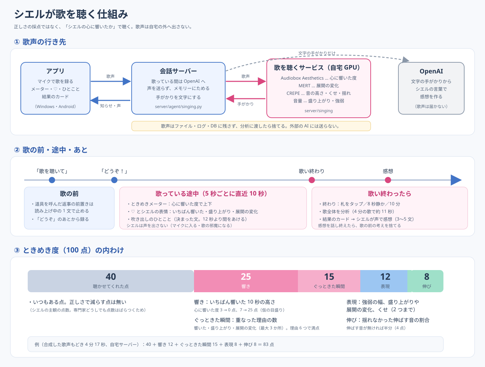
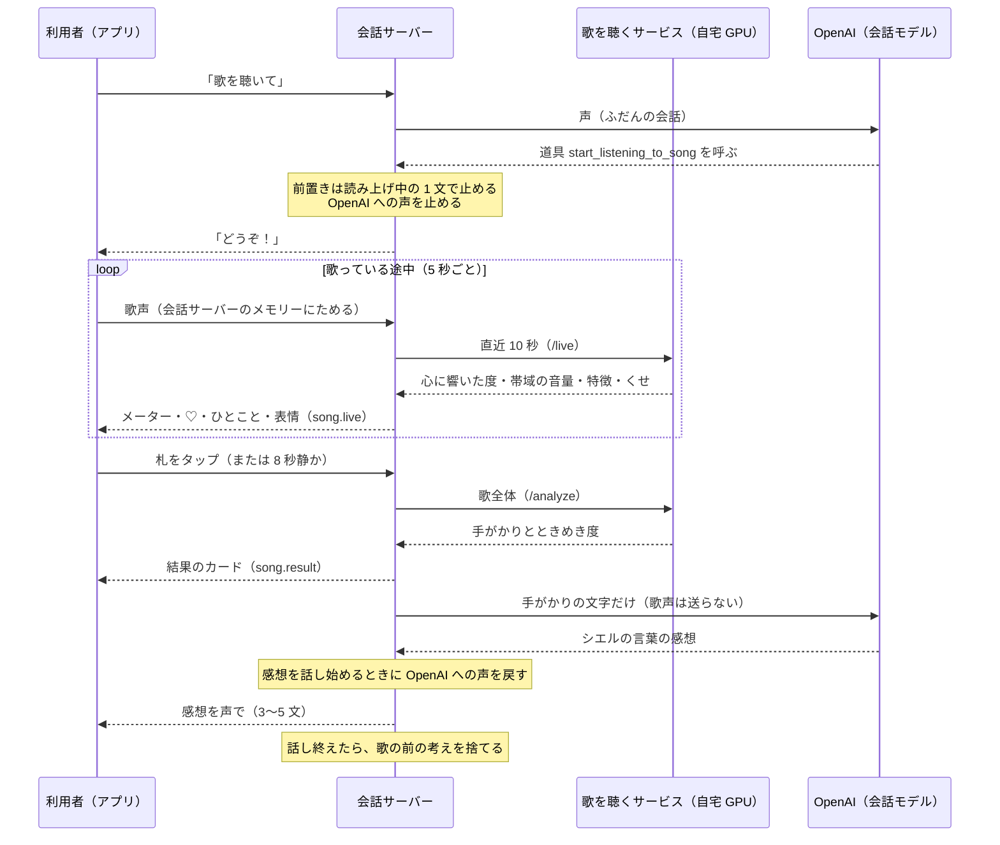
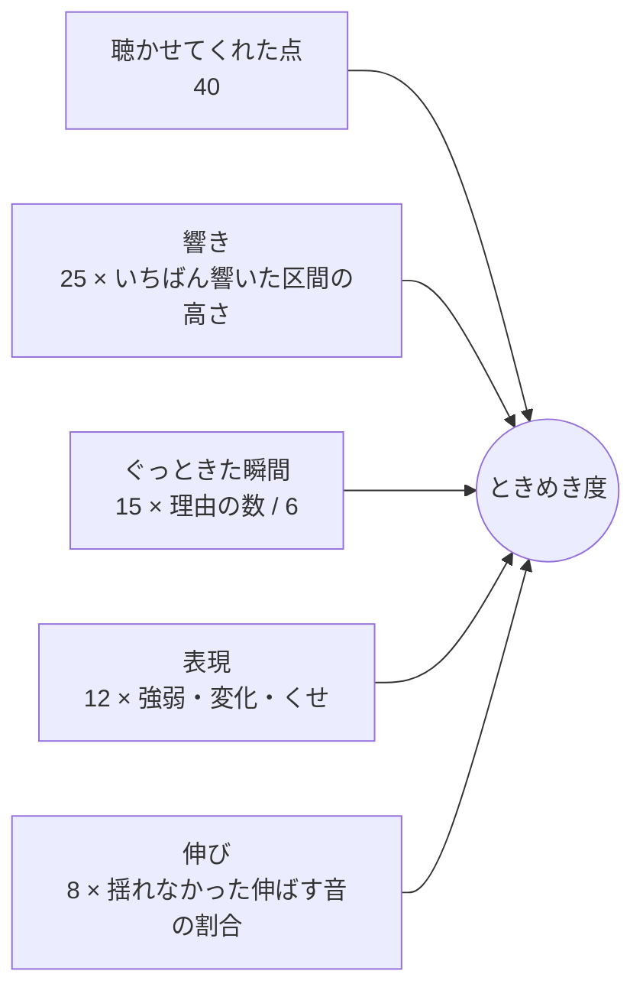
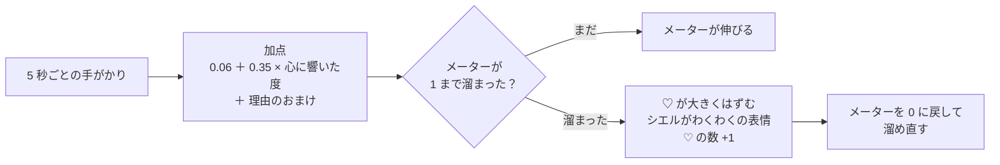

# シエルが歌を聴く仕組み（ときめき度と感想）

更新：2026-10-29（日本時間）。シエルに歌を聴いてもらうと、歌っている途中はメーター・♡・ひとことで反応し、歌い終わったら「ときめき度」と感想を返す。この資料は、その点数と感想がどう決まるかを、はじめて読む人向けにまとめたもの。決めた理由と経緯は [歌を聴く決定記録](decisions/singing-ja.md)、調べた研究は [歌を聴く機能の調査](singing-evaluation-research-ja.md) を参照。

[図をブラウザーで開く・拡大する](singing-scoring-ja.svg)

## 1. 考え方：正しさではなく「シエルの心に響いたか」

- カラオケの採点は、お手本のメロディーにどれだけ音の高さが合っているかを中心に点数を出す。シエルはそうしない。音の高さのくせは、その人の個性だから。
- 研究でも、好きな歌声は「機械で測った正しさ」ではほとんど説明できず、聴いた人が感じた印象（響きの豊かさ、声の入りの柔らかさなど）のほうがよく説明できた。しかも聴く人どうしで好みが大きく違う（[歌を聴く機能の調査](singing-evaluation-research-ja.md) の 7 章）。
- だから、シエルは**一人の聴き手**として、自分がどこでぐっときたかを話す。点数（ときめき度）も、正しさの点数ではなく**シエルの主観の点数**として出す。
- 音の高さは無視しない。「外れて聞こえる」ことは聴く人の好みに効くので、**伝わりを邪魔したかもしれない所だけ**、提案として 1 つ言う。

## 2. 全体の流れ

| 場面 | 起きること | 決まり |
|---|---|---|
| 始める | 声で「歌を聴いて」「採点して」と頼む（道具 `start_listening_to_song`） | 道具を呼んだ返事の前置きは、読み上げ中の 1 文で止める。すぐ「どうぞ」を言う |
| 録る | 「どうぞ」を言い終えた 0.3 秒後からの声を使う | シエルの声が混ざらないように |
| 終わる | 札「歌い終わったらタップ」、歌ったあと 8 秒静か（10 ms ごとに -42 dBFS 未満）、10 分 | 「どうぞ」から 30 秒歌が始まらなければやめる。歌声が 3 秒未満なら「聞こえなかった」 |
| 分析 | 歌全体を歌を聴くサービスへ | 4 分の歌で約 11 秒（自宅サーバー） |
| 返す | 結果のカード、シエルの声の感想 | 会話モデルへの声は、感想を話し始めるときに戻す。感想を話し終えるまで、シエルから別の話を始めない |

## 3. 歌声をどう聴くか（手がかり）

歌を聴くサービス（[server/singing](../server/singing/)）が、歌声から次の手がかりを出す。前後の無音は落としてから見る。時刻は歌い出しから。

| 手がかり | どう測るか | 使うもの |
|---|---|---|
| 心に響いた度 | 10 秒ずつ（5 秒ずらし）、「聴いて楽しい・心に響く」を 1〜10 で | Meta Audiobox Aesthetics の CE（Content Enjoyment） |
| 盛り上がり | 声の芯の帯域（920〜4400 Hz）の音量が、前の 2 区間より 3 dB 以上上がった区間 | 鳥肌が立つ所でこの帯域の音量が上がっていた研究（Nagel ら 2008） |
| 展開の変化 | 区間ごとの音楽の特徴が、前の区間から大きく変わった所（変わり方が平均＋1 標準偏差以上、最大 3 か所） | MERT-v1-95M の第 7 層 |
| ぐっときた瞬間 | 心に響いた度が中央値以上の区間に、盛り上がり・展開の変化が重なった所。理由の多い順に、重ならない最大 3 か所 | 上の 3 つ |
| 強弱の幅 | 声のある所の音量の 95% と 10% の差（18 dB 以上「広い」、10 dB 未満「狭め」） | 音量 |
| 声の入り | 声が出始めてから、その声の -3 dB に届くまで（120 ms 以上「柔らかい」、50 ms 以下「はっきり」） | 音量 |
| 声の明るさ・息 | スペクトルの重心（1500 Hz 以上「明るめ」、700 Hz 未満「落ち着いた」）、5 kHz より上の割合（2% 以上「息が多め」） | 目安。マイクや部屋でも変わる |
| 音の高さ | 10 ms ごと。周期がはっきりした所（0.5 以上）だけ使う | CREPE（tiny） |

### 音の高さから見るもの：個性と崩れを分ける

音の高さを 1 音ずつに分ける（声が切れるか、70 セント以上離れて 3 刻み続いたら次の音。0.15 秒未満は数えない）。

| 見るもの | 決まり | 扱い |
|---|---|---|
| しゃくり | 音の入りが、その音の芯より 80 セント以上下から上がってくる | 音の 30% 以上なら**くせ＝個性**としてほめる |
| フォール | 音の終わりが 100 セント以上下がる（0.3 秒以上の音） | 同上 |
| ビブラート | 0.8 秒以上伸ばす音の揺れが 4〜8 Hz に集まり、深さ 15 セント以上 | 伸ばす音の 30% 以上なら個性 |
| 揺れた伸ばす音 | ビブラートではないのに、伸ばす音が 30 セントより大きく揺れた | 提案の候補 |
| 外れて聞こえたかもしれない音 | **その人の音の基準**から 40 セント以上ずれた 0.4 秒以上の音。ビブラートの音と、調の外の音（わざとの半音かもしれない）は除く | 提案の候補 |

「その人の音の基準」：歌全体の音が、平均律から何セントずれているか（いつも少し低め・高めか）を先に測り、それを基準にする。いつも 30 セント低く歌う人は、それだけでは「外れ」にならない。調は Krumhansl の調性のプロファイルで推し量る。**原曲に合わせることは目標にしない。**

## 4. ときめき度の計算（0〜100 点）

| 内わけ | 満点 | 計算（[analysis.py の tokimeki](../server/singing/analysis.py)） |
|---|---|---|
| 聴かせてくれた点 | 40 | いつも 40。正しさで減らす点は無い |
| 響き | 25 | 25 × (いちばん響いた区間の心に響いた度 − 3) ÷ 4（0〜1 に収める）。3 以下で 0、7 以上で満点 |
| ぐっときた瞬間 | 15 | 15 × (ぐっときた瞬間の理由の合計 ÷ 6)（1 まで）。理由は「響いた」「盛り上がり」「展開の変化」、瞬間は最大 3 か所 |
| 表現 | 12 | 12 × [0.5 × (強弱の幅 − 6 dB) ÷ 14 dB（0〜1） ＋ 0.25 × 盛り上がりか展開の変化があれば 1 ＋ 0.125 × くせの数（2 まで）] |
| 伸び | 8 | 8 × (1 − 揺れた伸ばす音 ÷ 伸ばす音)。伸ばす音が無ければ 4 |

内わけはそれぞれ四捨五入してから足す。

例（合成した歌声もどき 4 分 17 秒、自宅サーバー、2026-10-27）：40 ＋ 響き 12 ＋ ぐっときた瞬間 15 ＋ 表現 8 ＋ 伸び 8 ＝ **83 点**。いちばん響いた区間の心に響いた度は約 4.9 で、響きは半分ほどにとどまった。

**目盛りは仮。** スマホのマイクでアカペラを録ると、心に響いた度は 4〜5 くらいに出る（合成の歌声で 4.2〜4.9）。素の値をそのまま点数にすると、どの歌も 40 点前後になるので、3〜7 を 0〜1 に広げている。本物の歌を何曲か聴いてから合わせ直す。

## 5. 歌っている途中の反応

5 秒ごとに直近 10 秒を `/live` に渡す（[singing.py の LiveCues](../server/agent/singing.py)）。声の出ている割合が 20% 未満の 10 秒（息つぎ・間奏）はモデルを使わず、何も出さない。

### ときめきメーターは「溜まる」

心に響いた度をそのまま出していたころは、スマホのアカペラ（4〜5）だと 3 割前後で上下するだけで満タンにならず、♡ が見られなかった。そこで、5 秒ごとに加点して溜め、満タンになったら ♡ を出す形にした（2026-10-29）。

| 加点 | 量 |
|---|---|
| いつも | 0.06 ＋ 0.35 × 心に響いた度（3〜7 を 0〜1 に。ときめき度の「響き」と同じ目盛り） |
| いちばん響いた（それまでの最大を超え、中央値より 0.3 以上高い。3 回目から） | ＋0.25 |
| 盛り上がり（帯域の音量が前の 2 回より 3 dB 以上。3 回目から） | ＋0.25 |
| 展開の変化（特徴の変わり方がそれまでの平均＋標準偏差以上。5 回目から） | ＋0.2 |
| ビブラート（1 つ以上）・しゃくり（2 つ以上） | それぞれ ＋0.05 |

- 満タン（1 以上）になったら ♡。メーターを満タンまで伸ばして ♡ を大きくはずませ、白く光らせてから 0 に戻す。溜まりすぎた分は持ち越さない。♡ の数はメーターの横に「×3」のように出す。
- 合成の歌声もどき（心に響いた度 3.9〜4.9）で、くせがあれば約 25 秒ごと、無ければ約 30 秒ごとに ♡。盛り上がりや展開の変化があれば早まる。**量は仮**で、本物の歌で合わせ直す。歌い終わるたびに、会話サーバーのログへ `ときめきメーター：♡ n 回…心に響いた度 平均…` を残す（数値だけ）。

### ひとことと表情

| 表示 | 出る時 |
|---|---|
| 吹き出しのひとこと・表情 | 加点の理由（いちばん響いた・盛り上がり・展開の変化・ビブラート・しゃくり）があったとき。前のひとことから 12 秒以上あいていれば、理由の 1 つ目に合う文を決まった中から選ぶ。♡ と重なったときの表情は、わくわく |

| 理由 | ひとことの例 | 表情 |
|---|---|---|
| いちばん響いた | 「ぐっときた…！」「いまの、すごく好き！」 | わくわく（excited） |
| 盛り上がり | 「盛り上がってきた！」 | 嬉しい（happy） |
| 展開の変化 | 「雰囲気が変わった！」 | 驚き（surprised） |
| ビブラート | 「きれいなビブラート！」 | にこにこ（relaxed） |
| しゃくり | 「しゃくり、いい感じ！」 | 嬉しい（happy） |

歌っている途中のシエルは**声を出さない**。シエルの声がマイクに入って分析が乱れ、歌う人の邪魔にもなるため。ひとことは会話モデルに作らせない（すぐ出せて、料金もかからない）。

最初の 1 回はモデルを GPU に載せるので 8〜10 秒かかる。メーターが動き出すのは、歌い出しから 15 秒ほど後。

## 6. 感想の作り方

1. 分析の結果を、会話サーバーが「聴き取りの手がかり」の文にする（[singing.py の facts](../server/agent/singing.py)）。ときめき度・ぐっときた瞬間の候補・盛り上がり・展開の変化・強弱・声の入り・明るさ・くせ・音域・揺れた伸ばす音・外れて聞こえたかもしれない音を、時刻つきで並べる。
2. その文と [singing_feedback.md](../server/agent/config/prompts/singing_feedback.md) を会話モデルへ渡す。**渡すのは文字だけ**で、歌声は送らない。
3. シエルは次の順で 3〜5 文で話す。
   1. ときめき度を一度だけ（「ワタシのときめき度は 83 点！」）
   2. いちばんぐっときた所と、そこで感じたこと
   3. その人らしさ（くせ・声の入りなど）を個性としてほめる
   4. もっと伝わるための提案を 1 つだけ（揺れた伸ばす音か、外れて聞こえたかもしれない音。無ければ表現を広げる提案）
   5. 応援か、何の歌だったかを 1 つ聞く
4. 数値（CE・dB・セントなど）や手がかりの名前は読み上げない。「外れていた」「下手」とは言わない。

結果のカード（アプリ）には、ときめき度・内わけ・ぐっときた所・あなたらしさ・もう一歩（時刻 1 つ）を出す。カードには「正しさではなく、シエルがどれだけときめいたか」と添える。

## 7. 歌声の扱いと GPU

- 歌っている間は、会話モデル（OpenAI）への声を止める。歌声は会話サーバーのメモリーにだけためて、分析に渡したら捨てる。ファイル・ログ・DB には残さない。
- 分析は自宅の GPU（RTX A2000 12GB）。読み上げ（Irodori-TTS）と分け合うので、「どうぞ」のあとと分析の前に、読み上げに作業用のメモリーを手放してもらう。分析のモデルは歌の間だけ載せ、終わったら外す。GPU 全体の最大は約 5.4 GB だった。
- 使うモデルのライセンス：Audiobox Aesthetics は CC-BY 4.0、CREPE（torchcrepe）は MIT、**MERT は CC-BY-NC 4.0（非商用）**。アプリを公開する前に MERT を外すか見直す。

## 8. 変えたいとき

| 変えたいこと | 場所 |
|---|---|
| ときめき度の配分・目盛り | `server/singing/analysis.py` の `TOKIMEKI_BASE`・`TOKIMEKI_PARTS`・`CE_LOW`・`CE_HIGH`、`tokimeki()` |
| くせ・揺れ・外れの決まり | 同じファイルの `SCOOP_CENTS`・`FALL_CENTS`・`HABIT_RATIO`・`WOBBLE_CENTS`・`OFF_CENTS` など |
| 盛り上がり・区間の長さ | 同じファイルの `BUILD_DB`・`PRESENCE_BAND`・`WINDOW` |
| 歌っている途中の間隔・ひとこと・表情 | `server/agent/singing.py` の `LIVE_EVERY`・`COMMENT_GAP`・`COMMENTS`・`EXPRESSIONS`（心に響いた度の幅 `CE_LOW`・`CE_HIGH` は analysis.py と合わせる） |
| ときめきメーターの溜まる速さ（♡ の間隔） | 同じファイルの `METER_BASE`・`METER_CE`・`METER_BONUS` |
| 歌い終わりの判定 | 同じファイルの `SILENCE_END`・`WAIT_START`・`MAX_SECONDS`・`VOICE_DB` |
| 感想の言い方 | `server/agent/config/prompts/singing_feedback.md`（次の会話から反映。再起動は要らない） |
| 画面の表示 | `unity/Assets/Scripts/Conversation/CielConversationUI.Song.cs` |

数値を変えたら `server/agent/tests/test_singing.py` を通す（[回帰テスト](regression-tests-ja.md)）。分析のサービス（`server/singing`）を変えたら、自宅サーバーへ反映し直す（[ビルド・サーバーデプロイ](build-ja.md)）。

## 9. 分かっている限界

- 目盛りは仮。本物の歌で、点数の高さや ♡ の出る間隔が自然かをまだ合わせていない。
- 歌詞は聞き取っていない（歌声を OpenAI の文字起こしに送らないため）。感想は歌詞に触れない。
- アカペラか、ヘッドホンで伴奏を聴く想定。スピーカーで伴奏を流すと、伴奏も一緒に分析される。
- 心に響いた度は、音声全般（話し声・音楽・効果音）で学習したモデルの値で、素人のアカペラ向けに作られたものではない。歌の中での高い・低いを見るのに使い、絶対の評価には使わない。
